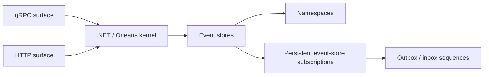

import { CardGrid } from '@astrojs/starlight/components';
import SimpleCard from '@components/SimpleCard.astro';

Cratis Chronicle runs event storage and processing in a server called the kernel. Applications connect through client APIs; the kernel handles appends, runs projections that derive queryable state, and manages event delivery. This separation lets application code describe facts and their uses without hosting the event store itself.

Use these boundaries when deciding where code should run and how to separate application data. A protocol entry point, an event store, and a namespace each answer a different question; none is a substitute for the others.

## Runtime shape

The kernel is a .NET application built on Microsoft Orleans, whose actors, called grains, coordinate runtime work. It also uses Cratis Choreography for durable jobs such as event-generation backfills. gRPC and HTTP expose entry points to that runtime; a particular client or tool need not use both transports.

| Boundary | Responsibility | Design decision |
| --- | --- | --- |
| Protocol surfaces | Accept calls into the kernel | Use the API and setup supported by your client |
| Kernel | Coordinate event storage and processing | Keep server enforcement separate from application handlers |
| Event stores and namespaces | Separate named runtime scopes | Choose where an application's events belong |
| Persistent subscriptions | Forward events between stores through outbox/inbox sequences | Choose which facts another store should receive |

An [event store](./concepts/event-store.md) contains namespaces, and each [namespace](./namespaces/) has its own event sequences. A namespace can separate one tenant's events from another's within a store. It is a data scope, not a claim that every client or storage provider has identical capabilities.

A [persistent subscription](./subscriptions/) connects event stores through an outbox on the source and an inbox on the receiving store. The kernel retains subscription state independently of a client connection. Forwarding is separate from the original append: recording a fact does not mean that another store or its consumers have finished processing it. Read [subscription recovery](./subscriptions/recovery) before choosing a replay operation, since forwarding replay can append events to the inbox again.

## Related inspection surfaces

Use Chronicle Workbench when you want to inspect a running instance in a browser, including its events and supported projection behavior. It is bundled with Chronicle and requires authorization. The Cratis CLI offers terminal workflows for inspection and diagnosis. Neither tool replaces the kernel or the application client.

The diagram describes responsibilities, not a deployment topology or a delivery guarantee. For an application setup, continue to the [hosting-model guide](./get-started/choose-hosting-model). For processing and recovery behavior, follow the subscription documentation rather than inferring exactly-once delivery from an outbox/inbox connection.

## Continue

<CardGrid>
  <SimpleCard title="Chronicle overview" icon="seti:db" link="/chronicle/">
    Start Chronicle locally and understand what the runtime owns.
  </SimpleCard>
  <SimpleCard title="Workbench" icon="laptop" link="/chronicle/workbench/">
    Inspect the running Chronicle instance from a local browser.
  </SimpleCard>
  <SimpleCard title="Cratis CLI" icon="rocket" link="/cli/">
    Use terminal inspection and diagnostic workflows.
  </SimpleCard>
</CardGrid>
