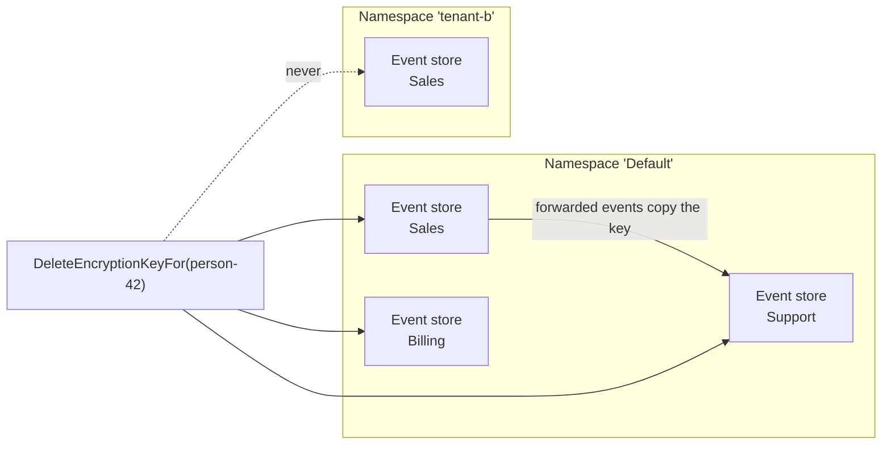

Cratis Chronicle supports erasure of a subject's personally identifiable information (PII) by deleting the encryption keys that protect it. The events remain in the log, but their encrypted PII can no longer be read without those keys. Use this as one step in a right-to-erasure workflow: it does not remove historical plaintext, exported copies or keys held in backups.

## The one call

Identify the event's [subject](../concepts/subject) and each namespace containing that person's data. Values marked `[PII]` are encrypted at append time under the subject's key; values stored before the marker was added are not retroactively protected.

Stop appends and forwarding of that subject's PII before erasing. The fence described below blocks later provisioning, but an already-running key write can race with erasure. Repeat the erasure after those writes have stopped if they overlapped it. Subsequent PII appends fail until you explicitly authorize a new key.

With an `IEventStore` resolved for the relevant namespace, erase the subject's key:

<ChronicleClientTabs snippet="compliance/erasure/delete-key" />

`IEventStore.PII` is an `IPIIManager`. `DeleteEncryptionKeyFor` records an erasure fence, deletes every key revision, removes unique-index claims that reserve values for the subject, and evicts the key from every silo's cache. A silo is a Chronicle kernel node. The fence lets the key store distinguish an erased subject from one that never had a key.

After key deletion, reading an event still returns its sequence number and unprotected fields. Encrypted PII whose key is gone is released as an empty value according to its schema type:

| Property type | Released value after erasure |
|---|---|
| String | An empty string |
| Non-nullable number or boolean | `0` or `false` |
| Nullable number or boolean | `null` |
| Collection | An empty collection |
| Object or value object | An empty object |

This mechanism is called crypto-shredding: the ciphertext stays in the immutable log, but its decryption key is destroyed. It depends on deleting all usable copies of the key; [key-store erasure guarantees](key-store-erasure-guarantees.md) explain the storage-specific limits. In 19.x, existing reads keep these defaults. A normal read cannot distinguish an erased `0`, `false` or empty string from a genuine value. An explicit .NET sequence read can additionally report confirmed erased paths.

### Opt in to erased paths in .NET

For example, with an `IEventSequence` named `sequence`, call `var events = await sequence.GetFromSequenceNumberWithErasedProperties(42);`. The optional `eventSourceId` and `filterEventTypes` parameters work as on `GetFromSequenceNumber`. Inspect each event's `ErasedProperties`, also available as `event.Context.ErasedProperties`, alongside its ordinary typed `Content`. The content still uses the defaults above; the metadata adds no markers or replacement values inside it.

Paths use JSON/schema names, dotted members and bracketed indices: `profile.name`, `contacts[0].email`. A protected whole container reports its boundary, such as `contacts`, not invented child paths. Lists are per event, unique and ordinally sorted. Dictionary keys use the same grammar without escaping, so keys containing dots or brackets can be ambiguous. Treat paths as potentially sensitive metadata; they may contain dictionary keys.

A path is reported only for recognized encrypted content whose key is missing **and** whose subject has a recorded erasure. Plaintext (including genuine defaults), decryptable content, unknown missing keys, corrupt ciphertext and other release failures are not evidence of erasure. An empty list therefore does **not** prove that nothing was erased. In particular, legacy tombstone gaps and old ciphertext encountered after a new key was authorized cannot be conclusively classified here; the list is not an authoritative erasure audit.

This opt-in describes only the returned current `Content`, not `OriginalContent`, revisions or generational content. It does not opt observers, projections or other SDKs into metadata. Existing reads remain unchanged and do not perform extra erasure lookups. Older servers do not support the new operation: unsupported/Unimplemented errors are propagated, not replaced by an apparently authoritative empty list. Use a server supporting this operation when opting in. Broader read surfaces remain tracked in [issue 4620](https://github.com/Cratis/Chronicle/issues/4620); representation changes are deferred to [issue 5388](https://github.com/Cratis/Chronicle/issues/5388).

Causation property values are not encrypted under the subject's key, so deleting the key does not erase them. Set [`events.causationPropertyRetention` to `Omit`](../hosting/configuration/events.md) to prevent **new** causation property values from being retained, including on forwarded events, revisions, and redactions. `Omit` does not remove values already stored in historical causation chains; handle those separately when assessing an erasure.

## What one call reaches

The erasure covers **every event store in the namespace you erased in**, not only the event store you resolved `PII` from.

An [event store subscription](../subscriptions/index.md) can copy the subject's encryption key into a target event store when forwarding events. Forwarding stays within the namespace, so erasure must reach all event stores there, including stores that do not currently hold the key:

Chronicle attempts to record the fence in every event store before deleting key material anywhere. This ordering prevents a later forwarded event from copying a surviving key into a store already cleared. It then deletes key material, removes those uniqueness claims and evicts cached keys.

Each phase attempts every event store even after a failure. Failures are reported together as `EncryptionKeyErasureIncomplete`; resolve them and repeat the call. A return without an error means those operations completed across the enumerated event stores, not that backups, stale replicas or external copies have been erased.

> [!IMPORTANT]
> Erasing in one namespace leaves the same person's keys in other namespaces untouched. Issue one erasure per namespace containing that person's data.

## The subject is fenced, not banned

The fence blocks automatic provisioning for the erased subject and rejects saves of the destroyed key material. It also prevents a subscription from copying that material back through the key-store API. It does not validate every key read, so a restored key or stale replica can still make old ciphertext readable.

Appending a `[PII]` value for an erased subject fails with `EncryptionKeyErased`. Chronicle neither silently creates a replacement key nor stores the value as blank.

If your application establishes a lawful basis to store new PII for the same person, explicitly authorize a new key:

<ChronicleClientTabs snippet="compliance/erasure/allow-new-key" />

The call creates no key. It allows the next `[PII]` write to provision a fresh key that cannot decrypt data protected by the erased one. The fence continues to reject the old key material. Authorization reaches every event store in the namespace; it does not authorize processing on your application's behalf.

The mechanics of the fence, and what it cannot protect you against, are in [The encryption key lifecycle](key-lifecycle).

## What you still have to do

Treat a successful key deletion as evidence for one part of your erasure procedure. Before recording the request as complete:

1. Repeat the call in every relevant namespace and resolve any incomplete erasures. Check failed observer partitions for that event source: a forwarding subscription or reactor still producing PII must stop, unless you deliberately authorize a new key.
2. Rebuild stale stored read models using a clean destination or an audited migration. Projection and reducer replay materialize erased PII as empty markers without creating a key or removing the fence; live subjects retain normal protection. You do not need a new key just to rebuild. Replaying over existing storage does not prove cleanup; follow the [read-model rebuild procedure](read-models.mdx#rebuilding-after-erasure).
3. Handle copies outside Chronicle, including warehouse exports, search indexes and data sent to third parties. Also assess historical causation values separately from encrypted event content.
4. Define what happens when a backup restores the key and removes its fence. Restore the key store consistently with the rest of storage and block access until required erasures have been reapplied. See [what the fence cannot protect against](key-lifecycle.mdx#not-stopped) and [backup and restore ordering](../hosting/configuration/compliance-storage.md#backup-and-restore-ordering).

Record who requested and authorized the erasure, and under what legal basis. Chronicle logs completion, the event stores reached and a one-way subject binding instead of the person's name, but it does not know the actor. [What Chronicle records](key-lifecycle) explains how to use those logs alongside your application's record.

## See also

| Topic | Description |
|---|---|
| [The encryption key lifecycle](key-lifecycle) | How the fence works, and what it does not protect against |
| [Compliance](index.md) | How Chronicle protects personal data in an immutable log |
| [Subject](../concepts/subject) | The identity a PII encryption key is held under |
| [Compliance and PII in subscriptions](../subscriptions/compliance-and-pii.md) | What forwarding preserves, and what it no longer copies |
| [Compliance Storage](../hosting/configuration/compliance-storage.md) | Where encryption keys are stored |
| [Event Redaction](../events/redaction) | Removing an event's content rather than its key |
