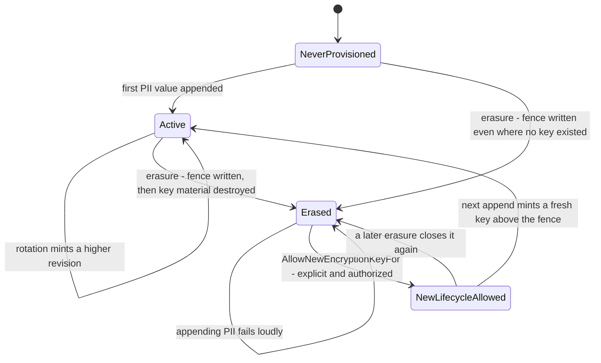
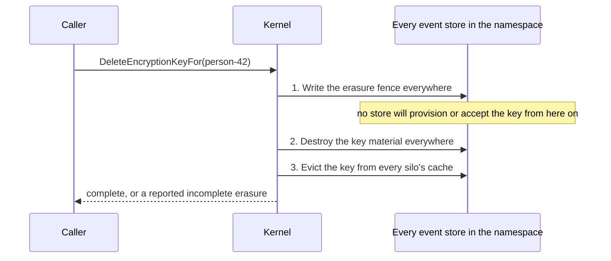

<a id="the-encryption-key-lifecycle"></a>

Cratis Chronicle records an erasure fence alongside a subject's encryption keys so that deleting them does not allow ordinary traffic to recreate or copy them back. The fence controls key provisioning and saves; it is not a check on every read or a guarantee that backups no longer contain the key.

A [subject](../concepts/subject) identifies whose data an event concerns. Use this explanation when planning erasure, reviewing failures or storing new personally identifiable information (PII) for a returning subject. For the call and completion checks, start with [Erasing a subject](erasing-a-subject).

## Why deleting the key is not enough

If a key store records only key material, an absent key cannot tell Chronicle why it is missing:

| Meaning | What the store shows |
|---|---|
| This subject was never protected here | no key |
| This subject's key was destroyed for right-to-erasure | no key |
| This subject's key has not been provisioned *yet* | no key |

Without a record of erasure, appending a `[PII]` value for a subject with no key provisions a new one. That key cannot decrypt old ciphertext, but it restarts storage of the person's PII without an explicit decision.

Copying an existing key is more consequential. An [event store subscription](../subscriptions/compliance-and-pii.md) can copy the subject's key into the target store when forwarding an event. If a source still holds the pre-erasure key, that copy can make the old ciphertext readable again. The fence gives both paths a record they can consult before writing a key.

## The erasure fence

Chronicle records the erasure itself, next to the keys, in the same key store. That record is the **erasure fence**, and it is what makes "erased" a state the store can tell apart from "never provisioned".

A fence for one `(event store, namespace, subject)` carries three things:

| Field | Meaning |
|---|---|
| `ErasedThrough` | The highest key revision the erasure covered. No key at or below this revision may ever be provisioned, saved, healed or copied again. |
| `ErasedKeyFingerprints` | The SHA-256 fingerprints of the public keys that were destroyed. That exact key material may never be stored again, at any revision. |
| `NewKeyAllowed` | Whether an explicitly authorized new lifecycle may mint a fresh key *above* the fence. Set to `false` by every erasure. |

The fence lives in the key store and is written before key deletion. It travels with that store's backups and replicas, which also means a restore from before erasure can remove it. Recording the fence and writing a key are separate operations in persistent backends; the [concurrency limit](#not-stopped) matters when erasure overlaps an append.



### What the fence refuses

The built-in key stores apply these checks when they see a fence:

- `GetOrAddFor` refuses new provisioning with `EncryptionKeyErased` until a new lifecycle is authorized.
- `SaveFor` refuses revisions at or below `ErasedThrough`, preventing a composed store from copying an old revision back to a member that was erased.
- A save or provisioning attempt using a fingerprint in `ErasedKeyFingerprints` is refused at any revision, even after a new lifecycle is authorized. Copying the same public key cannot bypass this check by assigning it a higher revision.

Reads have a different boundary. Individual stores' `TryGetFor`, `HasFor` and `GetFor` still answer about material they hold; they do not validate it against the fence. A composed store checks readable members' fences before serving a key, but that does not cover every read path. When the key is absent, encrypted `[PII]` releases as the type's empty value, such as an empty string, `0`, `false` or `null`; see [Erasing a subject](erasing-a-subject). If a stale replica or recovered secret returns the key, old ciphertext may still decrypt.

### What it does *not* refuse

Erasure applies to the current key lifecycle, not to every future use of the subject identifier. If your application establishes a lawful basis to process new PII, it can explicitly authorize a fresh key. Chronicle provides the operation; deciding whether to use it remains your responsibility.

## Erasure reaches every event store in the namespace

Subscription forwarding can copy a subject's key across event stores within a namespace. The erasure therefore reaches every registered event store plus the store addressed by the caller, all in that namespace:

<ChronicleClientTabs snippet="compliance/erasure/delete-key" />

The call records fences first, then deletes keys and removes unique-index claims that reserve values for the subject, then evicts cached keys from every silo (kernel node):



The ordering in the diagram prevents later forwarding from copying a survivor into a store already cleared, provided each fence write succeeds. It does not cancel key writes already in flight. Fences are recorded even in stores that never held the key, so later forwarding encounters the same refusal there.

Each phase attempts every event store even after a failure. `EncryptionKeyErasureIncomplete` reports the collected failures; resolve them and repeat the call before treating the erasure as complete. Cache eviction is attempted even when a prior phase fails.

## A later lifecycle for the same person

To allow a fresh key after your application has established a lawful basis to store new PII, call:

<ChronicleClientTabs snippet="compliance/erasure/allow-new-key" />

This reaches every event store in the namespace. It sets `NewKeyAllowed` without creating a key; the next `[PII]` append provisions one at revision `ErasedThrough + 1`. An incomplete authorization throws `EncryptionKeyLifecycleIncomplete`. Resolve the failures and repeat the authorization before resuming writes.

## What Chronicle records, and what is still yours

Chronicle logs completed erasures and new-key authorizations at information level. Authorizing a fresh key does not reverse the old erasure: the new key cannot decrypt data protected by the destroyed one. The completion messages look like this:

```text
Erased the encryption key for the subject bound to 'a3f1…' in namespace 'Default', across all 3 event stores
in it: Sales, Support, Billing. Every PII value protected under that key is now permanently unreadable, and no
event store in the namespace will provision or accept a key for the subject until a new one is explicitly
authorized
```

```text
Authorized a new encryption key for the erased subject bound to 'a3f1…' in namespace 'Default', across all 3
event stores in it: Sales, Support, Billing. The erased key does not come back - the next PII value written for
the subject provisions a fresh, independent one that can decrypt nothing written before the erasure
```

Incomplete operations are logged at error level and throw. These messages describe the operations Chronicle completed, not an audit of backups, replicas or external copies.

The subject binding is the lowercase hexadecimal SHA-256 hash of the UTF-8 subject identifier. You can compute it to find the matching act without putting the person's name in the completion log. Treat it as pseudonymous data: a small or guessable identifier space can be searched. These completion messages contain neither key material nor its fingerprint.

Your application must record the actor, instruction and legal basis. Chronicle knows which event stores it reached, but not who decided to erase the subject or authorize new PII.

A newly provisioned key protects the new lifecycle. It cannot decrypt old ciphertext, and the fingerprint fence still rejects the destroyed material. Until authorization, a `[PII]` append fails with `EncryptionKeyErased`; authorization is not needed merely to rebuild stored read models.

> [!IMPORTANT]
> A forwarded event carrying `[PII]` for an erased subject fails to append in the target, putting that event source's observer partition in a failed state. Other partitions continue. Stop the PII writes, or explicitly authorize a new key when your application permits it.

Stored read-model materialization is different from appending or revising an event. Projection and reducer replay recognize `EncryptionKeyErased` specifically for PII and persist an empty marker at that protected boundary. They neither provision a replacement key nor clear the fence; live subjects still use normal protection. Other protection failures, including infrastructure outages and non-PII handler failures, still fail the write. A new lifecycle is not a prerequisite for replay. For existing stale or wrong-subject documents, use the [clean rebuild procedure](read-models.mdx#rebuilding-after-erasure), not replay over dirty storage as proof of cleanup.

## Migrations and revisions release strictly

Reading a value for a query releases it leniently: a property that cannot be decrypted degrades to its empty value so that the query keeps working. Writing is held to a stricter standard. When Chronicle migrates stored events to a new [event type generation](../concepts/event-type-migrations) or applies a revision, it releases the stored protected values first and then protects the result again, so a silently blanked value would be written back as lost data. Both paths therefore release strictly:

- Key storage failures, I/O errors and malformed keys abort the migration or revision instead of storing blanks.
- A missing key with a recorded erasure releases as the property's empty value. A value that still decrypts, including one protected under a new lifecycle authorized by `AllowNewEncryptionKeyFor`, stays intact.
- A data-key unwrap failure for a subject with recorded erasure is treated as erased and logged. The new key cannot unwrap the data key embedded in old ciphertext, so failing every such migration would block later events of that type.

Release and persistence are separate steps, and they differ between the two paths:

- Stored-event migration protects the result in an erasure-aware way, writing empty values for erased properties into the new generation.
- Revision uses the ordinary protect step, which refuses an erased subject with `EncryptionKeyErased` until a new lifecycle is authorized with `AllowNewEncryptionKeyFor`.

The unwrap rule has a limit. It applies only to corruption that makes the data-key unwrap itself fail (`EncryptionKeyUnwrapFailed`). For a subject with a recorded erasure, such a corrupt data key looks the same as pre-erasure ciphertext, so it is migrated as erased and cannot be told apart today. This is tracked in [issue 4619](https://github.com/Cratis/Chronicle/issues/4619). Corruption of the authenticated payload is not covered: it still aborts the write, as does any unwrap failure for a subject with no recorded erasure.

## The threat model

The fence constrains supported key-store operations within a deployment. Its protection depends on readable fences, compatible silos and the storage backend's deletion behavior.

### Stopped

| Attempted resurrection | What refuses it |
|---|---|
| `GetOrAddFor` minting a fresh revision 1 after an erasure | The fence: provisioning throws `EncryptionKeyErased` |
| A cross-event-store subscription copying the pre-erasure key back in | The fence in the target, plus the fingerprint of the destroyed key |
| A composed key store healing a surviving member's copy into the erased member | `SaveFor` refusing every revision at or below `ErasedThrough` |
| A composed store serving a copy that survived in one member after another member was erased | Reachable members are checked for a matching destroyed-key fingerprint; a match refuses the read and reports the divergence |
| A silo cache handing back a key after the erasure landed | The fence invalidates the local cache, and the erasure evicts every silo's cache cluster-wide |
| An erasure that reached three stores out of four reporting success | `EncryptionKeyErasureIncomplete`, listing every failure |

### Not stopped

Account for these limits in your erasure procedure:

| Boundary | Consequence and action |
|---|---|
| A backup predates erasure | Restoring it can bring back both the key and the unfenced state. Block access until required erasures have been reapplied. |
| A usable copy exists outside Chronicle | Exported keys, application caches, database dumps and external systems are outside the fence's reach. Handle those copies separately. |
| A silo predates fence enforcement | It can provision without honoring the fence. Upgrade every silo before relying on erasure; mixed versions are unsupported while erasure is in force. |
| A custom `IEncryptionKeyStorage` omits fence support | The default implementation throws on erasure. Implement the contract before using that store for erasure. |
| Only an unreachable composed-store member holds the fence | Reads skip unavailable members, so provisioning can miss that fence and create a key. Resolve the incomplete erasure and repeat it when the member returns. |
| Provisioning is already in flight | In persistent backends, checking the fence and writing a key are separate operations. A write that passed the check can persist after deletion. Stop forwarding and appends for the subject, then repeat erasure. |
| A single store returns a stale or recovered key | Individual store reads do not enforce the fence. Review [key-store erasure guarantees](key-store-erasure-guarantees.md) before promising when data becomes unreadable. |
| Plaintext was already read or displayed | Key deletion cannot retract it, including plaintext projected into external systems. |

The fence itself also outlives the key. It retains the subject identifier, revision floor and public-key fingerprints, but no key material. Treat it as a retained record in your data assessment; deleting it would remove the protection against reprovisioning.

## Upgrading an existing deployment

Introducing fence support does not rewrite existing keys. Subjects with no recorded erasure continue through normal key provisioning, reading and rotation. The SQL backend adds its fence table through a schema migration.

Re-run erasure for subjects erased before fence support was deployed. Their missing keys are indistinguishable from keys never provisioned, so the upgrade cannot infer a fence for them. Repeating erasure is idempotent and records that fence.

**Upgrade every silo together.** The fence is enforced by the key store, so a silo that predates it provisions straight over one. Do not run mixed versions while an erasure is in force.

**Keys stored under earlier names.** HashiCorp Vault and Azure Key Vault now keep new keys under names of their own. Keys that an earlier version stored are still read when their earlier name belongs to one address only. For any other address Chronicle refuses to read or provision, instead of creating a second key, until the keys have been upgraded. Run the server with `--verify-encryption-keys` to count what is stored under earlier names, and, for HashiCorp Vault, with `--migrate-encryption-keys` to copy those keys to their new names; see [Compliance Storage](../hosting/configuration/compliance-storage.md#upgrading-keys-stored-under-earlier-names).

Backend by backend, the fence needs:

| Backend | What is added |
|---|---|
| MongoDB | An `encryption-key-erasures` collection per `(event store, namespace)`, created on first use |
| SQL | An `EncryptionKeyErasures` table, created by a migration that runs automatically on startup |
| HashiCorp Vault | An `erasure` secret beside the revisions under `k1/{store}/{namespace}/{identifier}` |
| Azure Key Vault | A `chronicle-k1--{hash}--erasure` secret |
| In-memory | Nothing persisted; the fence lives as long as the process |

## See also

| Topic | Description |
|---|---|
| [Erasing a subject](erasing-a-subject) | Make the call and check the remaining erasure work |
| [Compliance](index.md) | How Chronicle protects personal data in an immutable log |
| [Compliance and PII in subscriptions](../subscriptions/compliance-and-pii.md) | What forwarding preserves, and what it no longer copies |
| [Compliance Storage](../hosting/configuration/compliance-storage.md) | Where encryption keys and their fences are stored |
| [Key erasure guarantees per store](key-store-erasure-guarantees.md) | What an erasure guarantees on MongoDB, Vault and Azure Key Vault |
| [Subject](../concepts/subject) | The identity a PII encryption key is held under |
