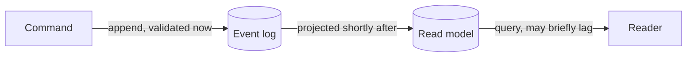

An append can succeed before a query shows its result. Cratis Chronicle commits the event to the log,
then projections update materialized (stored) read models asynchronously. When a workflow needs fresher data,
choose how that caller reads; when a business rule must hold while writers race, protect the
append itself. Those are different decisions.

## The two sides

Event sourcing separates the recorded change from the view built from it. A successful write
therefore does not mean every view has caught up:

A successful append commits and orders the event. Rules enforced by configured constraints or
concurrency checks are checked as part of that append. A [projection](./projection.md) updates its
materialized read model afterwards, so a read immediately after the write may still return the
previous state. Do not rely on a fixed delay to decide that the view is ready.

## Why not just make reads immediate?

Keeping projections off the write path lets them update independently. A new dashboard does not
make every append wait for that dashboard's model. The trade-off is that readers can see older
state while it catches up. [Observable queries](../scenarios/real-time-query) let a UI receive the
updated result without repeatedly fetching it.

For read-after-write, a passive read model computes state from events on demand instead of
persisting a view. It replays the requested event source's history, so use it for a model keyed by
that event source id, not one that joins other sources or uses a key from event content. The amount
of history that must be replayed determines the read cost.

Alternatively, keep the model materialized and wait for the append's observers before reading it.
In the .NET client, check that the append succeeded, then call `WaitForCompletion()` on its result
and handle any failed partitions it reports. That adds the catch-up wait to this caller without
making other writers wait. [Read model consistency](../read-models/consistency.md) covers both
choices and the client/server differences in which observers are included in the wait.

## Protecting invariants: don't read, constrain

In the [plain-read race example](../dynamic-consistency-boundary/choosing.mdx), a command reads
`SeatAvailability`, checks `seat.Claims > 0`, and appends `SeatClaimed` if the seat looks free.
Two callers can both read zero claims before either appends. Even a fresh passive read leaves
that gap between reading and writing.

A [constraint](../constraints/) checks a rule such as uniqueness at append time. A
[decision read](../read-models/decision-reads.mdx) instead records the log position used to build
one event source's state and guards the subsequent append against relevant intervening events.
Use these write-side mechanisms when the rule must hold despite concurrent writers.

## The Dynamic Consistency Boundary

An aggregate groups domain state behind a fixed consistency boundary: decisions load its events
and protect that group from conflicting changes. A [Dynamic Consistency Boundary](../dynamic-consistency-boundary/)
(DCB) lets the decision select the events it depends on instead, including events concerning
different entities.

Chronicle supports decision guards for one event source, optionally narrowed to a stream and the
event types the decision reads. It is not a DCB event store: each event has one event source, and
tags do not participate in consistency. A rule across two entities takes one read and one event
per entity in one atomic append. [Dynamic Consistency Boundary in Chronicle](../dynamic-consistency-boundary/chronicle.md)
explains what maps and what does not. For a concrete rule to implement next, follow
[Choosing how a rule holds](../dynamic-consistency-boundary/choosing.mdx).

## How to choose

| You need… | Use |
|---|---|
| A view to read and render | A materialized [projection](./projection.md) when the view can lag behind appends |
| The UI to update as data changes | An [observable query](../scenarios/real-time-query) |
| A unique value, or something created once | A [constraint](../constraints/) |
| A rule over state that must hold while writers race | A [decision read](../read-models/decision-reads.mdx), see [DCB](../dynamic-consistency-boundary/) |
| Read-after-write for one specific case | A [passive read model](../projections/declarative/passive.mdx), or [waiting for the append's observers](../read-models/consistency.md#read-after-write--waiting-for-a-materialized-read-model) |

## See also

- [Read Models](../read-models/) — consistency and retrieval in depth.
- [Dynamic Consistency Boundary](../dynamic-consistency-boundary/) — the full model.
- [Event sources and streams](../event-sources/index.mdx) — declare the dimensions an append is guarded by.
- [Designing read models](./designing-read-models) — designing for eventual consistency.
