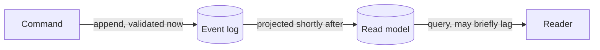

Consistency is where event sourcing feels different from CRUD, and where most early confusion lives. The short version: **writes are validated immediately; reads are usually eventual.** This page unpacks that and shows how to choose the right tool for each decision.

## The two sides

In a CRUD system, you write a row and read it straight back — one place, one consistency model. Event sourcing splits the write side from the read side, and they have different guarantees:

- **The write side is consistent now.** When you append an event, it's committed and ordered immediately. Invariants enforced at append time (constraints, the boundary below) hold the moment the command returns.
- **The read side is eventual.** A [projection](./projection.md) updates the read model *after* the append. The window is usually milliseconds, but a read taken instantly after a write may not reflect it yet.

## Why not just make reads immediate?

Because eventual reads are what make the model scale and stay simple: projections run independently, read models specialize per use case, and the write path doesn't wait on every view being updated. The cost is the small lag — and most UIs handle it naturally, especially with [observable queries](../scenarios/real-time-query) that update the moment the projection catches up.

When you genuinely need read-after-write for a specific case, you have two tools. A **passive** read model is never stored: Chronicle computes it from its events when you read it, so it always includes the latest append, at the price of replaying the instance's history — for a read model keyed by its event source id, since only that event source's events are replayed. Or keep the read model materialized and have the one caller that needs its own write back **wait for the append's observers** before reading. Neither makes other writers wait. See [Read model consistency](../read-models/consistency.md).

## Protecting invariants: don't read, constrain

The classic mistake is enforcing a rule by reading a model first: "is this email taken? no → append." Because the read is eventual, two commands can race and both pass. Enforce invariants on the **write side** instead:

- A [constraint](../constraints/) rejects an append that would violate a rule (uniqueness, for example) — evaluated against authoritative state at append time.
- A [decision read](../read-models/decision-reads.mdx) guards a rule over state you read first. See the Dynamic Consistency Boundary below.

## The Dynamic Consistency Boundary

Traditional event sourcing draws the consistency boundary around a fixed aggregate. A [Dynamic Consistency Boundary](../dynamic-consistency-boundary/) lets the decision define it: the append is rejected when an event the decision used changed after it was read. Chronicle gives you that for one event source, optionally narrowed to one stream and to the event types the decision reads. A plain read of a read model, even a fresh one, guards nothing. [Choosing how a rule holds](../dynamic-consistency-boundary/choosing.mdx) shows which mechanism fits which rule, and [Dynamic Consistency Boundary in Chronicle](../dynamic-consistency-boundary/chronicle.md) says what maps and what does not.

## How to choose

| You need… | Use |
|---|---|
| A view to read and render | A normal [projection](./projection.md) — embrace eventual consistency |
| The UI to update as data changes | An [observable query](../scenarios/real-time-query) |
| A unique value, or something created once | A [constraint](../constraints/) |
| A rule over state that must hold while writers race | A [decision read](../read-models/decision-reads.mdx), see [DCB](../dynamic-consistency-boundary/) |
| Read-after-write for one specific case | A [passive read model](../projections/declarative/passive.mdx), or [waiting for the append's observers](../read-models/consistency.md#read-after-write--waiting-for-a-materialized-read-model) |

## See also

- [Read Models](../read-models/) — consistency and retrieval in depth.
- [Dynamic Consistency Boundary](../dynamic-consistency-boundary/) — the full model.
- [Event sources and streams](../event-sources/index.mdx) — declare the dimensions an append is guarded by.
- [Designing read models](./designing-read-models) — designing for eventual consistency.
