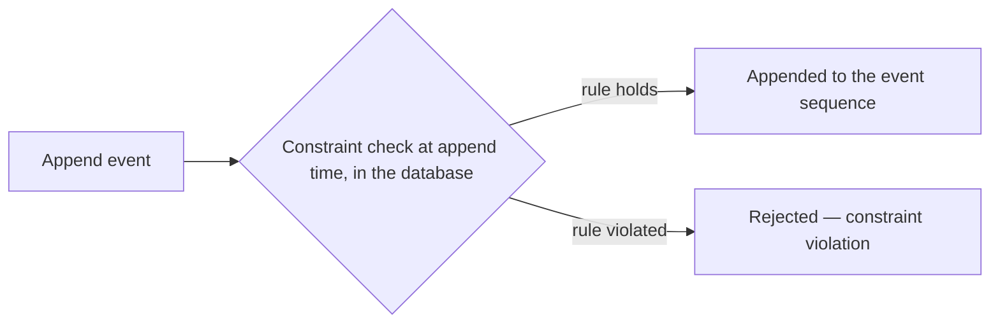

A constraint in Cratis Chronicle checks a rule at append time and rejects an event that would break it. Use a constraint when every writer must obey the same rule, such as keeping usernames unique across [event sources](./event-source.md). Checking a read model before appending is not enough: another writer can claim the value between the check and the append.

Constraints complement the [Dynamic Consistency Boundary](../dynamic-consistency-boundary/chronicle.md), which protects decisions against concurrent changes. A decision read guards a decision based on one key's history; a unique constraint guards a value across keys without requiring that read. Choose a constraint for a uniqueness rule, and a decision read when the rule depends on state you must calculate from events.

The rule runs when an event is appended to its [event sequence](./event-sequence.md), rather than later when an observer processes it. Handle a constraint violation as a rejected write, not as a read-model repair. [Define constraints](../constraints/index.md) shows the model-bound and declarative definitions.

## Unique Constraint

A unique constraint keeps a property value unique across event sources within the constraint's scope. Scope can narrow the rule by event-source type, stream type, or stream identifier. For user registration, include both the event that assigns the initial username and any event that changes it. Leaving a writer's event type out of the definition leaves that path unchecked.

By default, the constraint reserves one value per event source. Changing a username releases the source's previous value, so another user can claim it. Reclaiming the same value by its owner is allowed.

Choose per-value mode if old values must remain reserved. It keeps every value a source claims until a removal event releases it. A removal event can identify one value or release every value the source holds. [Keeping every value](../constraints/model-bound/unique.mdx#keeping-every-value) shows how to make that retention choice explicit.

## Unique Event Type Constraint

A unique event type constraint allows at most one occurrence from its set of covered event types for the same event source within the constraint's scope. Use it for a create-once rule rather than checking whether a projected instance already exists.

A configured removal event can release the constraint and allow a new occurrence. Without a removal event, the first occurrence continues to block another. The [unique event type definition](../constraints/model-bound/unique-event-type.mdx) covers release events and scope.
