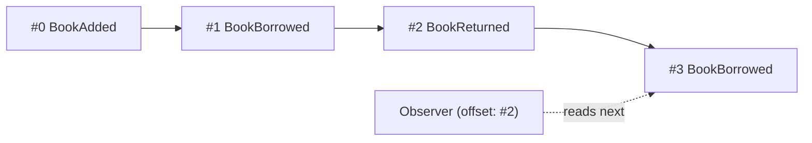

An event sequence in Cratis Chronicle is an ordered collection of events. Each appended event receives an increasing sequence number, unique within that sequence. [Observers](./observers.mdx) use these numbers as offsets to track how far they have processed and where to resume.

Sequence order is append order, not necessarily the order in which events happened. An imported event can carry an earlier occurrence time while receiving the next sequence number. Chronicle stores that time and other context as metadata alongside the event.

In this sequence, an observer at offset `#2` reads `#3` next:

The observer keeps its offset as new events arrive, so it can continue from its last processed position.

Most applications append to the event log:

| Type | Description |
| ---- | ----------- |
| Event Log | The main sequence you typically append to |

## Naming your own event sequences

An event sequence is stored under its identifier, so Chronicle refuses to create a new event sequence
whose name the storage provider uses for its own storage. Pick a different name. Event sequences that
already exist are unaffected. The reserved names depend on the storage provider:

| Storage provider | Reserved names |
| ---------------- | -------------- |
| MongoDB | Chronicle's own collection names, for example `observers`, `jobs` or `event-sequences`, and any name ending in `+constraint` |
| SQL | Chronicle's own table names, the migrations history table, and any name ending in `_constraint` or `_constraint_values` |
| In-memory | None |

The same applies to an event sequence a projection or reducer publishes to, and such a destination may not contain `#`.

## Event Type generations

An [event type](./event-type.md) can evolve through generations, each with its own schema. The `content` property stores event content per generation so observers can receive the representation they expect. Use [event type migrations](./event-type-migrations.mdx) to define how content moves between those schemas.

## Revisions

Appending records a new event. If an existing event contains incorrect data, revision records corrected content alongside the original instead of appending a different domain fact. Chronicle retains revision metadata, including when the correction occurred and who caused it.

A revision corrects an individual event; a generation changes an event type's schema. For the correction workflow, see [Event revision](../events/revision.md). If something new happened in the domain, record it as a new event.
