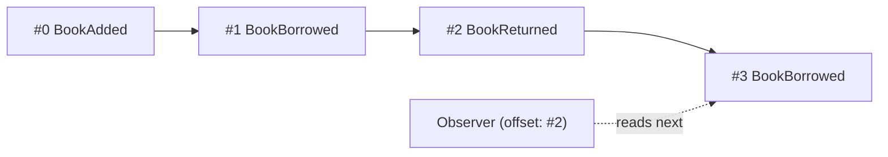

An event sequence is an ordered collection of events. Each event receives a unique, increasing
sequence number within that sequence. This is the position that [observers](./observers.mdx) use to
maintain their offset as they process events.

Chronicle stores metadata alongside each event, including its occurrence time. The sequence number
records append order, not occurrence-time order: an event imported with a supplied timestamp can have
an earlier occurrence time than the event appended before it.

The sequence below shows the order in which Chronicle appended the book events, each at a fixed
sequence number:

Here, `BookBorrowed` at #3 was appended after `BookReturned` at #2. If that borrowing was imported
later, its occurrence time could still be earlier than the return's. The sequence positions tell you
where the events sit in this sequence, rather than putting their timestamps in chronological order.

The observer has reached #2 and reads #3 next. Its offset records progress through the sequence, not
a point in occurrence time.

Chronicle has formalized the following event sequences:

| Type | Description |
| ---- | ----------- |
| Event Log | The main sequence you typically append to |

## Event Type generations

Every [event type](./event-type.md) can evolve over time. Changes to its shape are represented as
generations. The `content` property stores event content per generation, allowing observers to receive
different versions of the event. Generations describe how an event type evolves; revising an event
instead corrects the content of a particular event already in the sequence.

## Revisions

Appending adds a new event at the next position; it does not overwrite an event already in the
sequence. To correct an existing event, Chronicle supports a separate revision operation. A revision
targets the existing sequence number and uses the same event type.

Retention of original content and revision history depends on the storage provider. MongoDB stores
revisions alongside the original event content. SQL currently replaces the revised generation's
content in place, rather than retaining earlier content for that generation as a revision history.
A sequence position therefore identifies the event, but does not by itself guarantee access to every
earlier version of its content.

To revise an event, see [Event revision](../events/revision.md).
