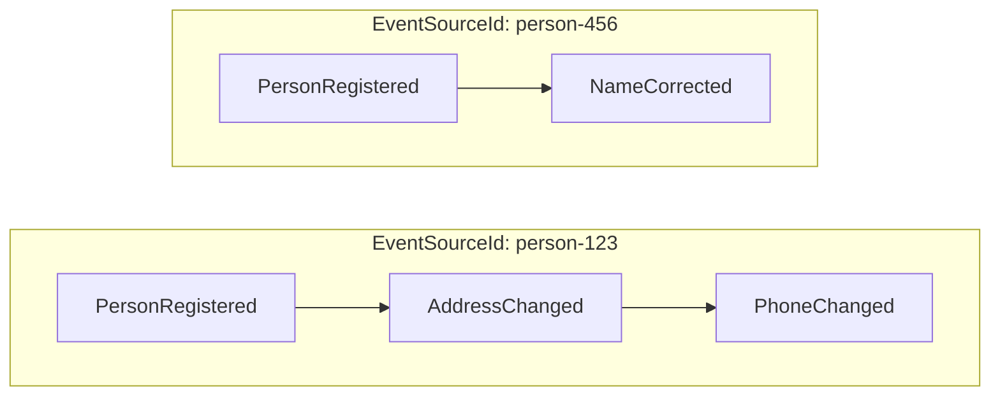

An event source is one entity or process in your domain: a person, an account, an order, a transfer. All the state changes of that entity are events, and the **event source id** (`EventSourceId`) is what binds them together. It is comparable to the primary key of a row in a database.

For instance, take the notion of a person. What identifies the person uniquely is in many systems the social security number assigned by the government. All state changes relevant for an instance of a person are identified by that one value, which is the event source id.

The diagram shows two event sources, two people, each with its own ordered story of events, all sharing the same event source id throughout:



When you append an event, the first argument is the event source id. Every event has exactly one.

## Four values that describe where an event belongs

Every stored event carries four routing values. Two identify the entity and two identify a part of its story.

| Value | Answers | Example |
|---|---|---|
| `EventSourceId` | Which instance? | `account-42` |
| `EventSourceType` | Which kind of event source? | `Account` |
| `EventStreamType` | Which named part of the story? | `Transactions` |
| `EventStreamId` | Which instance of that part? | `2026-04` |

The last three are optional. An event appended with only an event source id has the default event source type and the default stream, and that is how Chronicle has always worked. All four are indexed, filterable, and the dimensions a [concurrency scope](../events/concurrency.mdx) can narrow to.

A **stream** is a named part of an event source, such as the transactions of one month, or the onboarding of an account. It is not a separate entity: its events belong to the same event source and share its event source id. The stream type names the part, and the stream id picks one instance of it.

## Event source definitions

You can leave the type and stream values as strings you pass on each append. Or you can declare them once, as a type that implements `IEventSource`:

```text
[EventSource("Account")]
[EventStream("Onboarding")]
[EventStream("Transactions")]
public class AccountEventSource : IEventSource;
```

That type is an **event source definition**. Its name becomes the event source type of events appended through it. Each stream's name becomes an event stream type. The definition also declares which of the four values take part in the concurrency check of an append, per event source and per stream.

A definition does not list event types, is never instantiated, and does not replace the event source id: one definition serves every instance. The client discovers definitions, registers them with the kernel, and both sides check appends against them. Everything about them, from declaring one to how Chronicle uses it, is in [Event sources and streams](../event-sources/index.mdx).

## What takes part in consistency

| Value | Part of a concurrency scope | Part of a decision read's guard |
|---|---|---|
| Event source id | Yes | Yes. It is the key |
| Event source type | Yes | Optional narrowing |
| Event stream type | Yes | Optional narrowing |
| Event stream id | Yes | Optional narrowing |
| Event types | Yes | Yes. The event types of the read model |
| [Tags](./tagging.mdx) | No | No |

The first four values are the stream metadata, and they play the role that tags play in DCB. [Tags](./tagging.mdx) are labels you can filter and categorize by. They do not take part in consistency. An event has one event source, so a fact that concerns two entities is written as two events, one per event source, in one atomic append. [Dynamic Consistency Boundary in Chronicle](../dynamic-consistency-boundary/chronicle.md) explains what that means for DCB.

## Related

- [Event sources and streams](../event-sources/index.mdx): declare, append, guard and observe.
- [Event source id](../events/event-source-id.mdx): the types and conversions for the identifier.
- [Event metadata tags](./event-metadata-tags.md): the built-in routing metadata.
- [Closing streams](../closing-streams/index.mdx): end a stream.
- [Dynamic Consistency Boundary](../dynamic-consistency-boundary/index.md): decisions guarded by exactly the facts they used.
