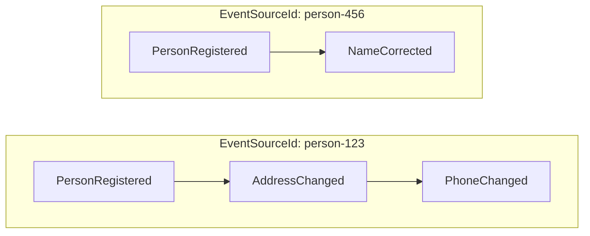

An event source in Cratis Chronicle is an entity or process whose changes you record as events: a person, an account,
an order, or a transfer. Its **event source id** (`EventSourceId`) ties those events together,
much as a primary key identifies a database row. Use the same id when recording later changes to
the same entity.

Choose a non-sensitive identifier, such as a randomly generated `Guid`, when the entity represents
a person. Event source identifiers cannot be marked as personally identifiable information (PII)
and encrypted; keep sensitive identifiers in [PII-marked event properties](../compliance/index.md#event-source-identifiers-cannot-be-encrypted)
instead.

Here, `person-123` and `person-456` have separate histories. Each person's events retain that
person's id throughout:



When you append an event, the first argument is the event source id. Every event has exactly one;
adding streams or a definition does not change that.

## Four values that describe where an event belongs

Every stored event carries four routing values. Two identify the entity and two identify a part of its story.

| Value | Answers | Example |
|---|---|---|
| `EventSourceId` | Which instance? | `account-42` |
| `EventSourceType` | Which kind of event source? | `Account` |
| `EventStreamType` | Which named part of the story? | `Transactions` |
| `EventStreamId` | Which instance of that part? | `2026-04` |

Only the event source id is required. An append without the other three values uses the default
event source type and stream. Start there when you do not need named subdivisions. All four
values are indexed and filterable, and a [concurrency scope](../events/concurrency.mdx) can narrow
to them.

A **stream** is a named part of an event source, such as the transactions of one month, or the onboarding of an account. It is not a separate entity: its events belong to the same event source and share its event source id. The stream type names the part, and the stream id picks one instance of it.

## Event source definitions

You can leave the type and stream values as strings you pass on each append. Or you can declare them once, as a type that implements `IEventSource`:

```text
[EventSource("Account")]
[EventStream("Onboarding")]
[EventStream("Transactions")]
public class AccountEventSource : IEventSource;
```

This .NET **event source definition** names the source type `Account` and declares `Onboarding`
and `Transactions` as stream types. One account can have many transaction streams, each selected
by a stream id such as `2026-04`. The definition also declares which routing values take part in
an append's concurrency check, per event source and per stream.

A definition does not list event types and is never instantiated. `AccountEventSource` describes
the kind of source; an event source id such as `account-42` still selects the account. The client
discovers definitions, registers them with the Chronicle server (the kernel), and both sides check
appends against them.
Follow [Event sources and streams](../event-sources/index.mdx) to declare a definition and append
through it.

## What takes part in consistency

| Value | Part of a concurrency scope | Part of a decision read's guard |
|---|---|---|
| Event source id | Yes | Yes. It is the key |
| Event source type | Yes | Optional narrowing |
| Event stream type | Yes | Optional narrowing |
| Event stream id | Yes | Optional narrowing |
| Event types | Yes | Yes. The event types of the read model |
| [Tags](./tagging.mdx) | No | No |

In a Dynamic Consistency Boundary (DCB), the events used for a decision determine what must remain
unchanged until the append. Chronicle uses the first four routing values above as stream metadata
to scope that check. [Tags](./tagging.mdx) remain labels for filtering and categorization; they do
not take part in consistency.

Because an event has one event source, a fact concerning two entities is written as two events,
one per event source, in one atomic append. [Dynamic Consistency Boundary in Chronicle](../dynamic-consistency-boundary/chronicle.md)
explains how that differs from DCB event stores.

## Related

- [Event sources and streams](../event-sources/index.mdx): declare, append, guard and observe.
- [Event source id](../events/event-source-id.mdx): the types and conversions for the identifier.
- [Event metadata tags](./event-metadata-tags.md): the built-in routing metadata.
- [Closing streams](../closing-streams/index.mdx): end a stream.
- [Dynamic Consistency Boundary](../dynamic-consistency-boundary/index.md): decisions guarded by exactly the facts they used.
