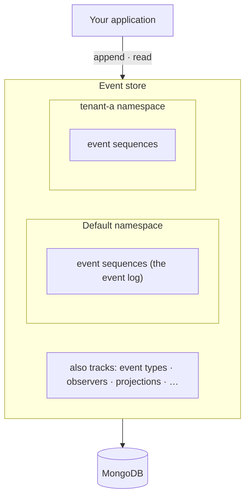

An event store in Cratis Chronicle holds your application's events in [event sequences](./event-sequence.md), together with the definitions and state needed to process them. It is the boundary you select when connecting an application to its event history.

The store also tracks [event types](./event-type.md), which describe the events, and [observers](./observers.mdx), which consume them. [Projections](./projection.md) use those events to build read models that your application can query.

An event store is a Chronicle concept, separate from the database engine that persists it. Chronicle supports [MongoDB](https://mongodb.com), PostgreSQL, Microsoft SQL Server and SQLite. MongoDB is the default, and the development Docker image includes it for local use. Choose a provider and connection details in [Storage configuration](../hosting/configuration/storage.mdx).

This example uses MongoDB and separates the event sequences into two namespaces:

## Namespaces

[Namespaces](./namespaces.md) separate data within an event store. For a multi-tenant application, you can give each tenant its own namespace while sharing the store's event type and projection definitions.

Chronicle uses the `Default` namespace when none is provided. Read [Namespaces](./namespaces.md) before choosing tenant identifiers: the namespace affects where events and read models are stored.
