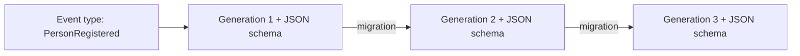

An event type in Cratis Chronicle gives a stored [event](./event.md) a stable identity and a schema for its content. Preserve that identity when refactoring code so existing events still reach their handlers; use generations when the schema needs to change.

Before appending to an [event sequence](./event-sequence.md), the client must register the event type with the [event store](./event-store.md). The client uses that registration to associate the event's code type with its stored identity and schema.

## Identity survives a code rename only if you preserve it

In the .NET client, the default event type ID is the class name, without its namespace. Renaming the class changes that ID unless you explicitly retain the previous value. Stored history stays under the old ID; handlers for the new ID do not see those events. Moving the class to another namespace without changing its name leaves its default ID unchanged.

When refactoring an existing event, preserve its stored ID. When changing its schema, use a new generation of that identity and an [event type migration](./event-type-migrations.mdx). Giving it a new ID would leave the existing history under a separate identity. The [.NET discovery diagnostics](../clients/dotnet/discovery-report.md) warn about likely event type renames based on schema shape, but cannot prove that two types represent the same fact.

## Generations

An event type starts at generation 1. When its schema changes, introduce a new generation of the same type so old and new schemas can coexist in the event store. Each generation registers its own JSON schema, which Chronicle uses to validate the event's content.

For example, `PersonRegistered` can retain its identity while migrations transform its content between generations:

Keep a record for each past generation alongside the current one. In .NET, declare a previous generation with `[EventTypeGenerationFor<T>]`, where `T` is the current generation's type. Chronicle resolves the shared event type ID from `T`'s `[EventType]`, so you do not have to repeat the ID on each historical record.

Continue with [Event Type Migrations](./event-type-migrations) to define those records and the transformations between them, or to work with the older explicit-ID style.
