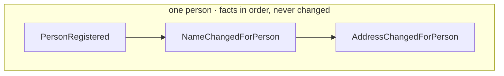

<a id="event"></a>

An event records something that happened in your domain, such as a person registering or changing
an address. Cratis Chronicle stores these [domain events](https://www.martinfowler.com/eaaDev/DomainEvent.html)
so you can derive current state from the changes that led to it. When designing an
[event type](./event-type.md), start with the business change you need to remember, then choose the
properties that describe it.

Each event belongs to an [event source](./event-source.md), the entity or process whose history it
records. For one person, that history might look like this:



## Past tense

Name an event in the past tense. The name should describe a fact, not a request to do something:

- ItemAddedToCart
- UserRegistered
- AddressChangedForPerson

## Singular purpose

Give each event one meaning. If a property is only populated for one of several unrelated changes,
consumers have to inspect the payload to discover what happened. Separate event types make that
distinction explicit and keep each consumer from having to reconstruct it.

## Immutable

Treat a recorded event as an immutable fact. Replacing its values would change the history that
projections replay and that you inspect when investigating a problem. Record a later business
change as another event so the earlier state and the change remain distinguishable.

Personal data needs a separate policy: immutability is not a reason to retain it indefinitely.
Chronicle's [compliance mechanisms](../compliance/index.md) cover encryption, erasure, and redaction.

## Avoid nullables / empty values

A missing value should have a clear meaning. Chronicle supports nullable event properties, but
using null to distinguish different kinds of change leaves every consumer to interpret that
choice. Prefer a separate event type when the meaning differs. The .NET analyzer rule
[CHR0012](../code-analysis/CHR0012) warns about nullable event properties so you can review the design.

Null can still be appropriate in data collection: a person might not have a middle name. That is
different from leaving the name empty because the event actually describes an address change.

## Cohesion

Keep together the values needed to describe one meaningful change. Registration may capture a
person's name and address at once; changing either later does not need to repeat the other.
The following payloads illustrate that boundary. In an application, classify the personal values
using [PII markers](../compliance/pii) before storing them.

### PersonRegistered

Registration can capture the person's initial details:

```json
{
    "socialSecurityNumber": "12345678901",
    "firstName": "John",
    "middleName": "David",
    "lastName": "Doe",
    "address": "32nd & Main street",
    "postalCode": "123456",
    "city": "Somewhere",
    "country": "Atlantis"
}
```

### NameChangedForPerson

A later name change carries the name, without repeating the address or social security number:

```json
{
    "firstName": "John",
    "middleName": "David",
    "lastName": "Doe"
}
```

### AddressChangedForPerson

An address change carries the address fields together:

```json
{
    "address": "32nd & Main street",
    "postalCode": "123456",
    "city": "Somewhere",
    "country": "Atlantis"
}
```

## Integrations

When a source system gives you current-state records rather than events, identify which business
change the data represents before defining an event type. Apply the same naming and cohesion
rules; a record's structure alone does not tell a consumer why it changed.

## Event discovery

[Event Storming](https://www.eventstorming.com) and [Event Modelling](https://eventmodeling.org) can
help you discover events before choosing their payloads. Event Modeling's building blocks help
connect those facts to the flows through the system. The
[Microsoft domain events guide](https://docs.microsoft.com/en-us/dotnet/architecture/microservices/microservice-ddd-cqrs-patterns/domain-events-design-implementation)
provides further background.

Once the business meaning is clear, read [Event type](./event-type.md) to give that contract an
identity in Chronicle, then [Modeling events](./modeling-events.mdx) for the implementation guidance.
