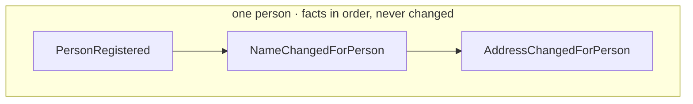

# Event

Use [domain events](https://www.martinfowler.com/eaaDev/DomainEvent.html) to record what has happened in
your domain. Registering a person and changing that person's name are different facts, even though
both involve a name. The name of an [event type](./event-type.md) and the properties it carries should
make that distinction clear to the code that consumes it.

This page explains how to choose those names and properties. The [Microsoft guide](https://docs.microsoft.com/en-us/dotnet/architecture/microservices/microservice-ddd-cqrs-patterns/domain-events-design-implementation)
also covers designing domain events.

> Note: Read more about the relationship to [event source](./event-source.md)

A well-designed event is a single, immutable, past-tense fact. For normal domain changes, append a new
fact rather than rewriting an earlier one: a name change follows registration, and an address change
adds another fact about the same person. The diagram illustrates this modeling principle, with the
person's story growing as new facts are recorded:



## Past tense

All events should be named as past tense, something that has happened:

- ItemAddedToCart
- UserRegistered
- AddressChangedForPerson

## Singular purpose

An event should never be ambiguous. It should have a clear meaning and purpose.
It should not be holding information for multiple purposes. For instance holding properties that are empty and only used
for specific purposes. Doing so makes the event unclear to reason about and requires logic in all observers and consumers
of the event.

## Immutable

`PersonRegistered` records the details accepted at registration. If the person later changes their
name, append `NameChangedForPerson` instead of replacing the name in the registration event. A consumer
can then distinguish the initial registration from the later change and react to each for a different
reason, such as starting onboarding or updating a displayed name. Rewriting registration would hide
that distinction.

Immutability here is a rule for modeling normal domain changes, not a promise that stored content can
never change. Chronicle provides deliberate historical revision and redaction operations, separate
from recording a new domain fact. Retention of original content and revision history depends on the
storage provider. A person's new name normally calls for a new event, not one of those maintenance
operations.

## Avoid nullables / empty values

An event has happened, and it should not represent unclear states.
As with singular purpose, nullable properties are open for interpretation and require extra logic
for every observer and consumer of the event.

Chronicle supports nullable properties on event types when needed.
However, consider this a design smell and prefer introducing a new event type when the meaning differs.
The .NET analyzer rule [CHR0012](../code-analysis/CHR0012) warns when nullable event properties are used so you can review the design choice.

> Note: There are conditions where it makes sense to allow null, typical data collection scenario might be the case.
> For instance, a person might not have a middle name.

## Cohesion

Choose properties that belong together to describe one meaningful change. In a system that holds
personal details, a person's name and social security number can be treated separately from their
address. Registration may bring those details together, while a later name change does not also mean
that the address changed.

The examples below show how the properties follow the purpose of each event.

### PersonRegistered

Registration may need to capture all the person's details as one fact:

```json
{
    "socialSecurityNumber": "12345678901",
    "firstName": "John",
    "middleName": "David",
    "lastName": "Doe",
    "address": "32nd & Main street",
    "postalCode": "123456",
    "city": "Somewhere",
    "country": "Atlantis"
}
```

### NameChangedForPerson

After registration, a name change needs only the name properties. Consumers do not have to inspect
unrelated address fields to work out what changed:

```json
{
    "firstName": "John",
    "middleName": "David",
    "lastName": "Doe"
}
```

### AddressChangedForPerson

An address change similarly carries the address details together, without repeating the person's name:

```json
{
    "address": "32nd & Main street",
    "postalCode": "123456",
    "city": "Somewhere",
    "country": "Atlantis"
}
```

## Integrations

When integrating with systems that are non event sourced you would need to deduct the event types from the data structure.
The same approach applies for defining the events as described in this document.

## Event discovery

There are a couple of well known approaches to discovering events in your domain; [Event Storming](https://www.eventstorming.com)
and [Event Modelling](https://eventmodeling.org). We tend to favor the latter as it has more focused building blocks. It gives a good
overview of a an entire system and the flows in it.
