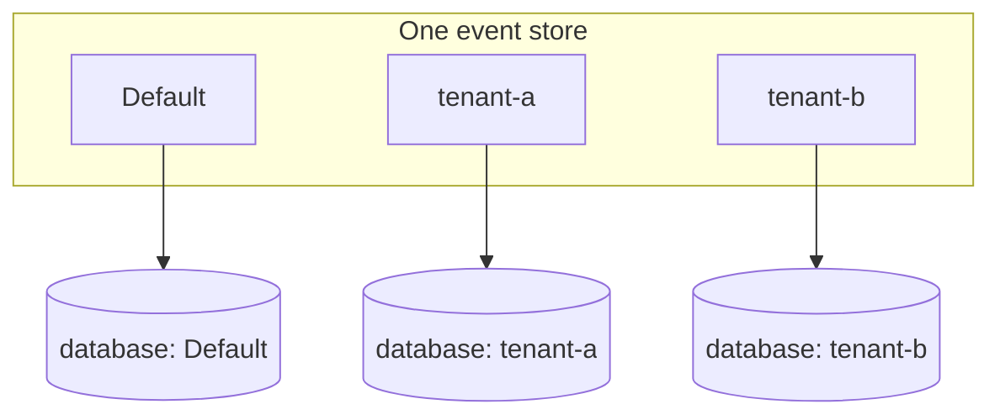

A namespace in Cratis Chronicle separates one set of data from another within the same event store. In a multi-tenant application, give each tenant its own namespace so its events, observer progress and read models stay separate from those of other tenants. A tenant is an organization or group using the shared application.

Chronicle uses the `Default` namespace when none is specified. Choose how your application resolves the namespace for each request before introducing tenant data. [Tenancy](../tenancy/index.md) explains that choice and where each tenant's database can live; [Manage namespaces](../namespaces/index.md) covers client usage and namespace removal.

## Subscription Readiness

Call `EnsureNamespace` when you need to establish a namespace before using it. The operation returns once healthy active projections and started event captures are subscribed there. Subscription is not catch-up completion: wait for observer completion before querying a read model that must include a particular append.

Failed subscription setup is logged and retried at the next subscription trigger. It does not prevent namespace creation, and retired observers are skipped. With a very large projection set, the call can time out while setup continues; retrying joins the running subscription pass.

A first append can also create a namespace implicitly. Its event log's observer watchdog, a periodic recovery check, reconciles subscriptions on the next tick even if the namespace-added notification was missed.

## Data Segregation

Namespace-specific data is stored separately from other namespaces. On MongoDB, each namespace has its own event sequence and read-model databases, while event-store-wide state is shared. This separation lets the databases maintain their own indexes; it does not decide which tenant a caller is allowed to access.

## Database Naming

On MongoDB, database names include the event store name and, where applicable, the namespace. For an event store named `Ada` with no database-name prefix:

| Holds | Namespace `Default` | Namespace `tenant-a` |
| --- | --- | --- |
| Event store wide state | `Ada+es` | `Ada+es` |
| Event sequences | `Ada+es+Default` | `Ada+es+tenant-a` |
| Read models | `Ada` | `Ada+tenant-a` |

Read models in the default namespace use the bare event store name, without a namespace suffix. Event sequence databases include the suffix even for `Default`. If you read models outside Chronicle, for example through an injected `IMongoCollection<TReadModel>`, use the same naming rule.

Always composing `<eventStore>+<namespace>` sends a default-namespace query to `Ada+Default` instead of `Ada`. A query against that nonexistent database returns empty results rather than an error, which can look like missing projection output.

The complete database name must satisfy MongoDB's naming rules. MongoDB rejects the characters `/ \ . " $ * < > : | ?`, spaces and the null character, and limits the name to 63 bytes. A tenant display name such as `Hive Consulting` therefore cannot be used unchanged as a namespace.

Chronicle validates the composed name and throws `InvalidDatabaseName` with the event store, namespace and reason for rejection, before the driver can fail with `Invalid namespace specified`. Choose a legal tenant identifier and allow room for the event store name and any prefix. [Storage configuration](../hosting/configuration/storage.mdx) explains database prefixes and the System event store's naming exception.
