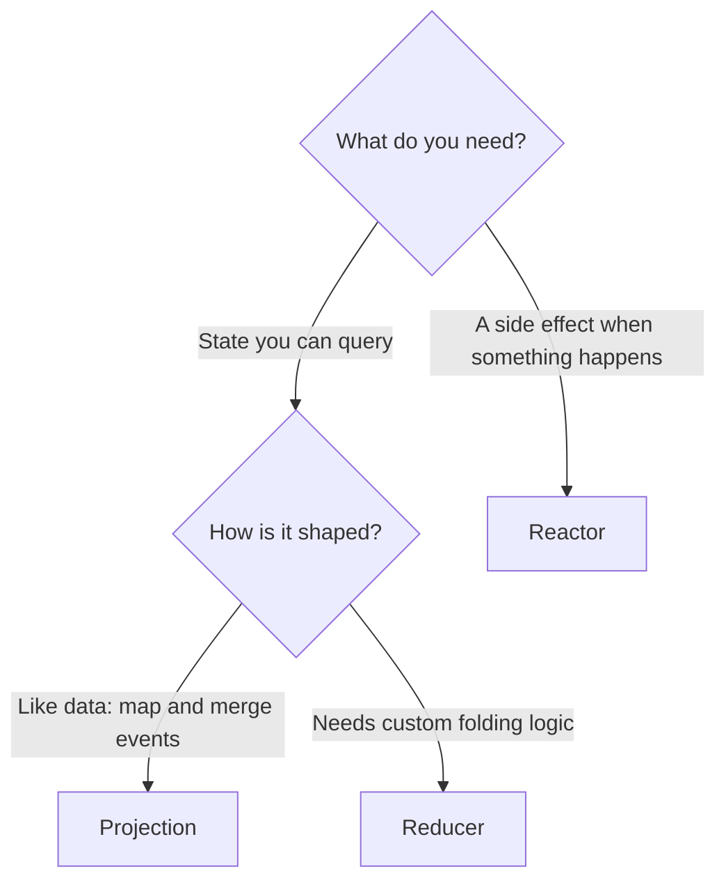

Use a projection or reducer in Cratis Chronicle when events need to become queryable state. Use a reactor when an event should cause an action, such as sending a notification or calling another system. The choice determines whether replay should rebuild a value or repeat an effect.

All three are [observers](./observers): they subscribe to event types in an [event sequence](./event-sequence.md). A projection declares how to build a read model; a reducer computes it in code from previous state and an event. A reactor handles the action outside that state-building process.

## Side by side

| | Projection | Reducer | Reactor |
|---|---|---|---|
| **Purpose** | Build a read model | Build a read model | Do a side effect |
| **How** | Model-bound attributes or a declarative builder, including AutoMap | Code combining previous state with an event | Handler code for subscribed event types |
| **Produces** | A read model instance you query | A read model instance you query | An action; it can also produce follow-up events |
| **Reach for it when** | Mappings and projection operations express the view | Custom state-transition logic is clearer in code | You must notify, integrate, or trigger a command |
| **Retry responsibility** | Keep state derivation free of external effects | Keep state derivation free of external effects | Make repeated delivery safe |

Idempotent handling means that processing the same delivery again does not duplicate its effect. Chronicle manages state persistence and replay for projections and reducers, but that does not make an email or API call inside state-building code safe. Keep those effects in a reactor and use a stable delivery identity or the destination's deduplication support. [Reactor delivery identity](../reactors/delivery-identity.mdx) explains how to identify repeated deliveries.

For a model keyed by event source, Chronicle uses the instance's last-handled event sequence number to guard state updates against redelivery. A projection that combines several event sources into one instance cannot use that guard because its writes can arrive out of order. Chronicle checkpoints those projections after every batch, limiting the recovery window to one batch; a repeated batch can still be applied twice.

Building state does not require storing an asynchronously updated view. A passive read model uses its projection or reducer on demand when you [read an instance](../read-models/getting-single-instance). This avoids waiting for a materialized view to catch up, but adds replay work to the read. A fresh result does not guard a later write against concurrent changes; use a [decision read](../read-models/decision-reads.mdx) when that protection is needed. [Aggregate roots in Arc](/arc/backend/csharp/chronicle/aggregates/defining-an-aggregate-root/) provide another way to organize state and behavior for a write-side decision.

## Choosing

Start with a [projection](./projection.md) when mapping, joining, or aggregating event data expresses the view. Projection operations include more than property copying, so a running total alone is not a reason to switch approaches.

Choose a [reducer](../reducers/) when custom calculations or conditional state transitions are easier to understand as code. You gain control over the fold, the function that combines previous state with each event, and take responsibility for that logic.

Choose a [reactor](../reactors/) for external work or follow-up actions. Recovery can deliver an event again; a deliberate replay can do so too. Decide how repeated delivery is handled before enabling the effect, and do not assume that every redeploy replays the reactor's history.

## The rules that keep them honest

A projection or reducer should only derive state. Replaying it must not send emails, call external APIs, or issue commands.

A reactor can invoke a command when the action needs command-side validation, or produce [follow-up events](../reactors/side-effects.mdx) through its client's supported mechanism. It is not the place to maintain the query model that a projection or reducer should build.

Replay rebuilds derived state; it cannot undo an external action. Treat reactor replay as an operational decision about effects, not as a read-model rebuild.

## Go deeper

- [Projections](../projections/) — the full range, including declarative and model-bound styles.
- [Reducers](../reducers/) — when and how to fold.
- [Reactors](../reactors/) — side effects and idempotency.
- [Read Models](../read-models/) — what projections and reducers write to, and how consistency works.
