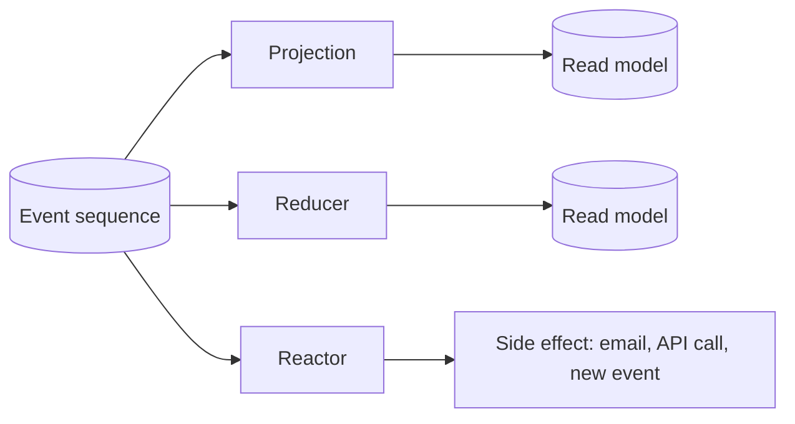

# Observers

An observer is a part of your system that is "listening" to events.
When events are appended to an [event sequence](./event-sequence.md) that the observer
is observing, it will automatically be notified of the event.

Every observer decides what events they are interested in during the subscription process.
This information is stored in the [event store](./event-store.md).

Adding event types does not always rewind an observer. Definition evolution depends on the observer
kind and its configuration: projections require a full replay for historical backfills and mapping
changes. Reactors do not replay on definition changes by default.
See [Observer configuration](../hosting/configuration/observers.md) and
[Projection registration lifecycle](../projections/registration-lifecycle.md).

During a full replay, the observer is inactive. When replay completes, it routes again to catch up
with remaining events and resume live observation, unless it is quarantined.

There are three kinds of observer, each turning events into something different — queryable state, or
an action:



## Failed partitions

A failed partition identifies the event source an observer stopped processing and records its attempts. The Workbench distinguishes unresolved failures that remain eligible for automatic retries from **quarantined** partitions, where automatic retries have stopped. Resolved failures are no longer active failures and are normally removed from the active list.

The client exposes `IsResolved` and nullable `IsQuarantined`. A missing quarantine value means the connected server did not supply that state; it does **not** mean healthy or automatically retryable. The Workbench displays it as **Unknown** rather than guessing.

SQL-backed failed-partition queries observe the shared database at the configured live-query polling interval, including changes made by another instance. They emit only changed snapshots, and unsubscribe when the query consumer disconnects. Resolution and retry activity therefore update the view without a manual refresh, subject to the polling interval.

A partition is **quarantined** when it has used up its retry attempts. This is separate from a quarantined *observer*, described below: partition quarantine stops automatic retries of that one partition. Live delivery can continue for other partitions, but a new failure during projection catch-up stops its single ordered step. Clear a partition's quarantine with the `ClearPartitionQuarantine` operation on the `Observers` service (or `ClearFailedPartitionQuarantineFor<TReactor>` from the .NET client). Clearing starts a new retry budget for the partition without discarding its attempt history, and can retry it immediately. Clearing an observer's quarantine is a different operation (`cratis chronicle observers clear-quarantine`) and does not touch its quarantined partitions.

## Quarantined observers

When enough partitions of an observer fail, Chronicle quarantines the observer itself: automatic retries stop and it stops processing until someone acts. A quarantine ends when an operator clears it (`cratis chronicle observers clear-quarantine`, or the Workbench) or when the observer is subscribed again. Connecting an instance of the application's client subscribes its reactors and reducers again, so a redeploy or a restart ends their quarantine. The Kernel subscribes projections, webhooks and its own reactors again when it starts, ending their quarantine. Event store subscriptions remain quarantined across a Kernel restart until an operator clears them. While the Kernel keeps running, the same happens when a client registers a changed projection or webhook definition, when a webhook is edited, and when a namespace is added. Deactivating and reactivating the observer's grain in a running Kernel does not end the quarantine: the observer still shows as **Quarantined** afterwards rather than **Disconnected**. The Kernel also checks event store subscriptions every minute, but this automatic reconciliation does not end their quarantine. [Observer configuration](../hosting/configuration/observers.md) lists what subscribes each kind of observer again.

## Fast forwarding an observer

Fast forwarding moves an observer to the tail of its event sequence. Every event it has not yet handled is skipped without
invoking it, and its failed partitions are discarded. Use it to get past a backlog, or events that can never be handled, when
the read side does not need to be rebuilt.

It is the opposite of a replay: nothing the observer already built is reset, so whatever the skipped events would have
done is missing from it. An observer that is replaying cannot be fast forwarded until the replay completes, and events
appended after the tail was read are handled as normal.

- Workbench: select the observer and choose **Fast forward**.
- CLI: `cratis chronicle observers fast-forward <observer-id>`.
- Clients: `IReactors`, `IReducers` and `IProjections` in .NET expose `FastForward`, and the TypeScript, Kotlin, Elixir and Go clients expose the same operation on their observer and projection APIs.

## Removing an observer

An observer outlives the code that declared it. Delete a read model and its projection, or remove a reactor, and nothing tells the event store — the observer simply stops being reported by any client, settles into `Disconnected` and stays there, keeping its definition, its state and handled counts in every namespace, its failed partitions and, for a projection, its projection definition.

A reactor rename or namespace move can leave the same kind of disconnected orphan, because its default id changes. Preserve the existing id to keep its position; remove the old observer only when the identity change is intentional and no service needs it. See [Reactor identity and renaming](../reactors/identity.mdx). The kernel retires renamed client projections during full-set registration.

Removing one deletes exactly that bookkeeping:

<ChronicleClientTabs snippet="concepts/observers/remove" />

The same operation is available in the Workbench, on the **Observers** page under a namespace, and from the CLI:

```shell
cratis chronicle observers remove the-observer
```

Three things are worth knowing before you use it.

**It covers the whole event store, not one namespace.** An observer's definition — and the projection definition it has when it is a projection — are store-level records shared by every namespace. Deleting those while leaving namespaced state behind in the other namespaces would produce the same half-present observer the removal exists to clear up, so the operation reaches every namespace.

**It refuses while the observer is alive.** For reactors and reducers, if the observer is running or a client is still subscribed in *any* namespace, nothing is deleted and the result names the blocking namespace. For projections, the kernel subscription is not a sign that the declaring application still exists: removal instead refuses while a connected client anywhere in the cluster declares the projection. Kernel-owned projection definitions are never removable. Projection refusals are store-wide and return an empty blocking namespace. There is no force flag: stop the application that declares the observer and try again.

Projection declarations are tracked for the lifetime of each connection. Recording is best-effort: if a connection lookup fails during registration, registration still succeeds but its declarations may not be known until the client registers again. Removal refuses to proceed if its own declaration lookup fails. Older clients that do not send a connection identifier cannot be checked this way, so their projections are removable even while the client is connected. After a kernel restart, declarations are known again as clients reconnect and register. A later registration recreates a removed projection. An abandoned projection is removable even while its kernel subscription is active; a reactor or reducer that is `Disconnected`, `Suspended` or `Quarantined` with no subscribed client is also removable.

**Read models are not touched.** Removal deletes the observer's bookkeeping, never a sink container or the data a projection wrote into it. If you want the read model gone too, delete it separately.

Removal is not a reset. If the code that declared the observer registers it again, the event store treats it as brand new and it replays the sequence from the beginning. To rewind an observer you still have, use replay instead.

## State management

One of the things you can use an observer for is to maintain application state, typically update
data in a database that is used for reading. However, it is recommended to use [projections](./projection.md)
for this purpose, as long as projections support your scenario. Projections are not a catch all
solution, and sometimes you need to do it manually. It is also a possibility to combine manual state
management with **immediate projections**.

## Reactors

Reactors are great for the **if this then that** type of scenarios. When an event occurs,
you can react to it and perform an action. This could be any type of action, e.g. out-of-process actions
like sending emails or calling an API. You could also append new events in an observer and make
your observer become a pattern matcher or a state machine that responds to certain conditions and
then generate more specific events for that condition.

## Reducers

While projections is a declarative approach and has some limitations, a reducer can help give you more
capabilities. With a reducer, Chronicle manages the actual storage. Chronicle will call you on every
event you are interested in for your reducer and you will get the existing state of the read model, if any,
and you can then provide a new representation of state as a consequence of the event. The result will then
be stored.
