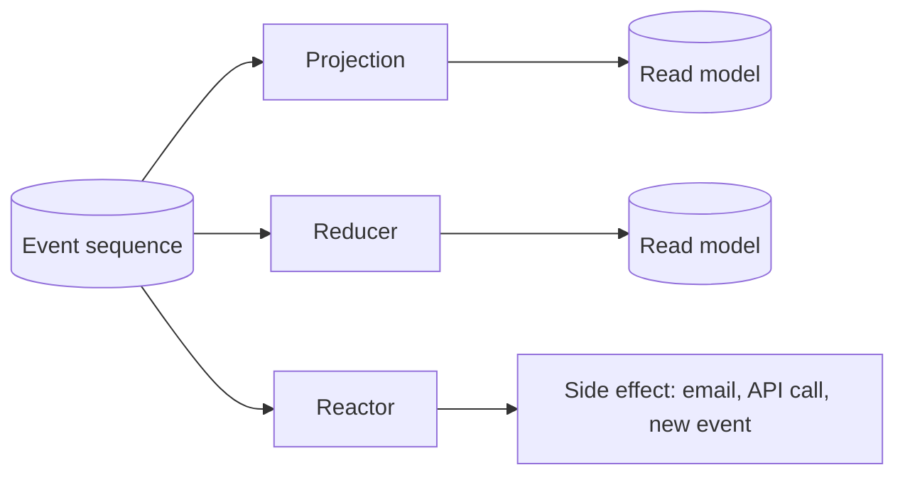

An observer in Cratis Chronicle processes subscribed event types from an [event sequence](./event-sequence.md) to build state or perform an action. Use its recorded progress and failure state to decide whether it needs recovery, replay, or removal; these operations have different effects on existing data.

Projections and reducers build read models. Reactors perform actions such as sending an email, calling an API, or producing a follow-up event:



[Choosing projections, reducers, or reactors](./observer-patterns.md) explains the design decision. This page focuses on what happens after an observer is registered. Its subscription identifies the event types it handles, and that information is stored in the [event store](./event-store.md).

Choose recovery by what you want to preserve:

| Situation | Next action |
| --- | --- |
| Processing stopped after failures | Fix the cause, then clear the relevant quarantine. Observer and partition quarantine are separate. |
| A derived view needs rebuilding | Replay where supported; consider effects separately for reactors. |
| Unhandled events should be abandoned | Fast-forward, accepting that skipped events will not update state or trigger actions. |
| An observer has been retired | Remove its bookkeeping across the event store; existing read-model data stays. |

## Failed partitions

A failed partition identifies the event source an observer stopped processing and records its attempts. The Workbench distinguishes unresolved failures that remain eligible for automatic retries from **quarantined** partitions, where automatic retries have stopped. Resolved failures are no longer active failures and are normally removed from the active list.

The client exposes `IsResolved` and nullable `IsQuarantined`. A missing quarantine value means the connected server did not supply that state; it does **not** mean healthy or automatically retryable. The Workbench displays it as **Unknown** rather than guessing.

SQL-backed failed-partition queries observe the shared database at the configured live-query polling interval, including changes made by another instance. They emit only changed snapshots, and unsubscribe when the query consumer disconnects. Resolution and retry activity therefore update the view without a manual refresh, subject to the polling interval.

A partition is **quarantined** when it has used up its retry attempts. This is separate from a quarantined *observer*, described below: partition quarantine stops automatic retries of that one partition. Live delivery can continue for other partitions, but a new failure during projection catch-up stops its single ordered step. Clear a partition's quarantine with the `ClearPartitionQuarantine` operation on the `Observers` service (or `ClearFailedPartitionQuarantineFor<TReactor>` from the .NET client). Clearing starts a new retry budget for the partition without discarding its attempt history, and can retry it immediately. Clearing an observer's quarantine is a different operation (`cratis chronicle observers clear-quarantine`) and does not touch its quarantined partitions.

## Quarantined observers

When enough partitions of an observer fail, Chronicle quarantines the observer itself: automatic retries stop and it stops processing until someone acts. A quarantine ends when an operator clears it (`cratis chronicle observers clear-quarantine`, or the Workbench) or when the observer is subscribed again. Connecting an instance of the application's client subscribes its reactors and reducers again, so a redeploy or a restart ends their quarantine. The Kernel subscribes projections and its own reactors again when it starts, ending their quarantine. Webhook startup reconciliation preserves quarantine and its durable recovery probe; eligible delivery failures can recover through a [successful probe](../webhooks/index.mdx#automatic-recovery-from-quarantine). Event store subscriptions remain quarantined across a Kernel restart until an operator clears them. While the Kernel keeps running, the same happens when a client registers a changed projection or webhook definition, when a webhook is edited, and when a namespace is added. Deactivating and reactivating the observer's grain in a running Kernel does not end the quarantine: the observer still shows as **Quarantined** afterwards rather than **Disconnected**. The Kernel also checks event store subscriptions every minute, but this automatic reconciliation does not end their quarantine. [Observer configuration](../hosting/configuration/observers.md) lists what subscribes each kind of observer again.

## Replay and definition changes

Adding event types does not always rewind an observer. Definition evolution depends on the observer
kind and its configuration: projections require a full replay for historical backfills and mapping
changes. Reactors do not replay on definition changes by default.
See [Observer configuration](../hosting/configuration/observers.md) and
[Projection registration lifecycle](../projections/registration-lifecycle.md).

During a full replay, the observer is inactive. When replay completes, it routes again to catch up
with remaining events and resume live observation, unless it is quarantined.

Use `RunningStateChangedAt` to see when an observer last entered its current running state, for example how long it has been disconnected. The timestamp is UTC and nullable; legacy records remain unknown until a real state change occurs.

If a projection or reducer replay cannot prepare its job steps, the kernel keeps the existing read model, quarantines the observer and leaves the replay pending; clearing the quarantine runs the replay again.

### Store-wide statistics and global replay

Kernel projection declarations support only namespaced materialization. Store-wide event statistics read
each namespace's statistics and concatenate the rows instead of maintaining a shared global sink.

A store-wide statistics query snapshots namespace membership once, before reading rows. A namespace added
after that snapshot is included only in a later query; a namespace removed afterward is still read for the
current query. If that read fails, the whole query fails. The snapshot covers membership, not a simultaneous
point-in-time view of all namespace counts.

At most **8 namespace reads** run concurrently per query. This bounds pressure on storage even for stores
with many namespaces, without serializing every contributor. The local `IStatisticsReader` cancellation
overloads stop waiting for discovery, cancel contributing reads and stop scheduling further namespaces.
Existing query and wire contracts are unchanged; they do not add a client cancellation field.

The row limit is **10,000 per namespace**, not per store. Exactly 10,000 rows are accepted when the reported
total confirms that the result is complete. A reported total larger than the returned row count or the limit,
or a full page whose completeness cannot be determined, fails the query rather than returning partial totals. A structured warning identifies the event store, namespace, row limit, returned row count and reported
total count. Any failed, canceled or capped contributor prevents a successful store-wide result; no partial
totals are returned.

### Recognize a refused global replay

A **global-scope projection** writes to a read-model destination (sink) shared by namespaces.
Replaying one namespace cannot safely rebuild data while other namespaces are still writing to that
same destination. Full and partition replay of persisted `Global` or `Both` projection scopes are
refused before resetting observer progress, admitting a job, or changing the shared sink. A definition
change that would require automatic full replay retains an explanatory recommendation instead;
performing that recommendation also refuses the namespace-local replay. A coordinated rebuild across
all namespaces is not currently supported.

Namespace-scoped projections are unaffected. These scope checks do not restrict reactors or reducers,
which have no global projection scope.

### Check progress after a replay refusal

A persisted global replay job can encounter the restriction during preparation, recovery, resume or
completion. The job becomes **Failed** and retains the scope refusal in its failure history. A refused
resume stops before recovering steps or finalizing the sink; further resume attempts are refused as a
failed job rather than retried in a loop. Do not keep resuming it as ordinary failure recovery.

The kernel removes the replay markers: the flags that hold back ordinary processing while a replay
owns the work. Removing them after refusal is **not replay completion**. It leaves the observer's
last-handled and next-event positions unchanged, resolves no failed partitions, claims no replay
coverage, and neither finalizes nor promotes the rebuilt data into service. Observer quarantine
remains in force.

For full replay, this also clears superseded partition replay and catch-up markers. As ordinary routing
does, the observer then re-evaluates outstanding work from its retained progress position, unless it is
quarantined.

For partition replay, `HeldBackFrom` is the earliest event position held back from live delivery when
the replay marker was set. The kernel saves it in the job request before admitting the job. After a
refusal, catch-up checks start **at that saved position, including its first event**, not at the shared
observer position: other partitions may have advanced that shared position meanwhile. This check does
not count as successful replay or resolve a failed partition.

### Recover a legacy partition with no saved position

Legacy persisted jobs lack `HeldBackFrom`. Released kernels beginning with v19.7.0 could admit
`Global`/`Both` partition replay jobs before the admission restrictions. On refusal, the kernel saves
a visible **quarantined partition failure** with an operator-recovery explanation before removing the
replay marker. A new failure has an unknown recovery position; existing failure positions and history
are preserved, as is observer progress. No catch-up or automatic retry is scheduled onto the unchanged
sink.

Keep this partition quarantined while an operator reconciles the sink with the contributing event
history and establishes a safe recovery position. Only then clear partition quarantine. Neither zero
nor the shared observer position is a safe guessed starting point. Clearing quarantine alone does not
repair the sink or establish that position.

### Upgrade when a global replay is already running

1. Stop replay workers and all contributing writes before upgrading. Upgrade all silos together:
   stop the old silos before starting upgraded ones, rather than mixing versions that can start global
   replay with versions that refuse it. A silo is one running Kernel instance in the cluster.
2. Preserve the served model, replay containers, backups, replay contexts and occurrences for
   investigation. Contexts and occurrences are the persisted records tracking the rebuild. The
   **shadow** is the temporary replay container, not proof of a complete replacement model. Resume,
   flush, end and legacy cleanup refuse the uncoordinated global replay rather than promote that
   shadow. A source namespace's completion proves neither the global model nor its backup complete.
3. Keep the affected model out of service. There is no automatic in-place repair: an operator must
   restore a known-good model and reconcile every contributing sequence offline before serving it
   again. Do not delete a replay container or backup merely because a namespace-local replay ended.

Persisted full and partition replay jobs recheck the stored projection scope during preparation,
resume and completion. Upgrading does not turn an already-running global replay into a supported
coordinated rebuild.

### Confirm retirement of the old global statistics observers

Kernel startup registers the complete set of built-in projections for each event store. This is the
**full-set kernel registration**: definitions absent from the new set are retired. Starting only
upgraded silos, after stopping all old ones, makes that registration reach an upgraded
`ProjectionsManager` grain—the cluster component that manages projection definitions—rather than one
still running old code. No manual grain invocation is needed for this startup registration.

Check startup registration for each affected event store rather than assuming startup means retirement
finished. If registration is deferred to a background retry, wait for the log message
`Kernel projections registered for event store '{EventStore}' after a background retry.` Deferred
registration reports degraded health while the kernel can continue serving; investigate the failure
before treating retirement as complete.

Registration retires the former global statistics observers and deletes their jobs, but leaves the
orphaned shared container intact. New statistics queries do not read it. The upgraded manager skips
incoming global kernel definitions with a warning, even if an old silo sends them in its complete set;
it still retires stored global kernel definitions and registers the other kernel projections.

While that manager is hosted on an old silo, old registration can still recreate the global writer;
new silos nevertheless refuse global replay. Retirement and job deletion do not guarantee that work
already executing on another old silo has drained. Finish the all-silo upgrade rather than treating
retirement as permission to resume writes or discard preserved data.

Global materialization requires coordinated generation ownership before it can return; see
[the scope decision](https://github.com/Cratis/Chronicle/blob/main/decisions/0015-global-projection-scope-is-restricted.md).

## Fast forwarding an observer

Fast forwarding moves an observer to the tail of its event sequence. Every event it has not yet handled is skipped without
invoking it, and its failed partitions are discarded. Use it only when you intend to abandon that backlog. It does not repair a read model or perform skipped reactor actions.

It is the opposite of a replay: nothing the observer already built is reset, so whatever the skipped events would have
done is missing from it. An observer that is replaying cannot be fast forwarded until the replay completes, and events
appended after the tail was read are handled as normal.

- Workbench: select the observer and choose **Fast forward**.
- CLI: `cratis chronicle observers fast-forward <observer-id>`.
- Clients: `IReactors`, `IReducers` and `IProjections` in .NET expose `FastForward`. TypeScript, Kotlin, Elixir and Go provide fast-forwarding through their observer administration APIs; method signatures differ by client.

## Removing an observer

An observer outlives the code that declared it. Delete a read model and its projection, or remove a reactor, and nothing tells the event store — the observer simply stops being reported by any client, settles into `Disconnected` and stays there, keeping its definition, its state and handled counts in every namespace, its failed partitions and, for a projection, its projection definition.

A reactor rename or namespace move can leave the same kind of disconnected orphan, because its default id changes. Preserve the existing id to keep its position; remove the old observer only when the identity change is intentional and no service needs it. See [Reactor identity and renaming](../reactors/identity.mdx). The kernel retires renamed client projections during full-set registration.

Removing one deletes exactly that bookkeeping:

<ChronicleClientTabs snippet="concepts/observers/remove" />

The same operation is available in the Workbench, on the **Observers** page under a namespace, and from the CLI:

```shell
cratis chronicle observers remove the-observer
```

Removal covers the whole event store, not one namespace. The observer definition and any projection definition are shared store-level records, so the operation also removes the observer's state in every namespace. Check all consumers before removing an observer that appears abandoned in only one namespace.

Chronicle refuses removal while a reactor or reducer is running or a client is still subscribed in any namespace. Nothing is deleted, and the result names the blocking namespace. For projections, a kernel subscription alone does not establish that the declaring application still exists. Removal instead refuses while a connected client anywhere in the cluster declares the projection. Kernel-owned projection definitions are never removable. Projection refusals are store-wide and return an empty blocking namespace. There is no force flag: stop the application that declares the observer and try again.

Projection declarations are tracked for the lifetime of each connection. Recording is best-effort: if a connection lookup fails during registration, registration still succeeds but its declarations may not be known until the client registers again. Removal refuses to proceed if its own declaration lookup fails. Older clients that do not send a connection identifier cannot be checked this way, so their projections are removable even while the client is connected. After a kernel restart, declarations are known again as clients reconnect and register. A later registration recreates a removed projection. An abandoned projection is removable even while its kernel subscription is active; a reactor or reducer that is `Disconnected`, `Suspended` or `Quarantined` with no subscribed client is also removable.

Removal leaves read models in place. It deletes the observer's bookkeeping, never a sink container or the data a projection wrote into it. Delete that data separately only if you also intend to retire the view.

Removal is not a reset. If the code that declared the observer registers it again, the event store treats it as brand new and it replays the sequence from the beginning. To rewind an observer you still have, use replay instead.

## State management

Use a [projection](./projection.md) to derive queryable state when its mapping operations fit the model. A reducer is the alternative when custom code expresses the state transition more clearly. Keeping state derivation in either of these paths lets Chronicle manage storage and replay; maintaining a separate view by hand makes those responsibilities yours.

## Reactors

Use a reactor when an event should trigger an action, such as sending an email or calling an API. A reactor can also produce follow-up events, but repeated delivery must not duplicate the intended effect. Start with [reactors](../reactors/) for handler setup, then read [delivery identity](../reactors/delivery-identity.mdx) before integrating with an external system.

## Reducers

A reducer receives an event and the existing read-model state, if any, and returns the next state. Chronicle manages storage for a materialized reducer; a passive reducer computes state on demand instead. Choose this approach for custom calculations, not for external actions. [Reducers](../reducers/) shows how to define the fold and choose its execution mode.
