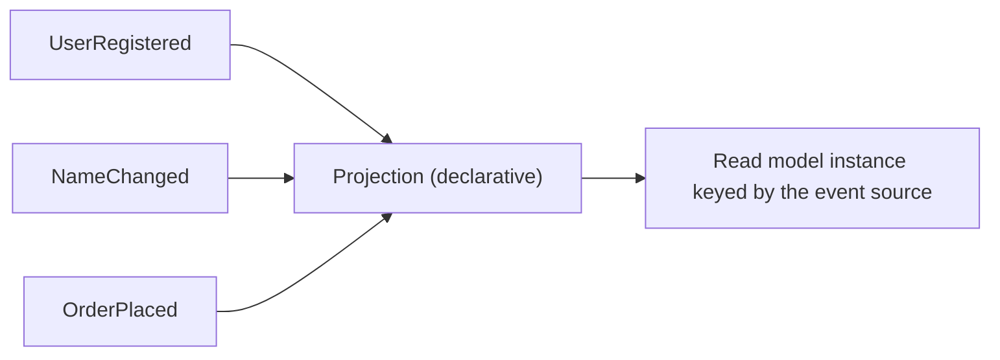

# Projection

A projection in Chronicle is a specialized observer. It is a declarative approach to describing
events you're interested in and how you want Chronicle to project it into something that you can
display in your application or provide as data for an API. Every projection can be very specialized
for the purpose it is being used in, in fact it is encouraged to create specialized projections
rather than reuse a projection for multiple scenarios. The reason for this is that you then don't
run the risk of serving multiple conflicting scenarios, which could for instance impact performance
and also general maintainability of your code.

Chronicle projections support relationships, one-to-one and one-to-many. It also supports functions that
allow you to count, add or subtract values. The identifier of the projected instance can also be
configured. By default it will use the [event source identifier](./event-source.md), but you can
point it to any other property or create a composite of multiple properties.

Projections can also use event metadata in composite keys. For example, a key based on the
`occurred` date groups events into time buckets for a histogram, with counts or totals per bucket.

## Next steps

- [Create your first projection](../tutorial/read-model.mdx) — build a queryable library catalog from events.
- [Projection reference](../projections/index.md) — choose a projection style and look up mapping and consistency options.
