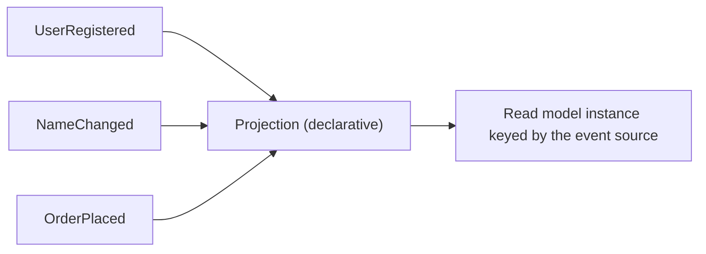

A projection declares how Cratis Chronicle turns events into a read model: the state a screen displays or
an API returns. It is an [observer](./observers.mdx), meaning it processes events as they arrive.
Use a projection when the view you need can be described as mappings, relationships, or calculations
over those events.

For example, the [.NET model-bound example](../projections/model-bound/index.mdx#basic-example)
uses `[FromEvent<MbIndexAccountOpened>]` on `MbIndexAccountInfo`. The event's `Name` maps to the
same-named read model property. `[SetFrom<MbIndexAccountOpened>(nameof(MbIndexAccountOpened.InitialBalance))]`
maps `InitialBalance` into `Balance`. The event remains a record of opening the account; the read
model holds the values the application wants to query.

## Shape the view for its reader

The same events can feed several projections. Give a screen or API its own focused view when its
needs differ from other consumers. A shared model means every change must account for all those
consumers; separate models cost more definitions to maintain, but let their shapes evolve separately.

Chronicle supports one-to-one and one-to-many relationships between events, plus functions that
count, add, or subtract values. Projections join events, not other read models, so each view derives
from the event history rather than another view's update schedule.

## Choose what identifies an instance

By default, the [event source identifier](./event-source.md) identifies a projected instance. You
can instead use an event property or a composite of several properties. Event metadata can also
contribute to a key: grouping by the `occurred` date/time value lets a projection count or sum
values into histogram buckets.

That choice affects how you read the result. A materialized projection stores the derived view
and updates it asynchronously. An on-demand, passive read folds one event source's history; it is
not a substitute for a materialized view that joins other sources or uses an event-content key.
[Read model consistency](../read-models/consistency.md) explains the retrieval trade-off.

To implement the view, follow [Choose how to build a read model](../projections/choosing-a-read-model-style.mdx).
Start with model-bound attributes for straightforward mappings, and compare the fluent API or
reducer code when the definition needs more structure.
