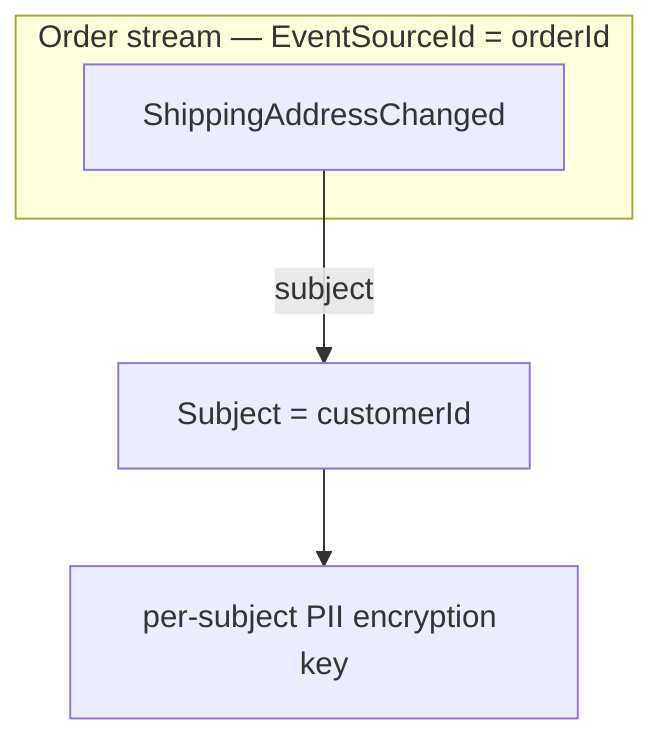

An event's subject in Cratis Chronicle identifies who the event is about and selects the key that protects its personally identifiable information (PII). Set it explicitly when the [`EventSourceId`](event-source.md) identifies something else, such as an order. The subject is not the actor who caused the event; that actor is recorded by [identity](./correlation-identity-causation.mdx#identity).

For a `ShippingAddressChanged` event, the `EventSourceId` can be the order identifier while the subject is the customer whose address changed. Using the customer as the subject groups their protected data under that person's key, even when events belong to different orders. Keys are scoped by event store, namespace and subject.

## Default — the `EventSourceId`

When you provide neither an explicit subject nor an event-property subject, Chronicle uses the `EventSourceId`. Keep this default when the event source already identifies the person the event is about:

<ChronicleClientTabs snippet="concepts/subject/default" />

## Specifying an explicit subject

Pass a subject explicitly when the event source identifies something else, such as an order. In .NET, `Subject` converts implicitly from `EventSourceId`, so you can supply an existing identifier without constructing a wrapper:

<ChronicleClientTabs snippet="concepts/subject/explicit" />

The .NET `Subject` type also converts implicitly from `string` and `Guid`. Kotlin, Java and TypeScript accept a subject through `AppendOptions`; TypeScript also accepts a `subject` on each entry passed to `appendMany`.

## Implicit subject with `[Subject]`

In .NET, mark the event property that identifies the person with `[Subject]`. The client reads its value when no explicit subject is provided. This keeps the choice with the event type instead of repeating it at every append:

<ChronicleClientTabs snippet="concepts/subject/implicit-with-attribute" />

An explicit `subject` argument takes precedence over a `[Subject]` property. Elixir can derive an append subject with `subject: :field` on the event type, and TypeScript can derive it from an event property marked `@subject()`. Kotlin and Java pass the append subject explicitly.

Read-model subject markers select the key used to decrypt protected values when a read model is returned. These are `@Subject` in Kotlin and Java, `@subject()` in TypeScript, and `subject :field` in Elixir. A Kotlin or Java read-model marker does not supply an event's append subject.

## Reading the subject back

The subject resolved at append time is returned as `EventContext.Subject` when you read the event sequence or receive the event in an observer, such as a reactor or reducer. If neither an explicit value nor an event property supplied a subject, the returned value is the `EventSourceId`.

When an observer forwards an event, pass `context.Subject` to preserve who the event is about. Otherwise, the destination can fall back to its own event source identifier and select a different compliance subject.

## Compliance

Properties marked as PII, for example with .NET's `[PII]`, are encrypted at append time under the subject's key. Chronicle provisions the key on first use and stores it in the encryption key store. Adding a PII marker later does not encrypt values already stored as plaintext.

Erasure deletes the subject's key revisions across event stores within the addressed namespace. Repeat the operation for each namespace holding that person's data. Events remain in the log, but their protected values cannot be decrypted without the deleted keys. This does not erase plaintext, exported copies or keys retained in backups.

Follow [Erasing a subject](./../compliance/erasing-a-subject) for the erasure procedure, including stopping in-flight PII writes and handling subsequent appends. [PII compliance](./../compliance/pii) explains how to mark the data that needs this protection.
