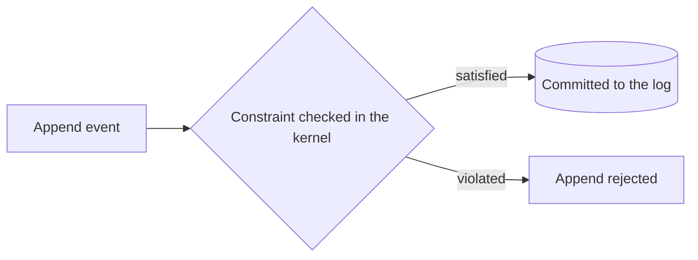

Chronicle constraints reject an append when it violates a registered uniqueness or stream-closure rule. Use them to reserve a value for one event source, allow a fact only once, or stop writes after a closing event. The Chronicle Kernel checks the rule, so it applies regardless of which client writes the event.

Each check stays within the namespace and event sequence receiving the append. Different namespaces have separate sets of unique values, as do different event sequences. A rule can cover several event types in that boundary, but it does not enforce uniqueness across tenants or across an event log and an outbox.

For the underlying concepts, see [Constraints at append time](../concepts/constraints.md).

## Why constraints matter

Checking whether a name is available in application code leaves a gap between the read and the write. Another writer may claim it in that gap. A constraint puts the rule inside the append instead of asking each writer to make the same check. It does not replace rules that need to count or compare state; those need a [decision read](../read-models/decision-reads.mdx) and a guarded append.

## Constraint types

Chronicle supports two types of uniqueness constraints and a constraint that closes streams:

| Rule you need | Constraint |
|---|---|
| Reserve a project name or email address so another event source cannot claim it | [Unique property](declarative/unique.mdx) |
| Initialize a project once, or allow one shift until a shift-ending event releases the rule | [Unique event type](declarative/unique-event-type.mdx) |
| Reject later writes in a chosen scope after a domain event closes it | [Closing stream](../closing-streams/index.mdx) |

A unique property constraint tracks ownership of a value; it does not reject the owning event source for using its own value again. A unique event type constraint tracks occurrences instead. Choose a closing stream constraint when the rule should block subsequent writes in the scope, not just a duplicate value or event type.

## Defining constraints

Choose where the declaration belongs:

| Approach | When to use |
|---|---|
| [Model-bound](model-bound/index.md) | Put the rule directly on an event type or property with attributes. Start here when the declaration fits the model. |
| [Declarative](declarative/) | Keep the rule in a dedicated class, combine event types with different property names, or compose a violation message with a callback. |

The .NET declarative API uses an `IConstraint` class and fluent builder calls. Other clients have different syntax and coverage; follow the client tabs on the rule's page rather than translating .NET calls literally.

## Tombstone markers do not close streams

The .NET `[Tombstone]` attribute does not close an event source or stream, reject later appends, or change the event type identity discovered by the client. Client discovery does not consume the attribute. The separate `Tombstone` field on event type identities and wire/storage representations does not enable closure through the attribute either.

Use an explicit [`[ClosesStream]` declaration](../closing-streams/closing-events.mdx) when a domain event should close a scope. The default scope combines event source id, event stream type, and event stream id; it does not close the whole event source. Choose broader dimensions deliberately: a source-only closure blocks every stream of that source. You can also restrict event sequences and name reopening event types. A reopening event removes only its constraint's closure, not a manual closure.

Adding or changing a closing declaration is not retroactive: it does not close scopes from historical events merely because the declaration was registered. A constraint reindex can rebuild event-driven closures from the log; it is an explicit repair operation, not a migration performed by adding the attribute. See [Closing streams: guarantees and limits](../closing-streams/index.mdx#guarantees-and-limits) before relying on a rebuild:

- The closing event becomes durable before the closure index update. They run in one kernel execution turn, so another append cannot interleave, but they are not crash-atomic. A lost update needs index recovery or reindexing; the marker supplies no extra guarantee.
- Manual closures are not rebuilt or removed by constraint reindexing.
- A redacted closing or reopening event whose scope came from a payload property may no longer contain enough information to rebuild that scope. Reindex leaves that constraint's closures untouched and reports the limitation.

Closure prevents new appends in the selected scope. It does not erase stored events, revoke read access, delete an aggregate, or release values held by uniqueness constraints. Reads and replays continue. Treat compliance erasure and authorization as separate concerns.

This distinction does not deprecate or remove `[Tombstone]`, change identity or wire fields, or introduce a migration.

## Constraint or decision read

A constraint checks a fixed rule about values and event types. It cannot count, sum or compare, so it cannot express "at most five courses per student" or "no more than the stock on hand". For a rule that depends on state, use a [decision read](../read-models/decision-reads.mdx) and a guarded append.

A constraint is checked inside the append for every writer, without an application read first. A decision read folds one key's history, meaning it applies the events to derive the state needed for the decision. It guards only the appends that carry it. [Choosing how a rule holds](../dynamic-consistency-boundary/choosing.mdx) compares them side by side.

A decision read cannot make a value unique across keys, and a constraint cannot count. [Scenarios](../dynamic-consistency-boundary/scenarios.mdx) shows each as code.

Know the limits of what a constraint covers:

- It is checked in one namespace and one event sequence. It does not span either.
- The index that records a claim is updated after the event is durable; the event and index update are not crash-atomic. If the update cannot complete, the kernel marks the affected index as pending and refuses governed appends with `ConstraintIndexUnavailable` while it catches up.
- It is not checked again when the kernel renumbers an append after a duplicate sequence number.

## Topics

- [Declarative](declarative/toc.yml): define a dedicated rule with builder calls.
- [Model-bound](model-bound/toc.yml): declare the rule on an event type or property.

