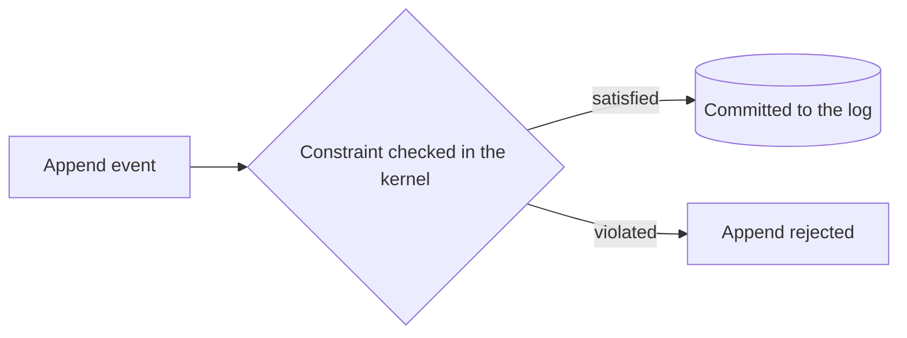

Constraints define server-side rules that must be satisfied before events are committed. They run inside the Chronicle Kernel and protect data integrity across event streams and event sources.

Use constraints to enforce rules like uniqueness across event types and event sources. Because constraints are evaluated in the kernel, they are consistent and apply to every client.

A constraint is checked within the event sequence an event is appended to, in the namespace it is appended in. It does not span namespaces, so each tenant has its own set of unique values, and it does not span event sequences.

## Why constraints matter

- Enforce invariants regardless of client behavior
- Provide consistent validation across all event sources
- Keep integrity logic close to the event store

## Constraint types

Chronicle supports two types of uniqueness constraints and a constraint that closes streams:

| Type | Description |
|---|---|
| **Unique property** | Enforces that a property value is unique across all events of one or more types |
| **Unique event type** | Enforces that only one event of a specific type can ever be appended per event source |
| **Closing stream** | Closes a stream scope when an event of a specific type is appended, so later appends inside the scope are rejected. See [Closing streams](../closing-streams/index.mdx) |

## Defining constraints

Chronicle provides two ways to define constraints:

| Approach | When to use |
|---|---|
| [Model-bound](model-bound/index.md) | Declaring constraints directly on event types using attributes — no separate class needed. **Preferred for most scenarios.** |
| [Declarative](declarative/) | Complex rules spanning multiple event types with different property names, or when you need a callback for constraint violation messages. |

## Constraint or decision read

A constraint checks a fixed rule about values and event types. It cannot count, sum or compare, so it cannot express "at most five courses per student" or "no more than the stock on hand". For a rule that depends on state, use a [decision read](../read-models/decision-reads.mdx) and a guarded append.

A constraint is checked inside the append for every writer, with no read first. A decision read folds one key's history and guards only the appends that carry it. [Choosing how a rule holds](../dynamic-consistency-boundary/choosing.mdx) compares them side by side.

A decision read cannot make a value unique across keys, and a constraint cannot count. [Scenarios](../dynamic-consistency-boundary/scenarios.mdx) shows each as code.

Know the limits of what a constraint covers:

- It is checked in one namespace and one event sequence. It does not span either.
- It is checked inside the append. The index that records the claim is updated after the event is durable. If that update fails, the failure is logged, and a later duplicate can pass until the constraint is reindexed.
- It is not checked again when the kernel renumbers an append after a duplicate sequence number.

## Topics

- [Declarative](declarative/toc.yml)
- [Model-bound](model-bound/toc.yml)

