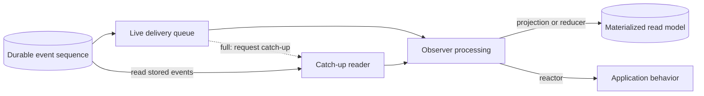

Suppose your application appends a `BookTitleChanged` event and a projection uses it to update a materialized book catalog. The append succeeds, but a query still returns the old title. Where is the change?

Chronicle stores the event and processes it through observers as separate work. Following the title change from storage to the catalog helps explain that old result—and where to look before deciding anything went wrong with the append.

## What a successful append means

On the normal append path, the Kernel confirms storage of the event before attempting live delivery. In this example, a successful result means the title-change event is stored in the event sequence. The projection may already be processing it, but the result does not tell you whether that work has finished.

An [observer](../../concepts/observers.mdx) consumes the events its subscription selects. A projection or reducer applies events to build a read model; a reactor runs application behavior, such as a side effect. For the catalog query to reflect the new title, the projection must apply the change and write it to read-model storage. Putting the event in a delivery queue is not that update.

This distinction matters when deciding what to do with an unexpected result. A schema or constraint rejection means the request was refused. A timeout or broken connection leaves the outcome unknown: the event may already have been stored. Do not append it again merely because the response is missing or the catalog still shows the old title.

## Why live delivery uses a queue

The live delivery queue holds batches of stored events for observer processing. It gives observers room to work without making each append wait for them to consume a batch. The queue is bounded by default, so that room has a limit; enqueueing uses the space available rather than waiting for consumers to drain it.

If events arrive faster than observers consume them, the queue can fill. The Kernel then removes that queue's live subscriptions and requests catch-up for those observers instead of waiting for space. The title-change event is already stored, so catch-up can read it from the event sequence rather than relying on a batch held in the live queue.

The two paths bring stored events to the same observer work. Live delivery passes them through the queue; catch-up retrieves them from the sequence with a reader. For the catalog, the projection then applies the title change and writes the read model. A reducer can also build a read model, while a reactor performs its application behavior. The append result does not report completion of that work on either path.

## How catch-up reads stored events

To read stored work, an observer needs a place to start. Its next-event position supplies that starting point, and catch-up uses a storage cursor to read a range of events in batches. This lets the observer work through stored history without the application recreating it with new appends.

The position says where to continue scanning, not that every partition has finished processing or every side effect has completed. It can move past events the subscription does not need. Failed partitions and partitions still catching up have separate state, so a high position alone cannot establish that the catalog contains the new title.

Appends can also arrive while an observer switches back to live delivery. The Kernel subscribes first, then checks the stored tail for relevant events it still needs to process. Existing catch-up work, pauses between catch-up attempts or failed partitions can postpone that check. If the check finds more work, the observer routes back to catch-up.

## When processing falls behind

To investigate the old title, follow the observer responsible for the catalog. Inspect it in the same event store and namespace as the application:

1. Start with [Chronicle diagnose](/cli/chronicle/diagnose/) to find health problems and incomplete checks. A check that could not run is not a healthy result.
2. Use [observer details](/cli/chronicle/observers/#show) to inspect the responsible observer's subscriptions, state and sequence position. Check that it actually subscribes to the event you expected to change the model.
3. [List its failed partitions](/cli/chronicle/failed-partitions/#list) and [inspect the affected partition](/cli/chronicle/failed-partitions/#show) for the failing sequence number, error and attempt history. Use that cause to choose the recovery described in the CLI guidance rather than treating lag alone as a reason to replay.

A healthy diagnostic report is not confirmation that a particular append has reached its read model. If your application needs its own write reflected before it reads, follow the [read-after-write guidance](../../read-models/consistency.md#read-after-write--waiting-for-a-materialized-read-model) rather than assuming append success includes materialization.
