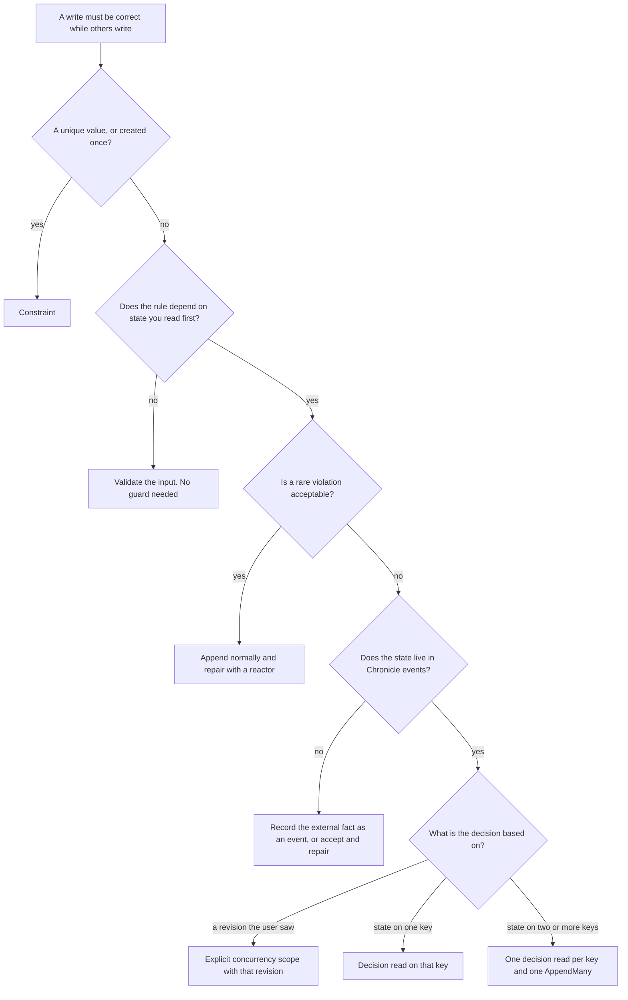

Use this page when you append events with the Chronicle client yourself (a minimal API, a controller, a worker, a console app) and a rule must stay true while other writers append at the same time. The code on these pages uses the .NET client. If you use Cratis Arc commands, start with [Choosing how a command's rule holds](/arc/backend/csharp/chronicle/consistency/) instead. It builds on this page.

## The short answer

- **A value must be unique, or something may be created only once:** declare a [constraint](../constraints/index.md). The kernel enforces it for every writer.
- **A rule depends on state you read first (a count, a stock, a status, a limit):** use a [decision read](../read-models/decision-reads.mdx) and append with `guardedBy`. The append is rejected if a relevant event arrived after the read.
- **A user edited something someone else changed in the meantime:** append with an explicit [concurrency scope](../events/concurrency.mdx) built from the revision the user saw.
- **A rule spans two keys:** take one decision read per key and append one event per event source in a single `AppendMany`.
- **A plain read never makes a rule hold.** An injected read model or `IReadModels` shows state. It does not capture a position and does not guard the append that follows.

Everything beyond this list is about picking between these, and about what each one costs.

## Where this fits in DCB

The [Dynamic Consistency Boundary](./index.md) pattern makes an append conditional on the facts a decision used. [Chronicle's mapping](./chronicle.md) has the details. In short:

- **Chronicle expresses the condition.** A concurrency scope holds a position and a filter. A decision read builds the scope for you and notes the position before it folds the state.
- **Chronicle adds constraints and checks.** Constraints enforce uniqueness for every writer without a read, and a decision read refuses shapes it cannot guard exactly.
- **Chronicle does not do everything DCB can.** Tags take no part in consistency, and an event has one event source ID, so a fact about two entities is two events in one `AppendMany`. [DCB examples in Chronicle](./dcb-examples.mdx) shows the Chronicle answer to each canonical DCB example.

## Decide by the shape of the rule

| Rule shape | Use | Alternatives | Never use | Too much |
|---|---|---|---|---|
| A value is unique (username, email, ISBN) | Constraint: `[Unique]` on the property, or an `IConstraint` | None needed. Choose per event source or per value, and release with a removal event | Reading a read model first, then appending | A decision read or a scope: they guard one key's history, not a value across keys |
| Something is created once | Constraint: `[Unique]` on the event type (one event of that type per event source) | `ExpectingNoMatchingEvent()` on the append for a one-off that is not worth a constraint | "Does it exist?" read, then append | A decision read |
| A rule over one key's history (cannot ship before payment, cannot cancel twice) | Decision read of a flat projection keyed by that event source | An explicit scope, with the tail captured before you read the events | A plain read model | Hand-rolled folds when a projection can express the state |
| Stock or count on one key (copies left, loans per member) | Decision read of a projection with `[Increment]` and `[Decrement]` | An explicit scope on the event types you counted | A materialized counter read with no guard | None, but see the cost of a hot key below |
| A rule across two keys (course capacity and a student's course limit) | One decision read per key, one event per event source, one `AppendMany` | Put every fact the rule needs on one event source, then use one read | Two separate appends, or a guard on only one side | None |
| An editing conflict (two people change the same record) | Explicit scope built from the revision the user saw | A decision read when the conflict only matters inside one request | Last writer wins by accident | A constraint |
| One stream inside an event source | A decision read scoped to the stream type and stream ID. Declare the stream with an [event source definition](../event-sources/index.mdx) so the read and the append share its names, see [Event sources and the Dynamic Consistency Boundary](../event-sources/dcb.mdx) | An explicit scope with stream type and stream ID | A read over the whole source when only one stream matters: you get conflicts from other streams | None |
| Rich behaviour (many rules over one lifecycle) | A decision read of a richer flat projection. In Arc, an aggregate root | Several decision reads, one per concern | Rules spread over validators and plain read-model checks | An aggregate where one counter rule would do |
| A rare violation is acceptable | Append normally, then repair: a [reactor](../reactors/index.mdx) appends a correcting event | A constraint for whatever part is cheap to enforce | Presenting a plain read as a guarantee | A decision read |
| A UX hint (disable a button, show "seats left") | A plain read of a materialized read model | None | Treating the hint as enforcement | A decision read: it costs several calls and a full fold |
| The rule depends on data outside Chronicle | Record the external fact as an event first, then decide on the event | Accept the risk and repair | Assuming a decision read covers it | None |
| A hot key with a long history | Keep each key's history short: split the key by period or by stream | A constraint if the rule is uniqueness. Accept an advisory read and repair | Ignoring the cost: every decision read folds the key's whole history again | None |

## A flowchart for the same choice

[Scenarios](./scenarios.mdx) shows each branch as code.

## How the options compare

| Option | Sees committed events | Captures a position before it reads | Guards the append | Use it for |
|---|---|---|---|---|
| Constraint | Not a read. Checked inside the append | Not needed | Yes, for every writer | Uniqueness, create once, closed streams |
| Decision read | Yes. It folds the key's events in a fresh session | Yes, before the fold | Yes: events of the model's types for that key after the position | State rules on one or a few keys |
| Explicit concurrency scope | Whatever you read | Only if you capture the tail before you read | Yes: events that match the scope after the position | Revisions the user saw, rules you read yourself |
| Default optimistic append | Not a read | Reads the tail at append time | Only the window between that read and the write | Nothing that depends on state |
| Plain read of a materialized read model (projection, reducer or self-reducing model) | No. It can lag the log | No | No | Display, hints |
| Plain read of a passive projection | Yes, at read time | No | No | Display, checks you will repair |
| Plain read of a passive reducer (classic or self-reducing) | Yes, at read time | No | No. A plain read guards nothing, but a qualifying reducer can be read as a [decision read](../read-models/decision-reads.mdx#reducers) | Display, checks you will repair |
| Reading the sink's database directly | No. Same lag as a materialized read | No | No | Reports. It couples you to the sink's schema, so avoid it in command logic |

Freshness depends on whether a read model is materialized or passive, not on whether a projection, a reducer or a self-reducing model builds it. Every read model is materialized unless it is passive: `[Passive]` on the read model, or `.Passive()` on a declarative projection. **Materialized** read models are stored and updated after the append returns. **Passive** ones are not stored. Chronicle folds them from the events when you read them. Passive reads are fresher, but neither kind records where in the log the read stopped, so neither can guard the append that follows.

Capturing the tail yourself before a plain read does not fix this. A materialized read model can lag the log, so the state you see can be older than the position you captured, and the events in between are neither seen nor guarded. A decision read folds a fresh session and checks that the fold reached the events it expected, which is why you should not rebuild it by hand.

This is the shape that looks safe and is not:

<ChronicleClientTabs snippet="dynamic-consistency-boundary/choosing/plain-read-race" variants="csharp" />

Two requests can both read `Claims` as `0` and both append. A constraint, or a decision read on the seat, closes that race.

In Arc, a `CommandValidator<T>` that reads a read model is also a plain read. See [Validators and protected decisions](/arc/backend/csharp/chronicle/consistency/validators/).

## What a decision read costs

A decision read does not use the stored read model. For each attempt the client:

1. Asks the kernel for the log's tail and for the tail of the key's model event types, in parallel.
2. Folds the key's events in a fresh session and starts a session cleanup request without waiting for it.
3. Retries, up to three attempts in total, if the fold stopped short of the second tail or ran past the first.

The first read of each model type in a process makes two more calls to list definitions. At commit the kernel runs one filtered tail query for each guarded key, in parallel. An append with no guard of your own still gets the default optimistic check: the client reads a tail when the append is made (the first append into a scope is unchecked unless configured otherwise) and the kernel validates it at commit. That protects only the short window between that read and the commit, not the decision you made earlier.

| Mechanism | Round trips | Work per read | Grows with |
|---|---|---|---|
| Constraint | None extra | An index lookup inside the append | Not expected to grow with history |
| Explicit scope | One tail call to capture the position | One filtered tail query at commit | Not measured |
| Materialized plain read | 1 | Reads the stored instance | Nothing |
| Passive plain read | 1 | The first read folds the key's history. Later reads apply newer events while the kernel keeps the instance in memory | History, on first read |
| Decision read | About 4 per attempt, up to 3 attempts, plus 2 on first use of a type | Folds the key's whole history of the model's event types, every time | History times reads |

A decision read is linear in the key's history and nothing caches it. Reads of one model type are expected to queue behind each other in the kernel, across keys. That has not been measured.

### Measured numbers

One run, on a loaded machine, so read the ratios and not the milliseconds.

| Operation (median ms) | 10 events on the key | 100 events on the key |
|---|---|---|
| Materialized `GetInstanceById` | 2.1 | 5.3 |
| Passive, instance already in memory | 3.7 | 8.7 |
| Passive, fresh fold | 8.1 | 13.9 |
| **Decision read (`GetDetached`)** | **12.7** | **22.6** |
| Tail call, then fetch the key's events and fold them yourself | 5.3 | 19.2 |

- **Environment:** the `cratis/chronicle:19.54.0-development` container with the `Cratis.Chronicle` 19.54.0 client, on an Apple M4 Pro with 12 cores and a load average of 80 to 100. The log held 20 other event sources with 500 events each. Each cell is the median of 20 samples. It is one run, and it was not repeated on later versions.
- **Result:** a decision read took about 1.6 times a fresh passive fold and 4 to 6 times a materialized read. It added roughly 10 to 20 ms over a materialized read.
- **Guarded append:** the extra cost of the guarded commit was lost in the noise. A read plus guarded append totalled 31.7 ms at 10 events and 19.9 ms at 100 events. The drop is noise, not a trend.
- **Not measured:** 1,000 and 10,000 events on the key, concurrent writers, the SQL storage provider, and the kernel queueing described above. The cost at those sizes follows the measured growth from 10 to 100 events (the decision read roughly doubled for ten times the events) and the linear fold. Measure your own model before you rely on it.

## When not to use a decision read

| Do not use it when | Because | Use instead |
|---|---|---|
| The rule is uniqueness or create-once | A constraint is checked inside the append, costs no extra reads and covers every writer | [Constraint](../constraints/index.md) |
| The read feeds a screen or a hint | You pay for a fresh fold and a guard you do not use | A plain read |
| The state has joins, children, derivatives or a key that is not the event source ID, or is a reducer with filters or constructor dependencies | Chronicle refuses these shapes. A guard it cannot compute exactly would be wrong | A flat projection keyed by event source, or a reducer without filters or dependencies. See [admitted projections](../read-models/decision-reads.mdx#admitted-projections) and [reducers](../read-models/decision-reads.mdx#reducers) |
| The key has a long history and many writers | Each read folds the whole history and conflicts rise with the write rate | Shorter keys, or accept an advisory read and repair |
| The data lives outside the Chronicle event log | Nothing in the log can invalidate it | Record the fact as an event |

### Why protection is opt-in

Chronicle does not guard a decision unless you ask. An `Append` with no scope gets only the default optimistic check, which covers the moment between reading the tail and writing. A decision read protects only the append you pass it to. In Arc, a command opts in with `[ProtectedDecision]`.

- **Existing code keeps its behavior.** The Arc change that introduced protected decisions states that unmarked commands keep their current behavior. Turning protection on everywhere would change what many existing commands do.
- **Protection fails closed.** A protected path refuses what it cannot guard exactly: reducers with filters or dependencies, joins, validators with dependencies, and commits of the unit of work by anyone but its owner, such as an aggregate's own `Commit()`. Code that works today and guards nothing would start to fail.
- **It has a price.** The cost above is acceptable per rule. It is not free for every read.
- **Other systems choose differently.** The [DCB specification](https://dcb.events/specification/) makes the append condition optional per append. [Axon Framework 5](https://docs.axoniq.io/axon-framework-reference/5.3/events/event-store-internals/) attaches the consistency marker automatically for a sourced entity. [KurrentDB](https://docs.kurrent.io/clients/node/v1.3/appending-events) defaults to no check.

There is no application-wide switch in Arc or Chronicle that makes protection the default.

## Where guarantees do not hold

"Silent" means the rule can fail with no error and no failed result.

| Situation | What happens | Silent or loud | What to do |
|---|---|---|---|
| You ignore the `AppendResult` | A constraint or concurrency rejection is a result, not an exception. The write is lost | Silent | Always check `IsSuccess`, then the specific violations |
| You commit the request's unit of work after the response | The ASP.NET Core middleware commits after the action returns. It does not report a concurrency conflict to the caller | Silent to the caller | Call `IUnitOfWorkCompletionFeature.CommitAsync()` before you respond |
| You take a decision read through the unit of work, then call plain `eventLog.Append` | The append is immediate and takes no part in the unit of work, so the guard never applies | Silent | Stage with `eventLog.Transactional.Append`, or use `GetDetached` with `AppendMany(guardedBy:)` |
| A scope has no sequence number and no `ExpectingNoMatchingEvent()` | The kernel skips it | Silent. `ConcurrencyCheckPerformed` is `false` | Build scopes with a position, and assert `ConcurrencyCheckPerformed` in tests |
| You capture the tail after you read the facts | Events appended in between are not guarded | Silent | Capture the tail first, or use a decision read |
| The first append into a scope | Not checked by default, so two concurrent creators both pass | Silent | Use a constraint, `ExpectingNoMatchingEvent()`, or a decision read: it guards an absent model too. See [the first append](../events/concurrency.mdx#the-first-append-into-a-scope-is-not-checked-by-default) |
| You use a plain read for the decision | It guards nothing | Silent | See the table above |
| The decision-read model has no `Id` property, or its shape is refused | `DecisionReadRefused`, with a reason | Loud | Fix the model. Check with `Admit<T>()` in a test |
| The read model is keyed on a different event source than the one where the facts are written | The model is empty or partial, and the guard watches the wrong source | Silent | Append every fact the rule needs on the source you read |
| New keys can join the set the rule counts over | A key nobody read is in nobody's guard | Silent | Model the rule on one key that carries the facts |
| Revise, redact, a migration, another event sequence, or a projection definition changed elsewhere | A decision read does not detect them | Silent | Treat them as outside the guarantee |
| A writer decides on the same rule without a guard | A guard detects its event whoever wrote it, but the unguarded writer's own decision is not protected and can break the rule | Silent | Guard every writer that decides on the rule, or use a constraint, which the kernel checks for every append |
| A conflict | The append is rejected and nothing is written. Chronicle does not retry | Loud | Read again and resubmit |
| A constraint's claim cannot be recorded after the event is durable | The event stays. A later duplicate can pass until you reindex the constraint | Silent, logged | Watch for the logged failure, and reindex |
| A constraint across namespaces or event sequences | Constraints do not span them | Silent | Design the unique value per namespace |
| Non-.NET writers append GUID event source IDs in another casing or format | The decision read's key no longer matches | Silent | Use lowercase canonical form in every writer |
| A long or hot key | Reads get slower and conflicts more likely. Results are not wrong | Slow | Shorten the key's history |
| A repair reactor triggers an irreversible side effect | A compensating event cannot undo it | Silent | Repair with events only, and make the repair safe to run twice |
| Your tests never interleave a competing append | The race is never exercised | Silent | Append a competing event between the read and the guarded append, and assert the conflict. For Arc commands see the [pitfalls](/arc/backend/csharp/chronicle/consistency/pitfalls/) |

For the retry inside the kernel after a duplicate sequence number: the kernel renumbers the append and validates concurrency scopes again before it retries, so decision-read guards keep working. It does not run constraints again on that path.

## What Arc adds

| Arc feature | What it gives you | Where to read |
|---|---|---|
| `[ProtectedDecision]` with `DecisionRead<T>` | A command that takes decision reads as parameters and commits them as the owner | [Choosing how a command's rule holds](/arc/backend/csharp/chronicle/consistency/) |
| Stream decisions (`IStreamReads`) | A guard on every event in one stream | [Stream decisions](/arc/backend/csharp/chronicle/commands/stream-decisions/) |
| Aggregate roots | A guard on the event types the aggregate handles, taken before the events are applied | [Aggregate roots](/arc/backend/csharp/chronicle/aggregates/) |
| `CommandValidator<T>` | Shape rules. A validator that reads state is a plain read | [Validators and protected decisions](/arc/backend/csharp/chronicle/consistency/validators/) |

## Next steps

- [Scenarios](./scenarios.mdx): each rule shape as working code.
- [Decision reads](../read-models/decision-reads.mdx): the API, admission rules and limits.
- [Read protection](../read-models/read-protection.mdx): make a host refuse unguarded reads and immediate appends.
- [DCB examples in Chronicle](./dcb-examples.mdx): the canonical DCB examples, the Chronicle way.
- [Concurrency](../events/concurrency.mdx): scopes, the builder and the first-append check.
- [Event sources and streams](../event-sources/index.mdx): declare the dimensions an append is guarded by.
- [Questions and answers](./faq.md).
