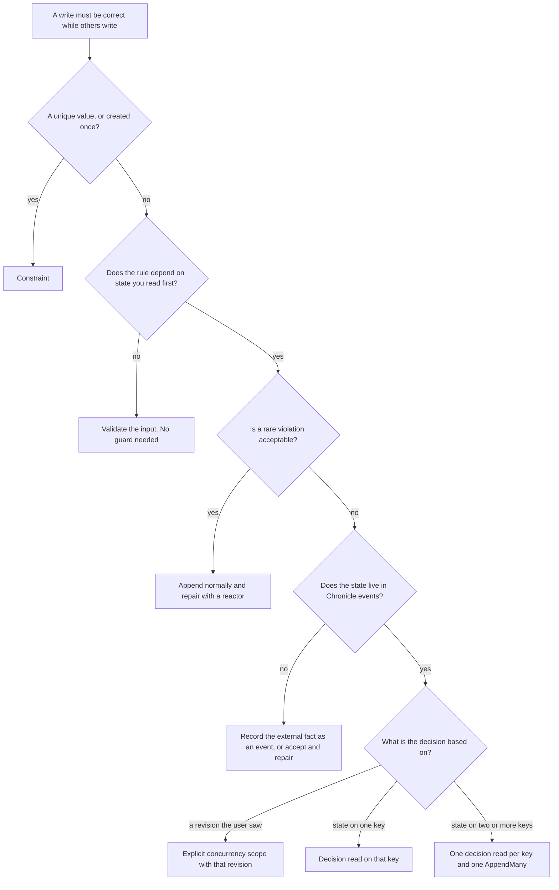

Use this page when you append events with the Chronicle client yourself (a minimal API, a controller, a worker, a console app) and a rule must stay true while other writers append at the same time. The code on these pages uses the .NET and Elixir clients. If you use Cratis Arc commands, start with [Choosing how a command's rule holds](/arc/backend/csharp/chronicle/consistency/) instead. It builds on this page.

## The short answer

- **A value must be unique, or something may be created only once:** declare a [constraint](../constraints/index.md). The kernel enforces it for every writer.
- **A rule depends on state you read first (a count, a stock, a status, a limit):** use a [decision read](../read-models/decision-reads.mdx) and append with `guardedBy`. The append is rejected if a relevant event arrived after the read.
- **A user edited something someone else changed in the meantime:** append with an explicit [concurrency scope](../events/concurrency.mdx) built from the revision the user saw.
- **A rule spans two keys:** take one decision read per key and append one event per event source in a single `AppendMany`.
- **A plain read never makes a rule hold.** An injected read model or `IReadModels` shows state. It does not capture a position and does not guard the append that follows.

Everything beyond this list is about picking between these, and about what each one costs.

## Where this fits in DCB

The [Dynamic Consistency Boundary](./index.md) pattern makes an append conditional on the facts a decision used. [Chronicle's mapping](./chronicle.md) has the details. In short:

- **Chronicle expresses the condition.** A concurrency scope holds a position and a filter. A decision read builds the scope for you and notes the position before it folds the state.
- **Chronicle adds constraints and checks.** Constraints enforce uniqueness for every writer without a read, and a decision read refuses shapes it cannot guard exactly.
- **Chronicle does not do everything DCB can.** Tags take no part in consistency, and an event has one event source ID, so a fact about two entities is two events in one `AppendMany`. [DCB examples in Chronicle](./dcb-examples.mdx) shows the Chronicle answer to each canonical DCB example.

## Decide by the shape of the rule

| Rule shape | Use | Alternatives | Never use | Too much |
|---|---|---|---|---|
| A value is unique (username, email, ISBN) | Constraint: `[Unique]` on the property, or an `IConstraint` | None needed. Choose per event source or per value, and release with a removal event | Reading a read model first, then appending | A decision read or a scope: they guard one key's history, not a value across keys |
| Something is created once | Constraint: `[Unique]` on the event type (one event of that type per event source) | `ExpectingNoMatchingEvent()` on the append for a one-off that is not worth a constraint | "Does it exist?" read, then append | A decision read |
| A rule over one key's history (cannot ship before payment, cannot cancel twice) | Decision read of a flat projection keyed by that event source | An explicit scope, with the tail captured before you read the events | A plain read model | Hand-rolled folds when a projection can express the state |
| Stock or count on one key (copies left, loans per member) | Decision read of a projection with `[Increment]` and `[Decrement]` | An explicit scope on the event types you counted | A materialized counter read with no guard | None, but see [the cost of a hot key](./limits.mdx#what-a-decision-read-costs) |
| A rule across two keys (course capacity and a student's course limit) | One decision read per key, one event per event source, one `AppendMany` | Put every fact the rule needs on one event source, then use one read | Two separate appends, or a guard on only one side | None |
| An editing conflict (two people change the same record) | Explicit scope built from the revision the user saw | A decision read when the conflict only matters inside one request | Last writer wins by accident | A constraint |
| One stream inside an event source | A decision read scoped to the stream type and stream ID. Declare the stream with an [event source definition](../event-sources/index.mdx) so the read and the append share its names, see [Event sources and the Dynamic Consistency Boundary](../event-sources/dcb.mdx) | An explicit scope with stream type and stream ID | A read over the whole source when only one stream matters: you get conflicts from other streams | None |
| A monthly or per-process limit on one account, where a whole-source read would mix periods | A [per-stream read model](../read-models/per-stream.mdx): `[EventStream<TSource>("Transactions")]` on the model, read with the stream ID. It is passive and folds that one stream | A stream-scoped decision read of a [source-keyed projection](../read-models/decision-reads.mdx#scoped-to-one-event-stream) you declare yourself | A key-only read of the model: it is refused | A materialized, whole-account model |
| Every decision read in a command or request host must be guarded, with no way to forget one | [Read protection](../read-models/read-protection.mdx): `EnforceReadProtection()` on the unit of work. In Arc, set read protection to On | `IDecisionReads.Get` and `AppendMany(guardedBy:)` on each append you write yourself | Plain `IReadModels` reads and immediate appends in the same invocation: they are refused | Read protection around one guarded append |
| Rich behaviour (many rules over one lifecycle) | A decision read of a richer flat projection. In Arc, an aggregate root | Several decision reads, one per concern | Rules spread over validators and plain read-model checks | An aggregate where one counter rule would do |
| A rare violation is acceptable | Append normally, then repair: a [reactor](../reactors/index.mdx) appends a correcting event | A constraint for whatever part is cheap to enforce | Presenting a plain read as a guard | A decision read |
| A UX hint (disable a button, show "seats left") | A plain read of a materialized read model | None | Treating the hint as enforcement | A decision read: it costs several calls and a full fold |
| The rule depends on data outside Chronicle | Record the external fact as an event first, then decide on the event | Accept the risk and repair | Assuming a decision read covers it | None |
| A hot key with a long history | Keep each key's history short: split the key by period or by stream | A constraint if the rule is uniqueness. Accept an advisory read and repair | Ignoring the cost: every decision read folds the key's whole history again | None |

## A flowchart for the same choice

[Scenarios](./scenarios.mdx) shows each branch as code.

## How the options compare

| Option | Sees committed events | Captures a position before it reads | Guards the append | Use it for |
|---|---|---|---|---|
| Constraint | Not a read. Checked inside the append | Not needed | Yes, for every writer | Uniqueness, create once, closed streams |
| Decision read | Yes. It folds the key's events in a fresh session | Yes, before the fold | Yes: events of the model's types for that key after the position | State rules on one or a few keys |
| Explicit concurrency scope | Whatever you read | Only if you capture the tail before you read | Yes: events that match the scope after the position | Revisions the user saw, rules you read yourself |
| Default optimistic append | Not a read | Reads the tail at append time | Only the window between that read and the write | Nothing that depends on state |
| Plain read of a materialized read model (projection, reducer or self-reducing model) | No. It can lag the log | No | No | Display, hints |
| Plain read of a passive projection | Yes, at read time | No | No | Display, checks you will repair |
| Plain read of a passive reducer (classic or self-reducing) | Yes, at read time | No | No. A plain read guards nothing, but a qualifying reducer can be read as a [decision read](../read-models/decision-reads.mdx#reducers) | Display, checks you will repair |
| Reading the sink's database directly | No. Same lag as a materialized read | No | No | Reports. It couples you to the sink's schema, so avoid it in command logic |

Freshness depends on whether a read model is materialized or passive, not on whether a projection, a reducer or a self-reducing model builds it. Every read model is materialized unless it is passive: `[Passive]` on the read model, or `.Passive()` on a declarative projection. **Materialized** read models are stored and updated after the append returns. **Passive** ones are not stored. Chronicle folds them from the events when you read them. Passive reads are fresher, but neither kind records where in the log the read stopped, so neither can guard the append that follows.

Capturing the tail yourself before a plain read does not fix this. A materialized read model can lag the log, so the state you see can be older than the position you captured, and the events in between are neither seen nor guarded. A decision read folds a fresh session and checks that the fold reached the events it expected, which is why you should not rebuild it by hand.

This is the shape that looks safe and is not:

<ChronicleClientTabs snippet="dynamic-consistency-boundary/choosing/plain-read-race" variants="csharp,elixir" />

Two requests can both read `Claims` as `0` and both append. A constraint, or a decision read on the seat, closes that race.

A read model injected into an Arc command or validator is also a plain read unless Arc is set to guard it. See [Validators and protected decisions](/arc/backend/csharp/chronicle/consistency/validators/).

## When not to use a decision read

| Do not use it when | Because | Use instead |
|---|---|---|
| The rule is uniqueness or create-once | A constraint is checked inside the append, costs no extra reads and covers every writer | [Constraint](../constraints/index.md) |
| The read feeds a screen or a hint | You pay for a fresh fold and a guard you do not use | A plain read |
| The state has joins, children, derivatives or a key that is not the event source ID, or is a classic reducer with filters or constructor dependencies other than `ILogger<T>` | Chronicle refuses these shapes, because a guard it cannot compute exactly would be wrong. A self-reducing read model is exempt from the dependency rule | A flat projection keyed by event source, or a reducer without filters, and without dependencies unless it is self-reducing. See [admitted projections](../read-models/decision-reads.mdx#admitted-projections) and [reducers](../read-models/decision-reads.mdx#reducers) |
| The key has a long history and many writers | Each read folds the whole history and conflicts rise with the write rate | Shorter keys, or accept an advisory read and repair |
| The data lives outside the Chronicle event log | Nothing in the log can invalidate it | Record the fact as an event |

The same applies to the other mechanisms:

| Do not use | When | Use instead |
|---|---|---|
| A [constraint](../constraints/index.md) | The rule counts, sums or compares, or depends on state that changes over time | A decision read |
| An explicit concurrency scope | The decision is based on something you read yourself and you cannot capture the position before you read | A decision read, which notes the position first |
| Explicit scopes and decision reads together on one source | You are not under read protection: the append is refused | One of them, or read protection with a scope that covers every read. See [How guards are derived](./how-guards-are-derived.mdx#adding-an-explicit-scope) |
| A per-stream read model | The rule spans the whole source, or another stream, or the key is the stream ID, or it must be a reducer | A whole-source decision read, or a stream-scoped read of a projection you declare |
| Read protection | You guard one append and pass the read to `AppendMany(guardedBy:)`, the rule is a uniqueness rule, or you do not own the code that begins and completes the unit of work | The guarded append, or a constraint |

### Why protection is opt-in

Chronicle does not guard a decision unless you ask. An `Append` with no scope gets only the default optimistic check, which covers the moment between reading the tail and writing. A decision read protects only the append you pass it to. A host opts in for a whole invocation with [read protection](../read-models/read-protection.mdx). Arc's own switch is described on [its consistency page](/arc/backend/csharp/chronicle/consistency/).

- **Existing code keeps its behavior.** Turning protection on everywhere would change what many existing commands do.
- **Protection fails closed.** A protected path refuses what it cannot guard exactly: classic reducers with filters or dependencies, joins, immediate appends, and commits of the unit of work by anyone but its owner, such as an aggregate's own `Commit()`. Code that works today and guards nothing would start to fail.
- **It has a price.** The [cost](./limits.mdx#what-a-decision-read-costs) is acceptable per rule. It is not free for every read.
- **Other systems choose differently.** The [DCB specification](https://dcb.events/specification/) makes the append condition optional per append. [Axon Framework 5](https://docs.axoniq.io/axon-framework-reference/5.3/events/event-store-internals/) attaches the consistency marker automatically for a sourced entity. [KurrentDB](https://docs.kurrent.io/clients/node/v1.3/appending-events) defaults to no check.

Chronicle has no application-wide switch that makes protection the default. You opt in per unit of work with `EnforceReadProtection()`.

## What Arc adds

| Arc feature | What it gives you | Where to read |
|---|---|---|
| Guarded read-model parameters on a command | The command's read models become decision reads, committed by the command's owner | [Choosing how a command's rule holds](/arc/backend/csharp/chronicle/consistency/) |
| Stream decisions (`IStreamReads`) | A guard on every event in one stream | [Stream decisions](/arc/backend/csharp/chronicle/commands/stream-decisions/) |
| Aggregate roots | A guard on the event types the aggregate handles, taken before the events are applied | [Aggregate roots](/arc/backend/csharp/chronicle/aggregates/) |
| `CommandValidator<T>` | Shape rules, and early feedback on state | [Validators and protected decisions](/arc/backend/csharp/chronicle/consistency/validators/) |

[Read protection](../read-models/read-protection.mdx#how-arc-uses-this-api) maps Arc's modes to the Chronicle API they drive.

## Next steps

- [Scenarios](./scenarios.mdx): each rule shape as working code.
- [Costs and limits](./limits.mdx): what a decision read costs and where a guard does not apply.
- [How guards are derived](./how-guards-are-derived.mdx): what an append conflicts with, and how guards merge.
- [Decision reads](../read-models/decision-reads.mdx): the API, admission rules and limits.
- [Read protection](../read-models/read-protection.mdx): make a host refuse unguarded reads and immediate appends.
- [DCB examples in Chronicle](./dcb-examples.mdx): the canonical DCB examples, the Chronicle way.
- [Concurrency](../events/concurrency.mdx): scopes, the builder and the first-append check.
- [Event sources and streams](../event-sources/index.mdx): declare the dimensions an append is guarded by.
- [Questions and answers](./faq.md).
