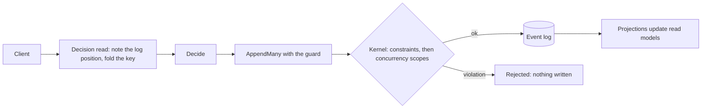

Use this page if you know the DCB pattern and want to see how Chronicle maps to it. For the idea itself, read [Dynamic Consistency Boundary](./index.md).

## The short answer

Chronicle can express a DCB append condition. A [concurrency scope](../events/concurrency.mdx) holds a position and a filter (event types, event source, stream), and the kernel rejects the append when a matching event exists after that position. A [decision read](../read-models/decision-reads.mdx) builds that scope for you: it notes the position before it folds the state you decide on.

Two differences matter:

- **Tags are not part of consistency.** A scope filters by event types and by the built-in metadata (event source ID, event source type, event stream type, event stream ID). Custom tags are stored and filterable, but they do not take part in concurrency checks.
- **Each event has exactly one event source ID.** A fact about two entities is written as two events, one per event source, in one atomic `AppendMany`.

## How the concepts map

| DCB concept | In Chronicle |
|---|---|
| Query | The filter of a concurrency scope. A decision read uses the key and the event types of its read model |
| Query item: event types are ORed | `EventTypes` on the scope: a match on any listed type |
| Query item: tags are ANDed | Event source ID, event source type, event stream type and event stream ID, each equal to one value, ANDed. Not tags |
| Several query items | Several scopes on one append. Any violation rejects the whole append. Two items on the same event source must be merged into one scope, which is wider but safe |
| `after` position | `SequenceNumber` on each scope. DCB has one position per condition, Chronicle one per scope |
| No `after`: no matching event may exist | `ExpectingNoMatchingEvent()` on the builder, or `EventSequenceNumber.BeforeFirst` |
| Note the position before reading | A decision read does it for you. By hand, call `GetTailSequenceNumber` before you read |
| Decision model | The state of a decision read: a flat projection keyed by the event source, over a finite set of event types |
| Append condition | `guardedBy:` on `AppendMany`, decision reads enrolled in a unit of work, or `concurrencyScopes:` / `concurrencyScope:` |
| Atomic append across entities | `AppendMany` is all-or-nothing across event sources. A unit of work commits as one `AppendMany` |
| Tags | Stored and filterable. Not part of the scope |
| An event with several tags (several entities) | One event source ID per event. Write one event per source |
| A globally unique value | A [constraint](../constraints/index.md) |

## How a decision flows

The kernel evaluates constraints first and then every scope, and writes nothing if either fails. Read models update afterwards, so a read after the append can still show old state for a moment.

## What Chronicle adds

- **Constraints.** The kernel enforces unique values, one event of a type per event source, and closed streams, for every writer, without a read. See [Constraints](../constraints/index.md).
- **Admission checks.** A decision read refuses a model it cannot guard exactly, such as a reducer, a join or a child collection, with a typed reason. It also checks that its fold reached the events it expected and retries up to three attempts.
- **Owner-only commit.** A unit of work that enrolled a decision read can be committed or rolled back only by its owner, so application code cannot commit it half-guarded.
- **Visible skipped checks.** `ConcurrencyCheckPerformed` on the append result says whether a scope was compared. A skipped check does not look like a passing one.
- **Conflicts mapped to your model.** `GetDecisionConflicts` tells you which read model and key changed, without exposing positions.

## What DCB can do that Chronicle cannot

- Query by arbitrary tags, or by several tags on one event.
- Put several independent query items on the same event source in one condition. Chronicle merges them into one wider scope.
- Decide from a projection that joins entities or is keyed by a property other than the event source. Decision reads refuse those shapes.
- Guard a read across event sequences. Decision reads and their guards apply to the event log only, and a unit of work cannot span event sequences.
- Target the default event stream ID specifically. The default acts as a wildcard.

Chronicle does not implement the DCB specification's API. It offers equivalent mechanics through its own.

## Metadata tags and custom tags

Scopes use these built-in metadata values:

| Value | Meaning |
|---|---|
| Event source ID | The entity or process the event belongs to |
| Event source type | The overarching concept, such as `Account` |
| Event stream type | A process related to the event source type, such as `Onboarding` |
| Event stream ID | Separates independent streams of one type, such as `Monthly` |
| Event types | Which event types the scope watches |

See [Concurrency](../events/concurrency.mdx#formalized-metadata-tags-for-concurrency) for how to scope by each. You can also attach [custom tags](../events/appending-with-tags.mdx) to events for categorization and filtering. They do not affect consistency.

## Aggregate roots and Arc

Chronicle has no aggregate root. If you prefer that style, Cratis Arc provides it on top of Chronicle and takes the position before the aggregate applies events. Arc also adds protected decisions, which take decision reads as command parameters. Read [Choosing how a command's rule holds](/arc/backend/csharp/chronicle/consistency/) and [Aggregate roots](/arc/backend/csharp/chronicle/aggregates/).

## Example: a rule across two entities

The course subscription rule needs two decision reads and two events. [Scenarios](./scenarios.mdx#a-rule-across-two-keys) shows the code.

## Next steps

- [Choosing how a rule holds](./choosing.mdx)
- [Scenarios](./scenarios.mdx)
- [Questions and answers](./faq.md)
- [Decision reads](../read-models/decision-reads.mdx)
- [Concurrency](../events/concurrency.mdx)
- [Appending with tags](../events/appending-with-tags.mdx)
