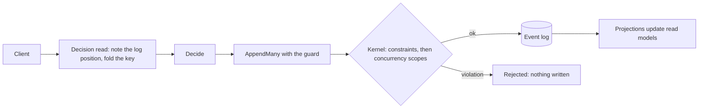

Use this page if you know the DCB pattern and want to see how Chronicle maps to it. For the idea itself, read [Dynamic Consistency Boundary](./index.md).

## The short answer

Chronicle supports DCB-style decision models and append conditions within its event-source model. It is not a DCB event store.

A [concurrency scope](../events/concurrency.mdx) holds a position and a filter (event types, event source, stream), and the kernel rejects the append when a matching event exists after that position. A [decision read](../read-models/decision-reads.mdx) builds that scope for you: it notes the position before it folds the state you decide on. That is a decision model and an append condition.

What Chronicle does not have is DCB's central idea, that **one event can belong to several domain concepts** through tags. In Chronicle:

- **Each event has exactly one event source ID** and single-valued stream metadata. There is no way to say that one event concerns both a student and a course.
- **Tags are not part of consistency.** A scope filters by event types and by the stream metadata, which is what plays the role of DCB's tags: event source ID, event source type, event stream type and event stream ID. Each has one value per event. Custom tags are stored and filterable, but they do not take part in concurrency checks.

A fact about two entities is therefore written as two events, one per event source, in one atomic `AppendMany`. That works, and it keeps both decisions correct. It does record one fact as two events, which DCB sets out to avoid. [When two events are acceptable](#when-one-fact-becomes-two-events) says when that is fine.

## What maps well

| DCB concept | In Chronicle |
|---|---|
| Decision model | The state of a decision read: a flat projection keyed by the event source, over a finite set of event types |
| Query | The filter of a concurrency scope. A decision read uses the key and the event types of its read model |
| Query item: event types are ORed | `EventTypes` on the scope: a match on any listed type |
| Query item: tags are ANDed | The stream metadata plays the role of the tags: event source ID, event source type, event stream type and event stream ID, each equal to one value, ANDed. An [event source definition](../event-sources/dcb.mdx) chooses which of them guard an append. Custom tags are not part of it |
| Several query items, ORed | Several scopes on one append. Any violation rejects the whole append. Two items on the same event source must be merged into one scope, which is wider but safe |
| `after` position, noted before the read | `SequenceNumber` on each scope. A decision read notes it before it folds. By hand, call `GetTailSequenceNumber` before you read |
| No `after`: no matching event may exist | `ExpectingNoMatchingEvent()` on the builder, or `EventSequenceNumber.BeforeFirst` |
| Append condition | `guardedBy:` on `AppendMany`, decision reads enrolled in a unit of work, or `concurrencyScopes:` and `concurrencyScope:` |
| Atomic append across entities | `AppendMany` is all-or-nothing across event sources. A unit of work commits as one `AppendMany` |
| Guarding a key that the decision only reads | A decision read's guard can sit on an event source that the append does not write to |
| A small, non-greedy decision model | One decision read per concern, narrowed to one stream when the rule is about one stream. See [Event sources and the Dynamic Consistency Boundary](../event-sources/dcb.mdx) |
| A globally unique value | A [constraint](../constraints/index.md) |

## What DCB can do that Chronicle cannot

- **Tag one event with several entities.** Chronicle gives an event one event source ID and one stream. One fact for two entities is two events.
- **Query for events tagged with both X and Y.** DCB ANDs tags inside one event, which is how its `studentAlreadySubscribed` projection finds the subscription of one student to one course. Chronicle has no form for "events concerning both". You read each entity's own history instead.
- **Use tags in the append condition.** Chronicle scopes do not carry custom tags. Anything the guard needs to distinguish must be an event source ID, event source type, stream type, stream ID or event type.
- **Put several independent query items on the same event source in one condition.** Chronicle merges them into one wider scope.
- **Decide from a projection that joins entities or is keyed by something other than the event source.** Decision reads refuse those shapes.
- **Guard a read across event sequences.** Decision reads and their guards apply to the event log only, and a unit of work cannot span event sequences.
- **Target the default event stream ID specifically.** The default acts as a wildcard.

Chronicle does not implement the DCB specification's API. It offers equivalent mechanics through its own.

## The Chronicle answer to each canonical DCB example

[DCB examples in Chronicle](./dcb-examples.mdx) shows each of these as code.

| DCB example | What DCB does | The Chronicle answer | Records a fact twice? |
|---|---|---|---|
| Course subscription | One event tagged with the student and the course, one decision model over both | Two decision reads and two events in one `AppendMany`, one per event source. Give the two events their own types so each read model counts only its own source's events | Yes, and each copy is a fact in its own entity's story |
| Unique username | Tag every claiming event with the username and query it | A `[Unique]` constraint on the property. The kernel enforces it for every writer | No |
| Invoice number | Query all invoices, next number is the last plus one | One numbering event source, a decision read of its last number, one event on that source | No |
| Opt-in token | Tag the sign-up events with the email and the token | Both events on the sign-up's own event source, checked against the sign-up the caller names | No |
| Dynamic product price | One decision model per cart item, built when the order is placed | One decision read per product in the cart, one event on the order's event source, guarded by every read | No |
| Idempotency | Tag the event with a client token and query the token | A `[Unique]` constraint on the token property, with an event source ID generated by the server | No |

### When one fact becomes two events

Two events for one fact is acceptable when each event is a fact in its own entity's history. A student subscribing to a course is an event in the course's story ("a student took a seat") and in the student's ("the student joined a course"). Giving them separate event types, such as `CourseSeatTaken` and `StudentJoinedCourse`, makes that explicit. It also keeps each read model to its own events: one type appended to both sources would create rows keyed by the wrong ids.

It is the wrong answer when the two copies are the same fact with the same meaning and nothing in either story needs it. Then look for a form with one event: a constraint, or one event on one source with a decision read over the other. The invoice number and the dynamic product price examples take that route. A decision read over a key you only read costs a fold but records nothing.

## How a decision flows

The kernel evaluates constraints first and then every scope, and writes nothing if either fails. Read models update afterwards, so a read after the append can still show old state for a moment.

## History mutation is outside the guarantee

Append conditions, including guards derived from decision reads, compare appended events against a position. A revision or redaction of an earlier event does not advance that boundary, so a decision made before the mutation can still commit. Constraints do not supply a history-mutation guard either.

Pause affected command producers and drain in-flight decisions before revising or redacting history, then resume with fresh reads. See the [contract and operational guidance](../events/concurrency.mdx#revisions-and-redactions-are-outside-append-conditions). An atomic mutation-epoch check is not available today.

## What Chronicle adds

- **Constraints.** The kernel enforces unique values, one event of a type per event source, and closed streams, for every writer, without a read. See [Constraints](../constraints/index.md).
- **Event source definitions.** A typed declaration of an event source and its streams, with the concurrency dimensions each stream is guarded by. See [Event sources and streams](../event-sources/index.mdx).
- **Closed streams.** A stream can be ended so no later append can invalidate a decision about it. See [Closing streams](../closing-streams/index.mdx).
- **Admission checks.** A decision read refuses a model it cannot guard exactly, such as a join, a child collection or a reducer with filters or constructor dependencies, with a typed reason. It also checks that its fold reached the events it expected and retries up to three attempts.
- **Owner-only commit.** A unit of work that enrolled a decision read can be committed or rolled back only by its owner, so application code cannot commit it half-guarded.
- **Visible skipped checks.** `ConcurrencyCheckPerformed` on the append result says whether a scope was compared. A skipped check does not look like a passing one.
- **Conflicts mapped to your model.** `GetDecisionConflicts` tells you which read model and key changed, without exposing positions.

## Metadata tags and custom tags

Scopes use these built-in metadata values:

| Value | Meaning |
|---|---|
| Event source ID | The entity or process the event belongs to |
| Event source type | The overarching concept, such as `Account` |
| Event stream type | A process related to the event source type, such as `Onboarding` |
| Event stream ID | Separates independent streams of one type, such as `Monthly` |
| Event types | Which event types the scope watches |

See [Concurrency](../events/concurrency.mdx#formalized-metadata-tags-for-concurrency) for how to scope by each, and [Event sources and streams](../event-sources/index.mdx) to declare them. You can also attach [custom tags](../events/appending-with-tags.mdx) to events for categorization and filtering. They do not affect consistency. DCB treats tags as part of the semantic model. In Chronicle they are a filter and a label.

## Aggregate roots and Arc

Chronicle has no aggregate root. If you prefer that style, Cratis Arc provides it on top of Chronicle and takes the position before the aggregate applies events. Arc also adds protected decisions, which take decision reads as command parameters. Read [Choosing how a command's rule holds](/arc/backend/csharp/chronicle/consistency/) and [Aggregate roots](/arc/backend/csharp/chronicle/aggregates/).

## Example: a rule across two entities

The course subscription rule needs two decision reads and two events. [Scenarios](./scenarios.mdx#a-rule-across-two-keys) shows the code.

## Next steps

- [Choosing how a rule holds](./choosing.mdx)
- [DCB examples in Chronicle](./dcb-examples.mdx)
- [Scenarios](./scenarios.mdx)
- [Questions and answers](./faq.md)
- [Event sources and the Dynamic Consistency Boundary](../event-sources/dcb.mdx)
- [Decision reads](../read-models/decision-reads.mdx)
- [Read protection](../read-models/read-protection.mdx)
- [Concurrency](../events/concurrency.mdx)
- [Appending with tags](../events/appending-with-tags.mdx)
