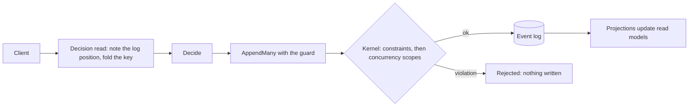

Chronicle supports Dynamic Consistency Boundary (DCB)-style decisions through fresh reads and conditional appends, using event source and stream metadata rather than custom tags. This lets one append depend on several entities' state, while each event still belongs to one event source. For the pattern itself, read [Dynamic Consistency Boundary](./index.md).

## The short answer

A [concurrency scope](../events/concurrency.mdx) holds a log position and a filter over event types, event source and stream metadata. The kernel rejects an append if a matching event exists after that position. A [decision read](../read-models/decision-reads.mdx) builds the scope for you: it records the position before folding events into the state you decide on. The state is the decision model; the scope supplies the append condition.

DCB also lets one event belong to several domain concepts through tags. Chronicle does not use that model. Each event has one event source ID and single-valued stream metadata. An event can carry another entity's ID in its payload, but a decision read on that other entity does not include it. Custom tags are stored and filterable; concurrency scopes do not use them.

When both entities need a fact in their histories, write two events in one atomic `AppendMany`, guarded by both reads. A source that only supplies facts for the decision needs a guard but no new event. [When two events are acceptable](#when-one-fact-becomes-two-events) explains the modeling choice.

## What maps well

| DCB concept | In Chronicle |
|---|---|
| Decision model | The state of a decision read: a supported projection or reducer over a finite set of event types, keyed by event source |
| Query | The filter of a concurrency scope. A decision read uses the key and the event types of its read model |
| Query item: event types are ORed | `EventTypes` on the scope: a match on any listed type |
| Query item: tags are ANDed | The stream metadata plays the role of the tags: event source ID, event source type, event stream type and event stream ID, each equal to one value, ANDed. An [event source definition](../event-sources/dcb.mdx) chooses which of them guard an append. Custom tags are not part of it |
| Several query items, ORed | Several scopes can guard one append; any violation rejects the batch. Decision reads on the same source merge into a wider scope. Explicit scope conjunctions can retain independent conditions |
| `after` position, noted before the read | `SequenceNumber` on each scope. A decision read notes it before it folds. By hand, call `GetTailSequenceNumber` before you read |
| No `after`: no matching event may exist | `ExpectingNoMatchingEvent()` on the builder, or `EventSequenceNumber.BeforeFirst` |
| Append condition | `guardedBy:` on `AppendMany`, decision reads enrolled in a unit of work, or `concurrencyScopes:` and `concurrencyScope:` |
| Atomic append across entities | `AppendMany` is all-or-nothing across event sources. A unit of work commits as one `AppendMany` |
| Guarding a key that the decision only reads | A decision read's guard can sit on an event source that the append does not write to |
| A tag that plays the role of a stream | The event stream type and event stream ID of a stream an [event source definition](../event-sources/dcb.mdx) declares |
| A boundary as wide as a stream | The dimensions a definition declares. Any event type in the range counts |
| One event with several tags | Not available. One value per dimension, so one event source and one stream per event |
| A small, non-greedy decision model | One decision read per concern, narrowed to one stream when the rule is about one stream, or a [per-stream read model](../read-models/per-stream.mdx) that always folds one stream |
| A globally unique value | A [constraint](../constraints/index.md) |

## What DCB can do that Chronicle cannot

| DCB capability | Chronicle boundary |
|---|---|
| One event belongs to several entities through tags | One event has one event source ID and one stream. If both histories need the fact, append an event to each source |
| A consistency query matches custom tags, such as both student and course | Scopes filter built-in metadata and event types, not custom tags. Read the facts from each source whose state matters |
| A decision model joins entities or uses a key unrelated to event source ID | Decision reads refuse these projection shapes; use separate supported reads |
| A read and its guard span event sequences | Decision reads apply to the event log, and a unit of work cannot span event sequences |
| A condition targets the default event stream ID specifically | The default acts as a wildcard |

Chronicle does not implement the DCB specification's API. Choose its constraints, decision reads and concurrency scopes according to the rule, rather than translating tag queries literally.

## The Chronicle answer to each canonical DCB example

[DCB examples in Chronicle](./dcb-examples.mdx) shows each of these as code.

| DCB example | What DCB does | The Chronicle answer | Records a fact twice? |
|---|---|---|---|
| Course subscription | One event tagged with the student and the course, one decision model over both | Two decision reads and two events in one `AppendMany`, one per event source. Give the two events their own types so each read model counts only its own source's events | Yes, and each copy is a fact in its own entity's story |
| Unique username | Tag every claiming event with the username and query it | A `[Unique]` constraint on the property. The kernel enforces it for every writer | No |
| Invoice number | Query all invoices, next number is the last plus one | One numbering event source, a decision read of its last number, one event on that source | No |
| Opt-in token | Tag the sign-up events with the email and the token | Both events on the sign-up's own event source, checked against the sign-up the caller names | No |
| Dynamic product price | One decision model per cart item, built when the order is placed | One decision read per product in the cart, one event on the order's event source, guarded by every read | No |
| Idempotency | Tag the event with a client token and query the token | A `[Unique]` constraint on the token property, with an event source ID generated by the server | No |

### When one fact becomes two events

A course subscription changes two histories: the course has one fewer seat, and the student has joined one more course. Separate types, such as `CourseSeatTaken` and `StudentJoinedCourse`, express those effects and let each read model count only its own source's events. Using one type on both sources would also create seat rows keyed by student IDs, and subscription rows keyed by course IDs.

Do not duplicate an event merely because the decision reads two entities. If the second history does not change, guard its read without writing to it. The product-price example reads product histories but writes only the order. For a unique value, a constraint can remove the need for a decision read altogether.

## How a decision flows

The kernel evaluates constraints first and then every scope, and writes nothing if either fails. Read models update afterwards, so a read after the append can still show old state for a moment.

## How history mutations affect a guard

A log position alone does not detect a revision or redaction of an earlier event. The .NET decision-read client also carries the kernel's mutation epoch, a counter that changes around history mutations, when the kernel reports it. The kernel rejects that guard if history is mutating or the epoch has changed. A scope without an epoch still checks appended events only; do not assume every client or kernel supplies this protection.

For the other boundaries, see [Costs and limits](./limits.mdx#what-is-outside-the-guard). When a path does not carry an epoch, follow the [operational guidance](../events/concurrency.mdx#revisions-and-redactions-are-outside-append-conditions) before changing history.

## What Chronicle adds

[Constraints](../constraints/index.md) enforce unique values, one event of a type per event source, and closed streams without an application read. Unlike a decision-read guard, they apply to every writer. [Event source definitions](../event-sources/index.mdx) name the sources, streams and dimensions used in a guard. A stream can also be [closed](../closing-streams/index.mdx) to prevent later appends.

Decision reads check whether a model can be guarded before reading it. Joins and child collections are refused, as are classic reducers with filters or constructor dependencies other than `ILogger<T>`. Self-reducing read models are exempt from the dependency rule. The client checks that the fold reached the expected events and makes up to three attempts. Once a read is enrolled in a unit of work, only its owner can commit or roll it back.

Check the append result as well as the read. `ConcurrencyCheckPerformed` distinguishes a skipped check from a passing one. `GetDecisionConflicts` maps a conflict back to the read model and key, with the conflicting event when the kernel reports it.

## Metadata tags and custom tags

Scopes use these built-in metadata values:

| Value | Meaning |
|---|---|
| Event source ID | The entity or process the event belongs to |
| Event source type | The overarching concept, such as `Account` |
| Event stream type | A process related to the event source type, such as `Onboarding` |
| Event stream ID | Separates independent streams of one type, such as `Monthly` |
| Event types | Which event types the scope watches |

See [Concurrency](../events/concurrency.mdx#formalized-metadata-tags-for-concurrency) for how to scope by each, and [Event sources and streams](../event-sources/index.mdx) to declare them. You can also attach [custom tags](../events/appending-with-tags.mdx) to events for categorization and filtering. They do not affect consistency. DCB treats tags as part of the semantic model. In Chronicle they are a filter and a label.

## Aggregate roots and Arc

Chronicle has no aggregate-root abstraction. Cratis Arc provides one on top of Chronicle and captures a position before the aggregate applies events. Arc can also manage decision reads and read protection around command execution. Start with [Choosing how a command's rule holds](/arc/backend/csharp/chronicle/consistency/) for the binding rules and explicit read allowances, or [Aggregate roots](/arc/backend/csharp/chronicle/aggregates/) for that programming model.

## Example: a rule across two entities

The course subscription rule needs two decision reads and two events. [Scenarios](./scenarios.mdx#a-rule-across-two-keys) shows the code.

## Next steps

Choose a mechanism first, then follow its example and API reference. Use the limits page before committing to a model with long histories or frequent conflicts.

- [Choosing how a rule holds](./choosing.mdx)
- [Costs and limits](./limits.mdx)
- [DCB examples in Chronicle](./dcb-examples.mdx)
- [Scenarios](./scenarios.mdx)
- [Questions and answers](./faq.md)
- [Event sources and the Dynamic Consistency Boundary](../event-sources/dcb.mdx)
- [Decision reads](../read-models/decision-reads.mdx)
- [Read protection](../read-models/read-protection.mdx)
- [Read models scoped to one event stream](../read-models/per-stream.mdx)
- [Concurrency](../events/concurrency.mdx)
- [Appending with tags](../events/appending-with-tags.mdx)
