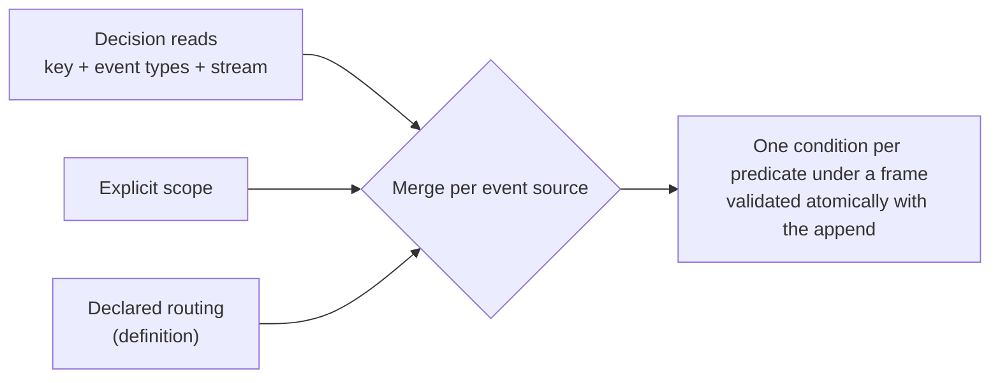

An append guard tells Cratis Chronicle which changes invalidate a write: it combines a position in the event log with a filter for the events that matter. The kernel rejects the append if a matching event arrived after that position. Trace the guard from your reads and scopes to understand a conflict or check that a rule watches the right facts.

The API names and read-protection merge rules below describe the .NET client. The inspection example also shows the Elixir client's way to examine enrolled reads.

## The parts of a guard

| Part | What it decides | Decision read | Explicit scope | Event source definition |
|---|---|---|---|---|
| Event source | Whose events count | The key you read | `WithEventSourceId` | The event's own source, when the definition declares `EventSourceId` |
| Event types | Which kinds of event count | The event types of the read model, including its removal types | `WithEventType` | None. Any type counts |
| Source type, stream type, stream ID | Which part of the source counts | Only for a stream-scoped read, with the values you pass | The builder | The dimensions the definition declares |
| Position | What the writer is assumed to have seen | The log's tail, captured before the read folds | The sequence number you captured | The tail, read when you append |

A decision read captures the position before it folds the events into state, so the guard covers changes during and after the read. With an explicit scope, capture the position before loading the facts yourself. A definition's default scope starts at append time and cannot protect an earlier decision. See [Choosing how a rule holds](./choosing.mdx).

A .NET decision read also captures a mutation epoch, the event sequence's counter for revisions and redactions. The kernel rejects its guard if that counter changes or the read captured a mutation in progress. This check covers the sequence, not just the events selected by the filter.

The guard is written with a `guard:` line in the examples below. It is a notation for this page. `IUnitOfWork.GetAppendConditions()` returns the real conditions, and their `ToString()` prints the same parts with event type IDs.

## One read, one guard

A read of a whole source guards the source, for the model's event types only.

```text
// GetDetached<MemberLoans>(member-1)
guard member-1: types=[MemberRegistered, LoanTaken, LoanReturned], after <tail at read>
```

A `BookRenamed` for the same member does not conflict, because the model does not use it. A `LoanTaken` for another member does not conflict, because the source differs.

A stream-scoped read adds the stream. The source type is added only when you pass one.

```text
// GetDetached<MonthlyWithdrawals>(BankAccount-7, "Transactions", "2026-10")
guard BankAccount-7: types=[MoneyWithdrawn], streamType=Transactions, streamId=2026-10, after <tail at read>
```

A withdrawal in `2026-11`, or a withdrawal on another account, does not conflict. See [A limit inside one stream](./scenarios.mdx#a-limit-inside-one-stream).

An absent model is guarded too. When no matching event existed at the read, an event of the model's types that arrives later conflicts. This is how "create it only if it does not exist yet" holds.

### Per-stream read models

A [per-stream read model](../read-models/per-stream.mdx) declares its stream with `[EventStream<TSource>("Transactions")]`. Its read must carry the declared event source type, the stream type and a stream ID, so the guard keeps all three dimensions. A read without them is refused, so the guard never falls back to the whole source.

```text
// GetDetached<WithdrawalsThisMonth>(BankAccount-7, "Transactions", "2026-10", "BankAccount")
guard BankAccount-7: types=[MoneyWithdrawn], sourceType=BankAccount, streamType=Transactions, streamId=2026-10, after <tail at read>
```

Under a read-protection frame, a second read in another month keeps a separate guard. Outside a frame, reads still merge as described below. [CHR0064](../code-analysis/CHR0064.mdx) reports a declaration that cannot produce this guard.

## Several reads on one source

A [read-protection frame](../read-models/read-protection.mdx) tracks reads for one unit of work under the host's read policy. Within it, reads with different predicates keep separate guards on the same source label when the kernel supports `concurrency-scope-conjunctions`. A predicate is the filter: source, event types and stream dimensions. Repeated reads of the same predicate retain the earliest position, including an absent model's expectation that no matching event exists. The kernel checks the guards atomically with the append, without making unrelated streams conflict.

Without that capability, protected reads fall back to a conservative merged guard. Each source or stream dimension survives only when its values agree across the contributions being merged; differing values widen the filter. The separate-guard examples below assume the capability is present.

Outside a frame, reads of the same source still merge into one guard. That legacy guard can only get wider, never narrower:

| What the reads share | The merged guard |
|---|---|
| Same source, same stream and source type | The union of the event types, from the earliest position |
| Same source, different stream type or stream ID | The union of the event types. Which stream values survive depends on where you commit, see below |
| Same source, different source types | The source type is dropped. Every source type counts |
| Different sources | One guard per source, validated together with the append |

The earliest position wins. An absent model, read before any matching event existed, counts as the earliest of all.

Where the reads are merged decides what happens to the stream values.

| Where | Stream type and stream ID | Event types |
|---|---|---|
| `AppendMany(guardedBy: reads)`, or a unit of work without a [read-protection frame](../read-models/read-protection.mdx) | Kept only when both are equal. If either differs, both are dropped | The union |
| A unit of work under a read-protection frame, with kernel conjunction support | Each predicate retains its stream type and ID in a separate guard | Each predicate retains its own event-type filter |

```text
// Two reads on BankAccount-7: Transactions/2026-10 and Transactions/2026-11

// outside a frame
guard BankAccount-7: types=[MoneyWithdrawn], any stream, after <earlier tail>

// under a frame
guard BankAccount-7: types=[MoneyWithdrawn], streamType=Transactions, streamId=2026-10, after <October tail>
guard BankAccount-7: types=[MoneyWithdrawn], streamType=Transactions, streamId=2026-11, after <November tail>
```

Outside a frame, a withdrawal in any month conflicts. Under a frame, only the two guarded months conflict. Legacy widening produces extra conflicts but cannot hide one; an ordered explicit scope list is another way to retain separate stream guards.

## Adding an explicit scope

An explicit scope can replace a read's guard only if it watches at least the same events from the same or an earlier position. A narrower scope would leave part of the decision unprotected.

| You combine | Result |
|---|---|
| A decision read and an explicit scope on one source, outside a read-protection frame | The append is refused with `DecisionReadConflictsWithConcurrencyScope`. Remove the scope or the read |
| A decision read and an explicit scope on one source, under a [read-protection frame](../read-models/read-protection.mdx) | The explicit scope is used if it covers everything the read watches and its position is not later than the read's. Otherwise `ExplicitScopeDoesNotCoverReads` |
| Two explicit scopes on one source, under a frame | Different predicates are retained. Contradictory expectations for the same predicate, or no guard mixed with a guard, throw `ConflictingExplicitScopes` with reads or `ConflictingContributionsOnLabel` without reads |
| A decision read and an aggregate-style contributed read on one source | `ReadAndAggregateOnSameSource` |

Two scopes mean the same when they have the same position and the same expectation, and each covers the other. Scopes that mean the same are merged into one.

[CHR0063](../code-analysis/CHR0063.mdx) reports a scope built for one stream of a definition and passed to an append that writes another stream.

A scope covers a read when its source, source type, stream type and stream ID are each unset or equal, its event types are empty or a superset, and its position is the same or earlier.

## Declared routing on a definition

An [event source definition](../event-sources/defining.mdx) can declare which dimensions guard an append. How that mixes with a read depends on where the append is made.

| Where | What the declared dimensions do to a decision read |
|---|---|
| `AppendMany(guardedBy: reads)` outside a frame | Nothing. The read's guard replaces the definition's default scope for that source |
| A unit of work under a [read-protection frame](../read-models/read-protection.mdx) | Read predicates remain intact. Different declared predicates add separate conditions at their own captured positions |
| An explicit scope under a frame | The explicit scope must cover the declared dimensions, or the commit is refused with `DeclaredRoutingNotCoveredByExplicitScope` |

A definition without a declared dimension, or with `None`, adds nothing. A declared set without `EventSourceId` becomes a separate guard that is not tied to the read, so it does not protect the state you read. [CHR0062](../code-analysis/CHR0062.mdx) reports it.

For example, an account declares the event source ID and the `Transactions` stream dimensions, and you read `MonthlyWithdrawals` for `2026-10`. Under a frame with kernel conjunction support, the read and the declared route contribute separate guards:

```text
// without the definition's dimensions
guard BankAccount-7: types=[MoneyWithdrawn], streamType=Transactions, streamId=2026-10, after <tail at read>

// with the definition's dimensions as an additional condition
guard BankAccount-7: types=[MoneyWithdrawn], streamType=Transactions, streamId=2026-10, after <tail at read>
guard BankAccount-7: any type, streamType=Transactions, streamId=2026-10, after <tail at routing resolution>
```

A deposit in `2026-10` after routing resolution now conflicts too, because the definition guards the whole month at that point. The read's earlier boundary still guards withdrawals. That is correct when the month is the consistency boundary. It is more than you need when only withdrawals matter. Declare dimensions only for streams where every writer should see every other, such as a ledger. See [Concurrency per event source and stream](../event-sources/concurrency.mdx).



## See what a commit guarded

In .NET, `GetAppendConditions()` exposes the conditions resolved for a commit under a read-protection frame. One source can have several `AppendCondition` entries when its predicates differ. Assert the filters and positions in a test, rather than checking only that a source has a guard. Each condition lists its `Origins`, such as `ProtectedRead` or `DeclaredRouting`, and the `Reads` behind it.

The Elixir example inspects the unit of work's enrolled decision reads before rolling it back; it does not return the .NET commit report.

<ChronicleClientTabs snippet="dynamic-consistency-boundary/how-guards-are-derived/see-the-guard" variants="csharp,elixir" />

For a test that races two writers without a frame, see [Test the race](./scenarios.mdx#test-the-race).

## Next steps

To change what a rule watches, start with [Choosing how a rule holds](./choosing.mdx), then use [Decision reads](../read-models/decision-reads.mdx) for model admission or [Concurrency](../events/concurrency.mdx) for the scope API. [Read protection](../read-models/read-protection.mdx) explains how a host refuses unguarded reads and immediate appends. For the meaning of the routing dimensions, see [Event sources](../concepts/event-source.md).
