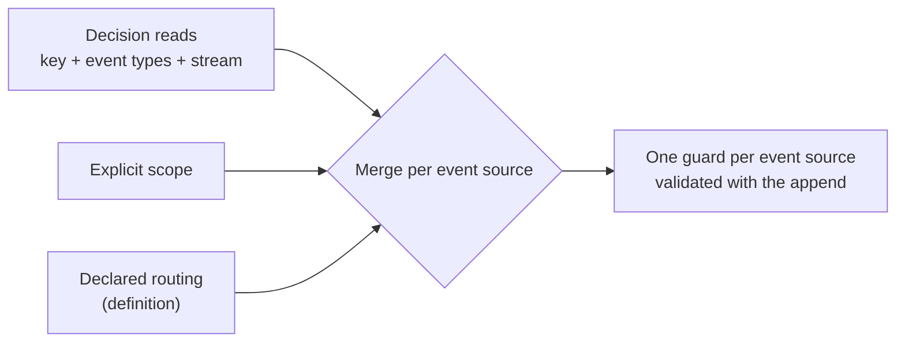

Use this page when you want to know exactly which events make an append fail. A guard is the append condition Chronicle sends to the kernel with the events: a position in the log, plus a filter. The kernel rejects the append if an event that matches the filter was appended after the position. Everything else on this page is about where the position and the filter come from.

## The parts of a guard

| Part | What it decides | Decision read | Explicit scope | Event source definition |
|---|---|---|---|---|
| Event source | Whose events count | The key you read | `WithEventSourceId` | The event's own source, when the definition declares `EventSourceId` |
| Event types | Which kinds of event count | The event types of the read model, including its removal types | `WithEventType` | None. Any type counts |
| Source type, stream type, stream ID | Which part of the source counts | Only for a stream-scoped read, with the values you pass | The builder | The dimensions the definition declares |
| Position | What the writer is assumed to have seen | The log's tail, captured before the read folds | The sequence number you captured | The tail, read when you append |

A decision read is the only form that captures the position before it reads the facts. That is why it can guard a decision. The other two guard only what you wire up yourself. See [Choosing how a rule holds](./choosing.mdx).

The guard is written with a `guard:` line in the examples below. It is a notation for this page. `IUnitOfWork.GetAppendConditions()` returns the real conditions, and their `ToString()` prints the same parts with event type IDs.

## One read, one guard

A read of a whole source guards the source, for the model's event types only.

```text
// GetDetached<MemberLoans>(member-1)
guard member-1: types=[MemberRegistered, LoanTaken, LoanReturned], after <tail at read>
```

A `BookRenamed` for the same member does not conflict, because the model does not use it. A `LoanTaken` for another member does not conflict, because the source differs.

A stream-scoped read adds the stream. The source type is added only when you pass one.

```text
// GetDetached<MonthlyWithdrawals>(BankAccount-7, "Transactions", "2026-10")
guard BankAccount-7: types=[MoneyWithdrawn], streamType=Transactions, streamId=2026-10, after <tail at read>
```

A withdrawal in `2026-11`, or a withdrawal on another account, does not conflict. See [A limit inside one stream](./scenarios.mdx#a-limit-inside-one-stream).

An absent model is guarded too. When no matching event existed at the read, an event of the model's types that arrives later conflicts. This is how "create it only if it does not exist yet" holds.

## Several reads on one source

Reads of the same source merge into one guard. The merged guard can only get wider, never narrower, so it never misses a change that either read would have caught.

| What the reads share | The merged guard |
|---|---|
| Same source, same stream | The union of the event types, from the earliest position |
| Same source, different stream types or stream IDs | The union of the event types. Both stream dimensions are dropped, so every stream of the source counts |
| Same source, different source types | The source type is dropped. Every source type counts |
| Different sources | One guard per source, validated together with the append |

```text
// Two reads on BankAccount-7: Transactions/2026-10 and Transactions/2026-11
guard BankAccount-7: types=[MoneyWithdrawn], any stream, after <earlier tail>
```

The widening produces extra conflicts. It cannot hide one. If a rule needs two streams, read the whole source once instead, so the guard says what it covers.

## Adding an explicit scope

Chronicle does not guess whether your own scope is enough. It checks.

| You combine | Result |
|---|---|
| A decision read and an explicit scope on one source, outside a read-protection frame | The append is refused with `DecisionReadConflictsWithConcurrencyScope`. Remove the scope or the read |
| A decision read and an explicit scope on one source, under a [read-protection frame](../read-models/read-protection.mdx) | The explicit scope is used if it covers everything the read watches and its position is not later than the read's. Otherwise `ExplicitScopeDoesNotCoverReads` |
| Two different explicit scopes on one source | `ConflictingExplicitScopes` with a read, `ConflictingContributionsOnLabel` without one |
| A decision read and an aggregate-style contributed read on one source | `ReadAndAggregateOnSameSource` |

A scope covers a read when its source, source type, stream type and stream ID are each unset or equal, its event types are empty or a superset, and its position is the same or earlier.

## Declared routing on a definition

An [event source definition](../event-sources/defining.mdx) can declare which dimensions guard an append. How that mixes with a read depends on where the append is made.

| Where | What the declared dimensions do to a decision read |
|---|---|
| `AppendMany(guardedBy: reads)` outside a frame | Nothing. The read's guard replaces the definition's default scope for that source |
| A unit of work under a [read-protection frame](../read-models/read-protection.mdx) | They merge into the guard. The declared dimensions are kept only where they equal the read's. Event types become any type. The read's position is kept |
| An explicit scope under a frame | The explicit scope must cover the declared dimensions, or the commit is refused with `DeclaredRoutingNotCoveredByExplicitScope` |

A definition without a declared dimension, or with `None`, adds nothing. A declared set without `EventSourceId` becomes a separate guard that is not tied to the read, so it does not protect the state you read. [CHR0062](../code-analysis/CHR0062.mdx) reports it.

An example under a frame. The account declares the event source ID and the `Transactions` stream dimensions, and you read `MonthlyWithdrawals` for `2026-10`.

```text
// without the definition's dimensions
guard BankAccount-7: types=[MoneyWithdrawn], streamType=Transactions, streamId=2026-10, after <tail at read>

// with the definition's dimensions merged in
guard BankAccount-7: any type, streamType=Transactions, streamId=2026-10, after <tail at read>
```

A deposit in `2026-10` now conflicts, because the definition says the whole month is the boundary. That is correct when the month is the consistency boundary. It is more than you need when only withdrawals matter. Declare dimensions only for streams where every writer should see every other, such as a ledger. See [Concurrency per event source and stream](../event-sources/concurrency.mdx).



## See what a commit guarded

Under a read-protection frame, `GetAppendConditions()` returns one `AppendCondition` per guarded source after the commit. Use it in a test to assert that a rule is guarded by what you think. Each condition lists its `Origins`, such as `ProtectedRead` or `DeclaredRouting`, and the `Reads` behind it.

<ChronicleClientTabs snippet="dynamic-consistency-boundary/how-guards-are-derived/see-the-guard" variants="csharp" />

For a test that races two writers without a frame, see [Test the race](./scenarios.mdx#test-the-race).

## Next steps

- [Choosing how a rule holds](./choosing.mdx)
- [Decision reads](../read-models/decision-reads.mdx): admission rules and limits.
- [Read protection](../read-models/read-protection.mdx): refuse unguarded reads and immediate appends.
- [Concurrency](../events/concurrency.mdx): the scope API.
- [Event sources](../concepts/event-source.md): the four routing values.
