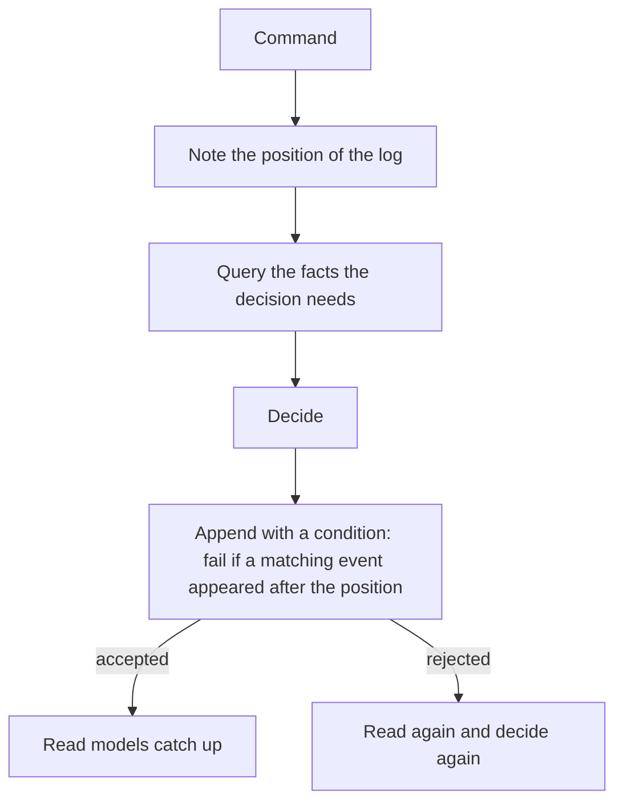

Use this page to understand the idea. To apply it, go to [Choosing how a rule holds](./choosing.mdx).

A Dynamic Consistency Boundary (DCB) is the smallest set of facts that must stay unchanged for one decision to be correct. You do not fix it in advance as an aggregate or a stream. The decision defines it when it runs: by the query it used to read its facts.

## How it works

1. Note the position of the last event you know about, then query the events that matter for the decision.
2. Decide from what you read.
3. Append the new events with a condition: fail if any event matching the same query exists after the position you noted.
4. Let read models catch up asynchronously.

The position must be noted before you read. If you note it after, events that arrived in between are neither seen by the decision nor caught by the condition.

## Why it matters

A fixed boundary forces unrelated facts into one consistency scope. A stream or aggregate per entity cannot express a rule that spans two entities, such as a course with a capacity and a student with a course limit, without either merging them or accepting a race. A DCB lets one append be conditional on exactly the facts the decision used, so independent writes do not conflict and dependent writes do.

The cost is that the decision carries its own query and position, and the store must evaluate the condition when it appends. A conflict is normal: the caller reads again and decides again.

## DCB and Chronicle

DCB as specified lets one event belong to several entities through tags, and lets a decision query by any combination of them. Chronicle supports DCB-style decision models and append conditions within its own model, where each event has exactly one event source and tags take no part in consistency. It is not a DCB event store. Where DCB tags one event with a student and a course, Chronicle writes two events, one per event source, in one atomic append. [Dynamic Consistency Boundary in Chronicle](./chronicle.md) says what maps and what does not, and [DCB examples in Chronicle](./dcb-examples.mdx) gives the Chronicle answer to each canonical DCB example.

## When it fits and when it does not

| It fits | It does not fit |
|---|---|
| A rule over a count, a stock or a status on one or a few keys | A value that must be unique across all keys. A [constraint](../constraints/index.md) is simpler and cheaper |
| A rule that spans two entities | A rule that depends on data outside the event log |
| Writers that rarely touch the same facts at the same time | A single key written by many writers all the time: conflicts will be constant |

## Read in this order

The pages run from the simplest use to the most detailed. Stop when you have what you need.

| Step | You want to | Read |
|---|---|---|
| 1 | Pick the mechanism for a rule | [Choosing how a rule holds](./choosing.mdx) |
| 2 | See a rule like yours as code, from a unique value to a process | [Scenarios](./scenarios.mdx) |
| 3 | Fold one stream of an entity, such as one month | [Read models scoped to one event stream](../read-models/per-stream.mdx) |
| 4 | See how Chronicle maps DCB, and the canonical examples | [Dynamic Consistency Boundary in Chronicle](./chronicle.md) and [DCB examples in Chronicle](./dcb-examples.mdx) |
| 5 | Know exactly which events make an append fail | [How guards are derived](./how-guards-are-derived.mdx) |
| 6 | Weigh the cost and find what stays outside the guard | [Costs and limits](./limits.mdx) |
| 7 | Make a host refuse unguarded reads | [Read protection](../read-models/read-protection.mdx) |
| | Declare event sources and streams as the boundary's dimensions | [Event sources and streams](../event-sources/index.mdx) and [Event sources and the Dynamic Consistency Boundary](../event-sources/dcb.mdx) |
| | Find a quick answer | [Questions and answers](./faq.md) |

## References

- [dcb.events](https://dcb.events): the pattern and its specification.
- [Killing the aggregate](https://sara.event-thinking.io/2023/04/kill-aggregate-chapter-1-I-am-here-to-kill-the-aggregate.html): the originating argument, with the course subscription example.
