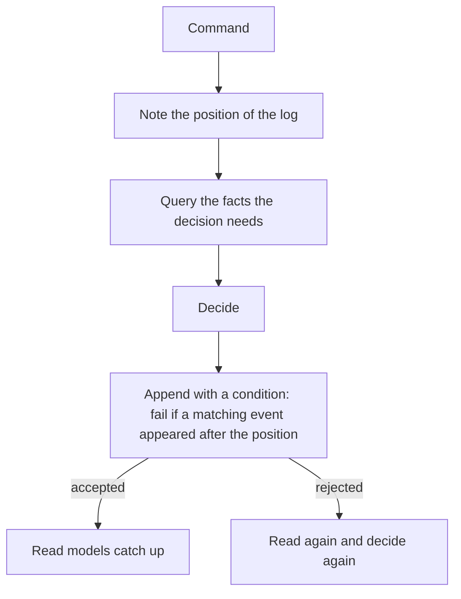

A Dynamic Consistency Boundary (DCB) defines which events must not change between reading state and appending a decision's result. Use it when a rule depends on current state, such as a course's remaining seats, and concurrent writers could invalidate what you read.

The decision defines its boundary through the query used to read those facts. It does not have to use a fixed aggregate or stream as its boundary. In Chronicle, [Choosing how a rule holds](./choosing.mdx) helps you choose between a decision read, a constraint and an explicit concurrency scope.

## How it works

1. Note the position of the last event you know about, then query the events that matter for the decision.
2. Decide from what you read.
3. Append the new events with a condition: fail if any event matching the same query exists after the position you noted.
4. Let read models catch up asynchronously.

The position must be noted before you read. If you note it after, events that arrived in between are neither seen by the decision nor caught by the condition.

## Why it matters

Consider a student joining a course. The decision needs both the course's remaining capacity and the student's subscription count. Guarding only the course misses another request enrolling the same student elsewhere; guarding only the student misses someone taking the last seat.

A DCB lets the append depend on both sets of events without combining the student and course into one aggregate. Events outside the query do not cause a conflict. A matching event does, even if the rule might still pass after reading the new state.

The decision carries its query and position, and the store evaluates that condition when it appends. After a conflict, the caller reads again and decides again. Reusing the old decision would ignore the change the guard detected.

## DCB and Chronicle

DCB as specified lets one event belong to several entities through tags, and lets a decision query by combinations of those tags. Chronicle supports decision models and conditional appends within its event-source model, but does not implement the DCB specification's API. An event source is the entity or process whose history an event belongs to; each Chronicle event has exactly one event source ID. Custom tags do not take part in consistency checks.

For the course subscription, Chronicle records a seat taken on the course and a course joined on the student, in one atomic append guarded by both reads. A decision can also guard a source it only reads, without writing to it. [Dynamic Consistency Boundary in Chronicle](./chronicle.md) explains the mapping and its limits; [DCB examples in Chronicle](./dcb-examples.mdx) shows which examples need two events and which do not.

## When it fits and when it does not

| It fits | It does not fit |
|---|---|
| A rule over a count, a stock or a status on one or a few keys | A value that must be unique across all keys. A [constraint](../constraints/index.md) enforces it without a decision read |
| A rule that spans two entities | A rule that depends on data outside the event log |
| Writers that rarely touch the same facts at the same time | A heavily contested key: matching writes cause conflicts, and each decision read folds its history again |

## Read in this order

Start with the choice your rule needs, then follow the scenario or reference that matches it.

| Step | You want to | Read |
|---|---|---|
| 1 | Pick the mechanism for a rule | [Choosing how a rule holds](./choosing.mdx) |
| 2 | See a rule like yours as code, from a unique value to a process | [Scenarios](./scenarios.mdx) |
| 3 | Fold one stream of an entity, such as one month | [Read models scoped to one event stream](../read-models/per-stream.mdx) |
| 4 | See how Chronicle maps DCB, and the canonical examples | [Dynamic Consistency Boundary in Chronicle](./chronicle.md) and [DCB examples in Chronicle](./dcb-examples.mdx) |
| 5 | Know exactly which events make an append fail | [How guards are derived](./how-guards-are-derived.mdx) |
| 6 | Weigh the cost and find what stays outside the guard | [Costs and limits](./limits.mdx) |
| 7 | Make a host refuse unguarded reads | [Read protection](../read-models/read-protection.mdx) |
| | Declare event sources and streams as the boundary's dimensions | [Event sources and streams](../event-sources/index.mdx) and [Event sources and the Dynamic Consistency Boundary](../event-sources/dcb.mdx) |
| | Find a quick answer | [Questions and answers](./faq.md) |

## References

- [dcb.events](https://dcb.events): the pattern and its specification.
- [Killing the aggregate](https://sara.event-thinking.io/2023/04/kill-aggregate-chapter-1-I-am-here-to-kill-the-aggregate.html): the originating argument, with the course subscription example.
