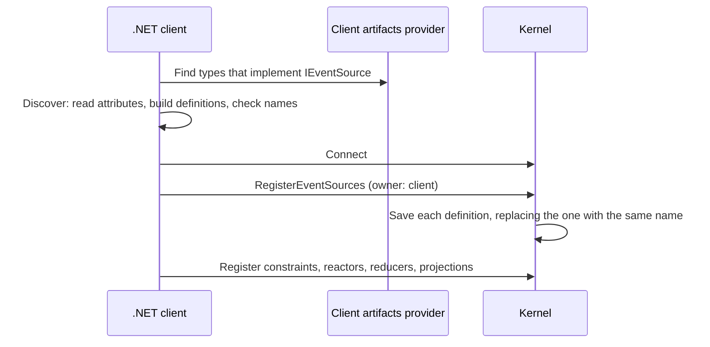
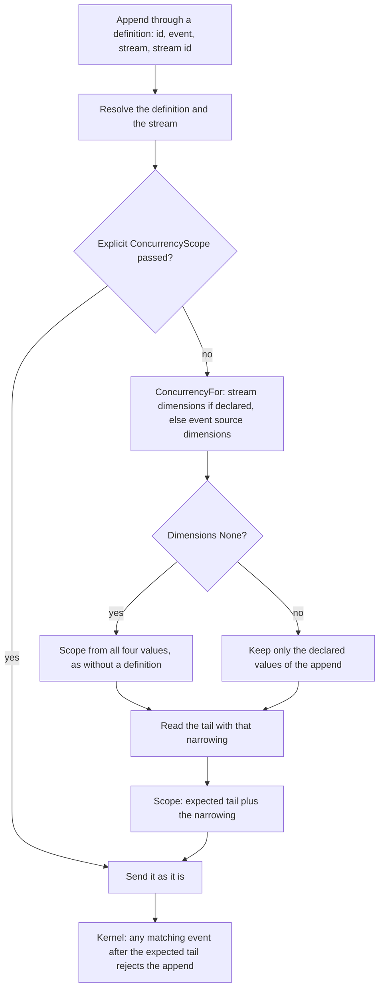

Cratis Chronicle turns an event source definition into routing names and a default concurrency scope: the condition checked before an append is accepted. The .NET client discovers the definition, registers it with the kernel, and uses it to resolve typed appends and observer filters. This explains why a name change affects stored-event matching and why a stream's dimensions change which writers can conflict.

## Discovery and registration

1. The client artifacts provider finds non-abstract, non-generic classes that implement `IEventSource`. With explicit registration it returns the nominated ones.
2. After discovering event types, the client reads `[EventSource]` and every `[EventStream]` and derives their names. It throws `DuplicateEventSourceName` or `DuplicateEventStreamName` when names collide. This happens before discovering constraints and observers, so `Append<TSource>`, `ForEventSource<TSource>` and `[FromEventSource<TSource>]` can use the resulting table of definitions.
3. When the event store connects, the client sends all definitions in one `RegisterEventSources` call. It registers them together with event types and read models, before constraints and observers. A store with no definitions sends nothing.
4. The kernel saves each definition under its name for the event store, replacing any definition with the same name. It keeps definitions that are no longer in your code because stored events refer to them.

The registered definitions are available from the kernel's `EventSources` service, which the Workbench uses for its **Event Sources** page. Each carries an owner. Definitions an application registers are owned by the `Client`.

Registration replaces by name, so two application versions with different declarations for the same name overwrite each other's definition when they register. During a rolling deployment, first roll out a version that declares the new streams everywhere. Only then deploy code that appends to them.

## What each event records

An event appended through a definition carries the same four routing values as any other event, plus the definition's name:

| Stored on the event | Value |
|---|---|
| Event source type | The definition's name |
| Event source id | The id you passed |
| Event stream type | The stream name, or the default `All` when the append names no stream |
| Event stream id | The stream id you passed, or the default |
| `EventContext.EventSource` | The definition's name. Empty when the event was appended without a definition |

The append request carries the definition's name, and the kernel resolves it again:

- If the name is not registered, the append fails with `UnknownEventSource`.
- If an explicit event source type is given and differs from the definition's, it fails with `EventSourceTypeDoesNotMatchEventSource`.
- If the stream type is not `All` and the definition has no such stream, it fails with `UnknownEventStreamForEventSource`.

An append that does not name a definition is accepted exactly as before, even when its event source type equals a registered name.

Observers filter on the stored event source type and event stream type. They do not look at `EventContext.EventSource`.

## How a scope is produced

The tail is the sequence number of the latest event matching the scope's routing values. The client reads it with the same filters the kernel will check. An append guarded by one account's monthly stream therefore compares against that stream's history, not another month's activity. When no event matches yet, the scope carries no expectation and the kernel skips it unless the first-append check is turned on.

For an `AppendMany` the .NET client resolves every distinct route for each event source id, including routes without definitions. Equal predicates share the earliest expected position; different predicates remain separate atomic conditions. An explicit scope list for an id takes precedence and is not recomputed. Repeated labels require the kernel's `concurrency-scope-conjunctions` capability; without it, `IncompatibleConcurrencyScopesForEventSource` is thrown before the request is sent.

The kernel checks every scope against the state before the batch and writes nothing if one is violated. Event sources that are only read, not appended to, can carry a scope too: that is how a [decision read](../read-models/decision-reads.mdx) guards a key.

## Tags and constraints

Tags are event metadata used for filtering. A definition does not assign them, and they take no part in concurrency scopes. See [Appending with tags](../events/appending-with-tags.mdx).

Constraints apply to every append, whether or not it uses a definition. A unique constraint compares property values across event sources. By default, a [closing event](./closing.mdx) closes the scope formed from the event's stored event source id, stream type and stream id. Custom closing dimensions can select a different scope; the event source definition does not choose them.

The kernel evaluates constraints before concurrency scopes and writes nothing if either fails.

## What definitions do not do

- They do not validate event types. Any event type can be appended through any definition.
- They do not change how events are stored or read. A definition is routing and guard metadata.
- They belong to one event store. Each event store registers its own definitions.
- They do not apply to the unit of work's `Transactional` sequence, which takes the routing values directly.

## Next steps

Use [Concurrency](./concurrency.mdx) to choose the dimensions for your appends, or [Questions and pitfalls](./faq.mdx) to diagnose a routing or registration mismatch. When a guard must reflect state you read before writing, continue with [Dynamic Consistency Boundary](./dcb.mdx) and [Dynamic Consistency Boundary in Chronicle](../dynamic-consistency-boundary/chronicle.md). The [Event source concept](../concepts/event-source.md) explains the underlying grouping.
