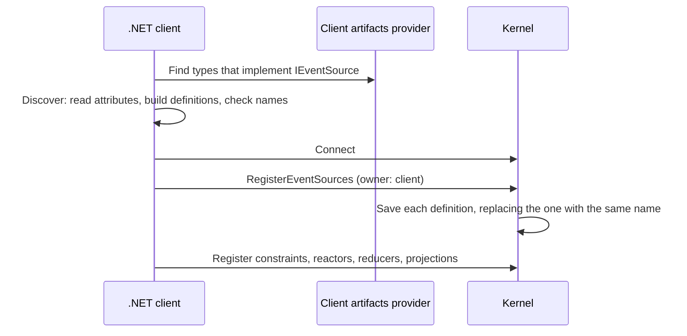
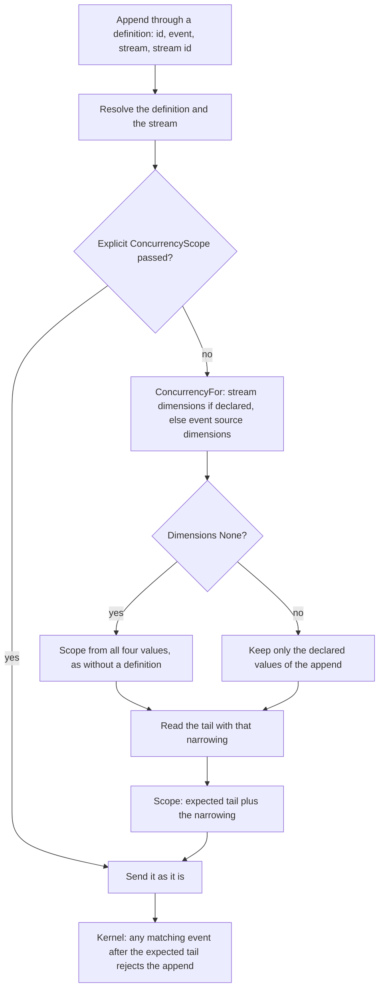

Use this page to understand what Chronicle does with a definition. You do not need it to use one. Read it when something behaves in a way the guides do not explain.

## Discovery and registration

1. **Find.** The client artifacts provider returns every non-abstract, non-generic class that implements `IEventSource`. With explicit registration it returns the nominated ones.
2. **Discover.** Discovery runs after event types are discovered and before constraints, reactors, reducers and projections. It reads `[EventSource]` and every `[EventStream]`, derives the name, and throws `DuplicateEventSourceName` or `DuplicateEventStreamName` when names collide. The result is the table of definitions that `Append<TSource>`, `ForEventSource<TSource>` and `[FromEventSource<TSource>]` use.
3. **Register.** When the event store connects, the client sends all definitions in one `RegisterEventSources` call. It does this together with event types and read models, before it registers constraints and observers. A store with no definitions sends nothing.
4. **Save.** The kernel saves each definition under its name for the event store, replacing any definition with the same name. A definition that is no longer in your code is not removed, because stored events refer to it.

The registered definitions are available from the kernel's `EventSources` service, which the Workbench uses for its **Event Sources** page. Each carries an owner. Definitions an application registers are owned by the `Client`.

Because registration replaces by name, two application versions that declare the same name differently take turns overwriting each other. During a rolling deployment, add streams in a version that is rolled out everywhere before another version appends to them.

## What each event records

An event appended through a definition carries the same four routing values as any other event, plus the definition's name:

| Stored on the event | Value |
|---|---|
| Event source type | The definition's name |
| Event source id | The id you passed |
| Event stream type | The stream name, or the default `All` when the append names no stream |
| Event stream id | The stream id you passed, or the default |
| `EventContext.EventSource` | The definition's name. Empty when the event was appended without a definition |

The append request carries the definition's name, and the kernel resolves it again:

- If the name is not registered, the append fails with `UnknownEventSource`.
- If an explicit event source type is given and differs from the definition's, it fails with `EventSourceTypeDoesNotMatchEventSource`.
- If the stream type is not `All` and the definition has no such stream, it fails with `UnknownEventStreamForEventSource`.

An append that does not name a definition is accepted exactly as before, even when its event source type equals a registered name.

Observers filter on the stored event source type and event stream type. They do not look at `EventContext.EventSource`.

## How a scope is produced

The tail is read with the same narrowing the scope carries. That is what keeps the client's position and the kernel's check answering the same question. When nothing matches the narrowing yet, there is no tail: the scope carries no expectation and the kernel skips it unless the first-append check is turned on.

For an `AppendMany` the .NET client resolves every distinct route for each event source id, including routes without definitions. Equal predicates share the earliest expected position; different predicates remain separate atomic conditions. An explicit scope list for an id takes precedence and is not recomputed. Repeated labels require the kernel's `concurrency-scope-conjunctions` capability; without it, `IncompatibleConcurrencyScopesForEventSource` is thrown before the request is sent.

The kernel checks every scope against the state before the batch and writes nothing if one is violated. Event sources that are only read, not appended to, can carry a scope too: that is how a [decision read](../read-models/decision-reads.mdx) guards a key.

## Tags and constraints

- **Tags** are metadata on an event that you can filter by. A definition does not assign tags, and tags take no part in concurrency scopes. See [Appending with tags](../events/appending-with-tags.mdx).
- **Constraints** are evaluated by the kernel for every append, whether or not it went through a definition. A unique constraint compares property values across event sources. A [closing event](./closing.mdx) closes the scope formed from the event's stored event source id, stream type and stream id, so appending it through a definition to its stream closes that stream.
- **Order.** In one append the kernel evaluates constraints, then concurrency scopes, and writes nothing if either fails.

## What definitions do not do

- They do not validate event types. Any event type can be appended through any definition.
- They do not change how events are stored or read. A definition is routing and guard metadata.
- They belong to one event store. Each event store registers its own definitions.
- They do not apply to the unit of work's `Transactional` sequence, which takes the routing values directly.

## Next steps

- [Concurrency](./concurrency.mdx)
- [Questions and pitfalls](./faq.mdx)
- [Dynamic Consistency Boundary](./dcb.mdx), and [Dynamic Consistency Boundary in Chronicle](../dynamic-consistency-boundary/chronicle.md)
- [Event source](../concepts/event-source.md)
