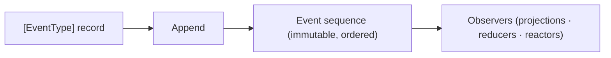

A Chronicle event records a fact about something that happened in your system, such as an order being placed. Append it to an event sequence to keep that fact in an ordered history that projections, reducers, and reactors can process.

In .NET, mark the record with `[EventType]` to identify it as an event. Chronicle uses the event type identity, rather than the .NET runtime type, to identify the stored event. The record describes the event's content, while appending adds it to the sequence for observers to process:

<ChronicleClientTabs snippet="events/index/event-type" />

## Event Sequences and the Event Log

Events live in event sequences, which are ordered, append-only streams. Each event receives a monotonically increasing sequence number that makes it possible to replay events, resume processing, and reason about how far consumers have progressed.

Chronicle includes a specialized event sequence called the event log. It is the default sequence used throughout the system and is exposed through the `IEventLog` API.

<ChronicleClientTabs snippet="events/index/event-log" />

## Working with Events

Start by choosing an [event source id](event-source-id.mdx), the identifier that groups one entity's events. Then [append a single event](appending) and check its result. If one decision produces several events that must be stored together, use [Appending many](appending-many). A [unit of work](transactions.mdx) lets a workflow stage events before committing them as a batch.

When the decision depends on state you read, add [concurrency protection](concurrency) so a competing append can invalidate that decision. Atomic storage keeps a batch together; it does not by itself protect the facts used to decide what to write.

For the rest of the event lifecycle:

- [Appending with tags](appending-with-tags) attaches metadata for grouping and filtering.
- [Cross-cutting properties](cross-cutting-properties) adds shared content to events in the .NET client.
- [Getting events](getting-events) reads stored facts; [Getting state](getting-state) folds events into state.
- [Observing appends](observing-appends) receives client-side append notifications.
- [Filtering reducers and reactors](filtering/index.md) selects which events an observer processes.
- [Revision](revision.md), [Compensation](compensation.md), and [Redaction](redaction) address corrections and removal. Choose the operation that matches what needs to change.
