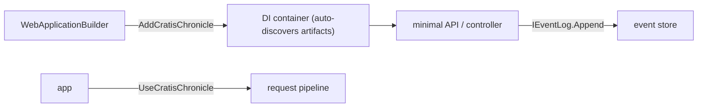

Use Cratis Chronicle in an ASP.NET Core app when an HTTP request needs to record a business event. Register the client with `WebApplicationBuilder`, then inject `IEventLog` into a route handler to append the event to the separately running kernel.

This guide builds a library API that records a book being borrowed. You'll check the event in the workbench and see how projections turn it into queryable loan state. For background processing, use the [Worker Service guide](./worker); to work without a host or dependency-injection container, use the [console guide](./console).

## Before you start

You need .NET 10 or higher and a local Chronicle kernel. Follow [Run Chronicle locally](./choose-hosting-model#run-chronicle-locally) to start the development image with Docker and check its health. This guide uses `chronicle://localhost:35000` and the image's bundled MongoDB at `mongodb://localhost:27017`.

You can also find the [complete ASP.NET Core quickstart sample](https://github.com/Cratis/Samples/tree/main/Chronicle/Quickstart/AspNetCore) on GitHub.

## Set up the project

Create a folder for your project, then a .NET web project inside it:

```shell
dotnet new web
```

Add a reference to the [Chronicle ASP.NET Core package](https://www.nuget.org/packages/Cratis.Chronicle.AspNetCore) (it brings in the base [Chronicle package](https://www.nuget.org/packages/Cratis.Chronicle) for you):

```shell
dotnet add package Cratis.Chronicle.AspNetCore
```

## Register Chronicle on the host

Register Chronicle before building the app, then configure its startup on the built application:

<ChronicleClientTabs snippet="get-started/aspnetcore/register" />

`AddCratisChronicle` registers client services in ASP.NET Core's dependency-injection (DI) container and selects the `Quickstart` event store. The client discovers your event types and processing definitions, called artifacts. These include projections that build read models and reactors that run code in response to events.

`UseCratisChronicle` configures client startup. Request middleware is installed automatically by default; the authentication section below explains explicit placement. Discovery also happens in the [console](./console) client. The host integration adds service resolution and request handling, not discovery alone.

The registration snippet is an excerpt, not a complete `Program.cs`. Keep its builder and app setup in `Program.cs`. After defining the endpoint below, call `AspNetCoreBookEndpoint.MapEndpoints(app)` before `app.Run()` so the route is mapped and the web host keeps running.



[!INCLUDE [common](./_includes/common.mdx)]

## Authentication and tenant namespaces

Chronicle installs middleware for units of work and causation automatically through startup filters. A unit of work groups the request's appends for commit; causation tracks what caused the operation. This middleware wraps your application's middleware, including authentication.

Starting a request unit of work does not resolve an event store or namespace. That happens on the first operation that needs the store, including resolving scoped `IEventStore`, `IEventLog`, or read models. A successful resolution is reused for the rest of the request and its commit.

For a claim-based [namespace resolver](../namespaces/aspnetcore), run authentication before any middleware or endpoint that uses Chronicle. Read the tenant claim from `IHttpContextAccessor.HttpContext.User` in the resolver. Reject missing or invalid tenant claims on HTTP requests rather than falling back to a shared namespace.

Client startup and background work have no HTTP principal, so handle those resolutions separately. A request rejected by authorization, or one that never uses Chronicle, does not need a namespace just to start or complete its unit of work. If an authentication handler itself uses Chronicle, a namespace must already be available when it does.

If you need explicit control over ordering, set `UseAutomaticMiddleware = false` in the options passed to `builder.AddCratisChronicle(...)`. Then configure the pipeline in this order:

1. `app.UseRouting()`
2. `app.UseAuthentication()`
3. `app.UseAuthorization()`
4. `app.UseCratisChronicle()`
5. Map your endpoints.

With automatic middleware disabled, `UseCratisChronicle()` installs the unit of work and causation middleware at that position and configures client startup. Leave automatic placement enabled when you do not need to control ordering.

Calling `UseCratisChronicle()` more than once on the same application builder does not install duplicate middleware. Both placement modes use the same commit-on-success, rollback-on-failure, and request completion-feature behavior.

## Append from an endpoint

The borrowing route takes `IEventLog` from the container, the book id from the route, and the member name from the query string:

<ChronicleClientTabs snippet="get-started/aspnetcore/endpoint" />

The `bookId` is the [event source](../concepts/event-source.md): the book this fact belongs to. `memberName` is the event's payload. The request unit of work collects the append and commits it after the handler completes; returning from `Append` inside the handler is not itself confirmation of that commit. Projections update stored read models asynchronously after the event is recorded.

To check the endpoint, first add a book using `GetStartedBookService.AddBook()` from the earlier example and keep its returned id. Start the web app and send a POST request to `/api/books/{bookId}/borrow?memberName=Alex`, replacing `{bookId}` with that id and using the app's listening address, not the kernel's port. In the workbench, select `Quickstart`, then **Sequences**, and find `GetStartedBookBorrowed` for the same book.

Once projection processing catches up, `GetStartedBook.OnLoan` is `true`, `BorrowedBy` is `Alex`, and a `GetStartedBorrowedBook` instance exists. Those are the two checks that matter: the event was recorded, and the read models reflect it. A read immediately after the request can still show the earlier state.

## Register your artifacts

Chronicle creates its discovered artifacts — reactors, reducers, projections — through the container. If an artifact is registered as a service, Chronicle uses that registration; otherwise it constructs the artifact itself and resolves its constructor parameters from the container. Registering the artifact itself is therefore optional — do it when you want to control its lifetime:

<ChronicleClientTabs snippet="get-started/aspnetcore/register-artifact" />

What you must register is everything an artifact depends on, such as the notification service a real waitlist reactor would take. As the solution grows, Cratis Fundamentals can register those services by convention:

<ChronicleClientTabs snippet="get-started/aspnetcore/register-by-convention" />

`AddBindingsByConvention` binds an interface to its matching implementation when they share a namespace and names such as `IFoo` and `Foo`. `AddSelfBindings` registers eligible concrete types as themselves. Existing registrations are kept, so you can still register a service explicitly when you need a particular lifetime or implementation.

## Configure the MongoDB client

The `GetStartedBooks` query reads documents Chronicle wrote, so the MongoDB driver needs to match how Chronicle stores them — register these conventions once at startup:

[!INCLUDE [mongodb](./_includes/mongodb.mdx)]

Then register the database and the collections you want to inject, so a type can take an `IMongoCollection<GetStartedBook>` dependency without ever touching `MongoClient`:

<ChronicleClientTabs snippet="get-started/aspnetcore/mongo-registration" />

Now the `GetStartedBooks` query from the querying section above resolves its collection straight from the container.

## Recap

The API now has a route that records borrowing as an event rather than updating a loan row directly. Chronicle's request middleware commits the event, projections build the loan views, and the DI container supplies the services your endpoints and processing code need.

## Where to go next

For a UI over this API, [Arc](/arc/) adds commands, queries, and generated TypeScript proxies; [Build a full-stack feature](/build-a-full-app/) shows how those pieces fit together. Continue with the [tutorial](/chronicle/tutorial/) to develop the library model, or use the [Worker Service](./worker) and [console](./console) guides to change the host while keeping the domain definitions.
