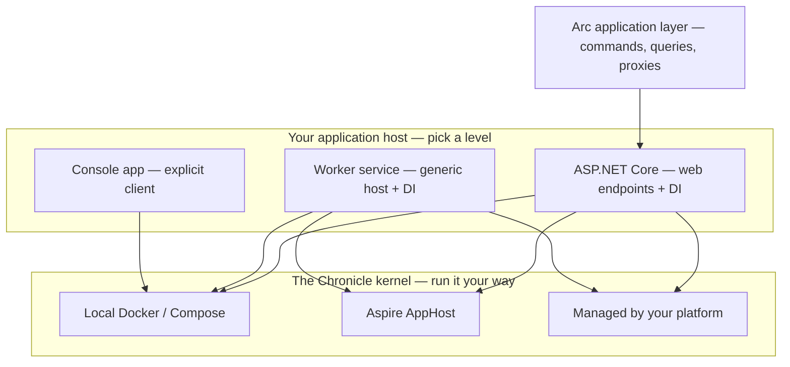

import { Tabs, TabItem, Aside } from '@astrojs/starlight/components';

Choose a console app, .NET Worker Service, or ASP.NET Core app to host your Cratis Chronicle client.
The client connects to a separate kernel process that stores events and coordinates processing. Choosing
an application host does not choose how you deploy that kernel.

Start with a console app to learn the event flow, a worker for background processing, or ASP.NET Core
for HTTP endpoints. Then start a local kernel using Docker or Aspire below. Your first checkpoint is a
healthy kernel and an accessible workbench; the host-specific guide will take you through recording an
event and reading the state built from it.



## The app host decides how much wiring you own

| Host or application layer | What you write | What Chronicle supplies | Use it when |
| --- | --- | --- | --- |
| [Console](./console) | `new ChronicleClient(...)`, `GetEventStore(...)`, append events yourself | Default artifact discovery; you create the client and manage its lifetime. | You are learning, debugging a small reproduction, or writing a script. |
| [Worker Service](./worker) | `Host.CreateApplicationBuilder`, `AddCratisChronicle(...)`, a `BackgroundService` | DI registration and artifact discovery for reactors, reducers, and projections. | You process events, run background workflows, or keep derived state updated. |
| [ASP.NET Core](./aspnetcore) | `WebApplication.CreateBuilder`, `AddCratisChronicle(...)`, `UseCratisChronicle()` | DI registration, artifact discovery, and request-pipeline integration. | You expose HTTP endpoints, controllers, or minimal APIs that append events. |
| [Arc + Chronicle](/arc/backend/csharp/chronicle/) | Arc commands and queries; Chronicle-backed command return values and projections | Arc's command/query pipeline plus Chronicle event appending, identity, tenancy, and read-model integration. | You want a typed full-stack CQRS app with generated TypeScript proxies. |

<Aside type="note" title="Arc is not a host model">
Arc adds commands, queries, and generated TypeScript proxies to an ASP.NET Core application.
It is an application layer, not another process host. An Arc application using Chronicle still needs
the ASP.NET Core client setup and a running kernel.
</Aside>

Artifacts are the definitions Chronicle discovers in your code: event types, projections that build
queryable state, reducers that compute state from events, and reactors that run code when events arrive.
You can reuse these domain definitions across hosts. Client startup and service registration change
with the host, so follow its guide rather than copying the entire application setup.

## You decide who runs the kernel

The kernel runs separately from your application and needs storage. For local development, the bundled
development image supplies both. For a team or production environment, choose who owns the kernel,
storage, credentials, and certificates:

| How you run it | What it gives you | Use it when |
| --- | --- | --- |
| [Local Docker](#run-chronicle-locally) | One kernel reachable at `chronicle://localhost:35000`, with the workbench at `https://localhost:35000` on the same port. | You need the fastest local feedback loop. |
| [Docker Compose](/chronicle/hosting/docker-compose/) | Chronicle and storage as named services in a local or CI topology. | You want repeatable local infrastructure for a team or pipeline. |
| [Aspire AppHost](#let-aspire-wire-it-up) | Chronicle as an Aspire resource with endpoints and storage references wired into dependent projects. | Your .NET solution already uses Aspire to compose services locally. |
| [Production-managed kernel](/chronicle/hosting/production/) | A Chronicle container, durable storage, TLS, secrets, health checks, and versioned deployment owned by your platform. | The application should only know the Chronicle connection string and credentials. |

Here, "managed" means your team or platform operator runs the kernel and its storage. It does not name
a separate client mode or a hosted Cratis service. Your application connects to that kernel using its
configured endpoint and credentials.

For the host guides, start a local kernel using one of the options below.

## Run Chronicle locally

The kernel must be running and reachable before your application can append an event. You can reuse
the same local kernel across the host guides; start it again whenever it is no longer running.

### Prerequisites

- [.NET 8 or higher](https://dot.net) — the SDK you build and run your app with.
- [Docker Desktop or compatible](https://www.docker.com/products/docker-desktop/) — the kernel ships as a container.
- *Optional:* a MongoDB client such as [MongoDB Compass](https://www.mongodb.com/products/tools/compass), handy for peeking at the read models a projection builds. You don't need it to follow the guides — the built-in [workbench](#see-it-in-the-workbench) shows you the events.

### The fastest start: the development image

The `latest-development` image includes MongoDB. With Docker running, start the kernel and publish its
ports only on your machine:

```shell
docker run -d --name chronicle \
  -p 127.0.0.1:35000:35000 \
  -p 127.0.0.1:27017:27017 \
  cratis/chronicle:latest-development
```

The `127.0.0.1:` prefixes publish both ports on this machine only. That matters here: the development
workbench accepts well-known credentials and the bundled MongoDB has no authentication. Wait for the kernel
to report `Healthy` before connecting to it, and remove it with `docker rm -f chronicle` when you are done:

```shell
curl --insecure --fail --retry 30 --retry-all-errors --retry-delay 1 https://localhost:35000/health
```

The kernel serves client connections and the workbench over TLS on port `35000`. MongoDB uses a
separate port:

| Port | What it is |
| --- | --- |
| `35000` | The kernel endpoint your app connects to (`chronicle://localhost:35000`), and the [Chronicle workbench](#see-it-in-the-workbench) — a web UI for browsing your event store — at `https://localhost:35000`. |
| `27017` | The bundled MongoDB, where projections write their read models. |

Use this bundled MongoDB setup for the host guides, which query MongoDB read models directly. If you'd
rather run against a database you already have — or a
different engine entirely — read on; otherwise jump to [picking your host guide](#next-connect-your-host).

### Bring your own database

The `latest-development-slim` image leaves the database out, so you point Chronicle at one you run
yourself. Two environment variables tell it where to go:

- `Cratis__Chronicle__Storage__Type`
- `Cratis__Chronicle__Storage__ConnectionDetails`

The Compose files below bring up the kernel and a database together. Pick the tab for your engine.

<Tabs syncKey="database">
<TabItem label="MongoDB">

Chronicle uses MongoDB transactions and change streams, so MongoDB must run as a replica set (or a
sharded cluster) — a standalone `mongod` won't do. This file initializes a single-node replica set for
local development:

```yaml
services:
  chronicle:
    image: cratis/chronicle:latest-development-slim
    depends_on:
      - mongodb
      - mongodb-init
    environment:
      - Cratis__Chronicle__Storage__Type=MongoDB
      - Cratis__Chronicle__Storage__ConnectionDetails=mongodb://mongodb:27017/?directConnection=true
    ports:
      - 127.0.0.1:35000:35000

  mongodb:
    image: mongo:8.2
    command: ["mongod", "--replSet", "rs0", "--bind_ip_all"]
    ports:
      - 127.0.0.1:27017:27017

  mongodb-init:
    image: mongo:8.2
    depends_on:
      - mongodb
    restart: "no"
    command:
      - /bin/bash
      - -lc
      - |
        until mongosh --host mongodb --quiet --eval "db.adminCommand('ping')" >/dev/null 2>&1; do
          sleep 1
        done
        mongosh --host mongodb --quiet --eval "
        try {
          rs.status();
        } catch (e) {
          rs.initiate({
            _id: 'rs0',
            members: [{ _id: 0, host: 'localhost:27017' }]
          });
        }"
```

Why this setup:

- `host: 'localhost:27017'` makes the replica set topology usable from host tools (for example `mongosh` and Compass) when they connect to `mongodb://localhost:27017/?replicaSet=rs0`.
- Chronicle still reaches MongoDB over the Docker network (`mongodb:27017`) and uses `directConnection=true` to avoid following the advertised host back to `localhost` inside the Chronicle container.
- `directConnection=true` does not disable transactions; transactions still work because MongoDB is running as a replica set.
- If your existing data volume was initialized with a different replica-set host, run `docker compose down -v` (or wipe the MongoDB data volume) before starting again so `rs.initiate()` can apply the new host.

</TabItem>
<TabItem label="PostgreSQL">

```yaml
services:
  chronicle:
    image: cratis/chronicle:latest-development-slim
    depends_on:
      - postgres
    environment:
      - Cratis__Chronicle__Storage__Type=PostgreSql
      - Cratis__Chronicle__Storage__ConnectionDetails=Host=postgres;Port=5432;Database=chronicle;Username=postgres;Password=postgres
    ports:
      - 127.0.0.1:35000:35000

  postgres:
    image: postgres:16
    environment:
      - POSTGRES_DB=chronicle
      - POSTGRES_USER=postgres
      - POSTGRES_PASSWORD=postgres
    ports:
      - 127.0.0.1:5432:5432
```

</TabItem>
<TabItem label="SQL Server">

<Aside type="caution">
The SQL Server credentials in this example are for local development only. For production, use secure
credentials and manage secrets through Docker secrets, environment files, or an external secret manager.
</Aside>

```yaml
services:
  chronicle:
    image: cratis/chronicle:latest-development-slim
    depends_on:
      - sqlserver
    environment:
      - Cratis__Chronicle__Storage__Type=MsSql
      - Cratis__Chronicle__Storage__ConnectionDetails=Server=sqlserver,1433;Database=Chronicle;User Id=sa;Password=Your_strong_password123!;TrustServerCertificate=True;Encrypt=False
    ports:
      - 127.0.0.1:35000:35000

  sqlserver:
    image: mcr.microsoft.com/mssql/server:2025-latest
    environment:
      - ACCEPT_EULA=Y
      - MSSQL_SA_PASSWORD=Your_strong_password123!
    ports:
      - 127.0.0.1:1433:1433
```

</TabItem>
<TabItem label="SQLite">

SQLite is file-based, so there's no second container — just a volume for the database file:

```yaml
services:
  chronicle:
    image: cratis/chronicle:latest-development-slim
    environment:
      - Cratis__Chronicle__Storage__Type=Sqlite
      - Cratis__Chronicle__Storage__ConnectionDetails=Data Source=/data/chronicle.db
    volumes:
      - chronicle-data:/data
    ports:
      - 127.0.0.1:35000:35000

volumes:
  chronicle-data:
```

</TabItem>
</Tabs>

Bring any of these up the usual way, in the background:

```shell
docker compose up -d
```

Every published port in these files is bound to `127.0.0.1`, because the credentials in them are
development placeholders. Drop the prefix only on a network you trust, and never with these credentials.
`docker compose down` stops the stack; `docker compose down -v` also deletes its data volumes.

Want local observability too — logs, traces, and metrics next to the kernel? The
[Docker Compose hosting guide](/chronicle/hosting/docker-compose/) adds the Aspire dashboard to the same
topology.

### See it in the workbench

The Chronicle workbench is the kernel's web UI for inspecting event stores. Open
[https://localhost:35000](https://localhost:35000) and sign in with the development credentials
(username `Admin`, password `ChangeMeNow!`). The development kernel generates a self-signed TLS
certificate, so your browser will warn you. Accept it only for this local development endpoint.

A healthy response from the earlier health check and a successful workbench sign-in confirm that the
local kernel is reachable. They do not yet confirm an application append. After following a host guide,
select its `Quickstart` event store and open **Sequences** to find the book event you recorded.

## Let Aspire wire it up

If your solution uses [Aspire](https://learn.microsoft.com/dotnet/aspire/), add Chronicle to its AppHost
instead of starting a separate Compose stack. The AppHost describes the services to run and the
connections between them. Add the `Cratis.Chronicle.Aspire` package to that project:

```shell
dotnet add package Cratis.Chronicle.Aspire
```

In development run mode, `AddCratisChronicle()` uses the image with bundled MongoDB. Reference the
Chronicle resource from the application that needs to connect to it:

<ChronicleClientTabs snippet="get-started/choose-hosting-model/basic-apphost" />

To choose a database, pass a configure callback. Aspire keeps the development image in run mode and uses
the production image when publishing, regardless of the callback. The `With*` method you pick sets the
kernel's storage type and connection string from the resource you hand it — the same two environment
variables you saw in the Compose files, now derived from your app model instead of hand-written:

<Aside type="caution" title="The production image also wants certificates">
In publish mode, Aspire selects the production image even without a configure callback. It does not
generate the TLS certificate it serves port 35000 with, nor the certificate that protects its OAuth keys —
it throws at startup and stops. The snippets below show storage wiring only, so pair them with
`WithTlsCertificate(...)` and `WithEncryptionCertificate(...)` before publishing; the
[Aspire integration guide](/chronicle/hosting/aspire/) shows both. In run mode, the development image
generates its own certificates even if you configure an external database.
</Aside>

<Tabs syncKey="database">
<TabItem label="MongoDB">

<ChronicleClientTabs snippet="get-started/choose-hosting-model/mongo-database" />

`mongo` can be any resource with a connection string — a MongoDB Atlas connection string as shown, or a
container added directly in the AppHost with `builder.AddMongoDB("mongo")`.

</TabItem>
<TabItem label="PostgreSQL">

<ChronicleClientTabs snippet="get-started/choose-hosting-model/postgres-database" />

</TabItem>
<TabItem label="SQL Server">

<ChronicleClientTabs snippet="get-started/choose-hosting-model/sqlserver-database" />

</TabItem>
<TabItem label="SQLite">

SQLite is file-based, so you pass the connection string directly instead of a resource:

<ChronicleClientTabs snippet="get-started/choose-hosting-model/sqlite-database" />

</TabItem>
</Tabs>

`WithReference(chronicle)` hands your application projects a `chronicle://host:port` connection string
pointing at the kernel's gRPC endpoint — no hardcoded ports. The
[Aspire integration guide](/chronicle/hosting/aspire/) covers the rest: exposed endpoints, compliance
key storage with HashiCorp Vault or Azure Key Vault, and the full AppHost walkthrough.

## Next: connect your host

With the local Docker setup, connect to `chronicle://localhost:35000`. With Aspire, use the endpoint
supplied by the resource reference. Choose the guide for your application:

- [Console](./console): create the client explicitly and record your first book event.
- [Worker Service](./worker): append from background work and keep a process running for reactors.
- [ASP.NET Core](./aspnetcore): record a borrowing event from an HTTP endpoint.

If you want to understand the event flow before choosing a host, [Get started](/chronicle/get-started/)
introduces appending events, projecting state, and reacting to events across the available clients.

## Common paths

| If you are... | Start with | Then move to |
| --- | --- | --- |
| Learning Chronicle from scratch | [Get started](/chronicle/get-started/), then [Console](./console) | [Tutorial](/chronicle/tutorial/) |
| Adding events to an existing web API | [Run Chronicle locally](#run-chronicle-locally), then [ASP.NET Core](./aspnetcore) | [Production hosting](/chronicle/hosting/production/) |
| Building background event processors | [Worker Service](./worker) | [Reactors](/chronicle/reactors/) and [Reducers](/chronicle/reducers/) |
| Building a full-stack Cratis app | [Arc + Chronicle](/arc/backend/csharp/chronicle/) | [Build a full-stack feature](/build-a-full-app/) |
| Preparing a team environment | [Docker Compose](/chronicle/hosting/docker-compose/) or [Aspire](#let-aspire-wire-it-up) | [Production hosting](/chronicle/hosting/production/) and [Data Protection Key Encryption](/chronicle/hosting/encryption-certificate/) |

If you are still unsure, start with the console guide. It lets you check an append and a read model
before adding HTTP request handling or background-service lifetime.
