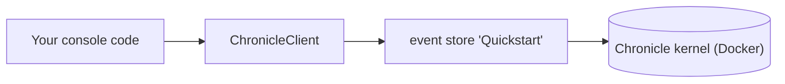

Use a .NET console app to learn how Cratis Chronicle records events and turns them into queryable state without setting up a web or worker host. You create the client and control its lifetime; the Chronicle kernel runs separately and stores the events.

This guide follows a library book from registration to borrowing and return. Your first checkpoint is a book event in the workbench, followed by a read model: the current state built from those events. If you already need a long-running application, the [Worker Service](./worker) and [ASP.NET Core](./aspnetcore) guides use dependency injection (DI) to supply the client services.

## Before you start

You need .NET 10 or higher and a local Chronicle kernel. Follow [Run Chronicle locally](./choose-hosting-model#run-chronicle-locally) to start the development image with Docker and check its health. This guide uses `chronicle://localhost:35000` and the image's bundled MongoDB at `mongodb://localhost:27017`.

For a runnable console application, see the [SimpleConsole sample](https://github.com/Cratis/Chronicle/tree/main/Samples/SimpleConsole) on GitHub. It uses an employee domain rather than the library domain in this guide.

## Set up the project

Create a folder for your project, then a .NET console project inside it:

```shell
dotnet new console
```

Add a reference to the [Chronicle client package](https://www.nuget.org/packages/Cratis.Chronicle), and the MongoDB driver for the step that queries the read models' database directly:

```shell
dotnet add package Cratis.Chronicle
dotnet add package MongoDB.Driver
```

Those are the .NET packages. In a TypeScript project, install the client, its `@cratis/fundamentals` peer dependency and `reflect-metadata`. The client needs Node.js 22.19 or later:

```shell
npm install @cratis/chronicle @cratis/fundamentals reflect-metadata
```

The [TypeScript client guide](/chronicle/clients/typescript/getting-started/) covers the rest of the project setup.

## Connect the client

Create a `ChronicleClient` and open the `Quickstart` event store, the named space for this example's events and read models:

<ChronicleClientTabs snippet="get-started/console/connect" />

`ChronicleConnectionString.Development` supplies the local endpoint and its well-known development credentials. The .NET parameterless constructor uses the same connection, but naming it here makes the choice explicit. Use your own connection string and credentials for a kernel outside this local setup.

The snippet defines a helper method. Call `await GetStartedConsoleClient.Run()` from `Program.cs` to see the connection message. Add the append and query calls below inside `Run`, while the client is still alive. Creating the client explicitly does not disable artifact discovery: the .NET client still discovers your event types, projections, and reactors.

That single `eventStore` is your handle to everything that follows:



[!INCLUDE [common](./_includes/common.mdx)]

## Check the console app's result

Inside `Run`, call `new GetStartedBookService(eventStore).AddBook()` and await the returned book id. Run the app and look in the `Quickstart` event store's **Sequences** view for `GetStartedBookAdded`. That confirms the append reached the kernel, rather than only confirming a connection.

Query the read model after projection processing catches up. A materialized read model is stored state updated in the background, so an immediate read can be empty. Keep the client alive while checking reactor output; disposing it ends this application's event processing.

## Configure the MongoDB client

The `GetStartedBooks` query above reads documents Chronicle wrote. With no container to hand you an `IMongoCollection<GetStartedBook>`, you create one yourself: connect a `MongoClient` to `mongodb://localhost:27017`, open the `Quickstart` database, and get the `GetStartedBooks` collection. For the driver to deserialize those documents, it also needs to match how Chronicle stores them — register these conventions once at startup, before the first query:

[!INCLUDE [mongodb](./_includes/mongodb.mdx)]

With the conventions registered, the `GetStartedBooks` query reads the projection's documents exactly as written.

## Recap

The console app owns the client lifetime and appends events to `Quickstart`. The workbench shows the recorded facts; the read models show the library's current state. A host is not required to learn that flow, though it helps manage services in a long-running application.

## Where to go next

Continue with the [tutorial](/chronicle/tutorial/) to build the library model step by step, or move the client setup into a [Worker Service](./worker) or [ASP.NET Core](./aspnetcore) app when you need a host. The [Concepts](/chronicle/concepts/) section explains the event log, projections, reducers, and reactors.
