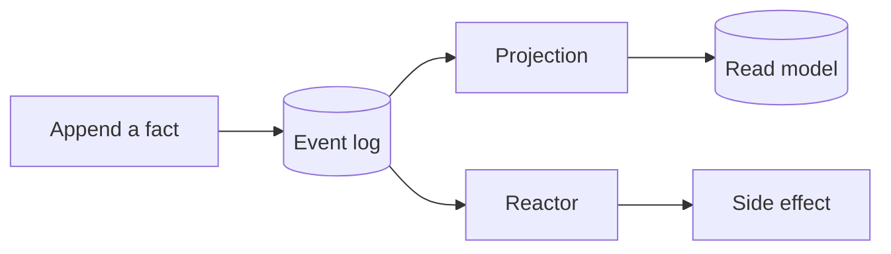
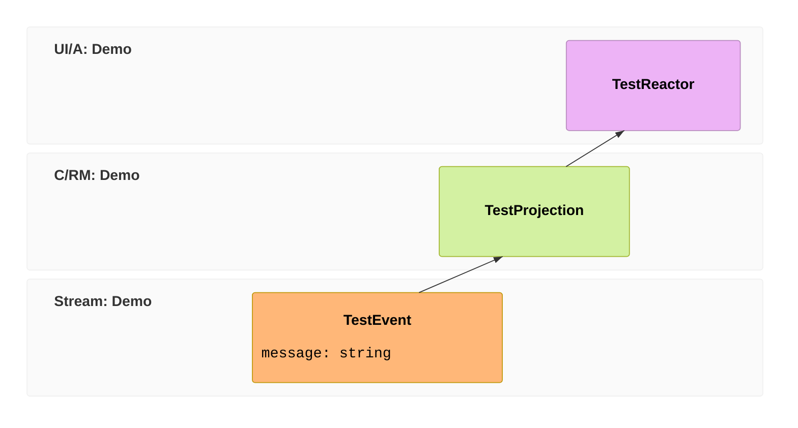

import { Aside, Steps } from '@astrojs/starlight/components';

To start with Cratis Chronicle, run its kernel locally, connect a client, and append an event: a fact your application records. Chronicle can turn that history into read models you query and deliver events to application code for actions such as notifications. This guide starts the kernel and explains how those pieces fit together.

You need Docker for the local server and the language tools required by your chosen client. After the health check succeeds, follow that client's setup guide to create an application. The shared examples below explain the model; they do not form a runnable application on their own.

<Aside type="note" title="Never done event sourcing?">
An event records a meaningful change, such as a book being added, instead of replacing the book's current row. You can follow the setup without prior event-sourcing experience. For the reasoning behind that choice, read [Why Event Sourcing](/chronicle/why-event-sourcing/).
</Aside>

## Pick a client

Choose the client that matches your application and keep its guide open while you start the kernel. For a new C# project, the host quickstarts include project creation and package installation; the .NET client guide covers connection and configuration details. The clients share a server protocol, not identical APIs or capabilities.

| Client | Setup guide |
| --- | --- |
| .NET | [Console app](./console), [ASP.NET Core app](./aspnetcore), or [Worker Service](./worker); [.NET client configuration](/chronicle/clients/dotnet/getting-started/) |
| Kotlin | [Kotlin client](/chronicle/clients/kotlin/get-started/) |
| Java | [Kotlin/JVM client](/chronicle/clients/kotlin/get-started/) |
| Elixir | [Elixir client](/chronicle/clients/elixir/get-started/) |
| TypeScript | [TypeScript client](/chronicle/clients/typescript/getting-started/) |

<Aside type="note" title="Java uses the JVM client">
Java examples are owned by the Kotlin/JVM client repo. Use the JVM setup guide, then choose the Java tab when reading shared examples.
</Aside>

## Start Chronicle

<Steps>

1. Chronicle application code connects to a running Chronicle kernel. For local development, use the development image. It bundles MongoDB, so Docker is the only prerequisite:

   ```shell title="Start Chronicle"
   docker run -d --name chronicle \
     -p 127.0.0.1:35000:35000 \
     -p 127.0.0.1:27017:27017 \
     cratis/chronicle:latest-development
   ```

   The `127.0.0.1:` prefixes publish both ports on this machine only. The development image's workbench accepts well-known credentials and its MongoDB has no authentication, so keep both off shared networks.

2. The kernel listens on `chronicle://localhost:35000`, and the workbench runs on `https://localhost:35000`, the same TLS-secured port. The bundled MongoDB on port `27017` stores the materialized read models; the guides below query it directly. Wait for startup to complete. This command retries the health check and prints `Healthy` when the kernel reports itself ready:

   ```shell title="Wait for readiness"
   curl --insecure --fail --retry 30 --retry-all-errors --retry-delay 1 https://localhost:35000/health
   ```

   `--insecure` is there because the development image serves a self-signed certificate.

</Steps>

:::caution
Remove the container with `docker rm -f chronicle` when you are done. With this setup, removing the container also removes the events and read models stored inside it.
:::

If you need Docker Compose, Aspire, a separate database, or production-style hosting, use [Choose an application host model](./choose-hosting-model).

## The Chronicle loop

After setup, follow one fact through the system: append it to the event log, derive a view with a projection, and handle it with a reactor. The projection and reactor consume the event independently; a reactor does not wait for the projection to finish.



In [event modeling](/event-modeling/) notation, the tiny example below is:



First, connect a client and choose an **event store**, the named home for your application's events. An **append** adds a fact to its event log. The client-flow example records a `TestEvent` carrying a message:

<ChronicleClientTabs snippet="get-started/client-flow" />

The append records the fact before projections or reactors consume it. To use the example in your application, you also need the event declaration and the registration described in your client's setup guide.

The event declaration defines the data you record. Here, `TestEvent` carries a message; each client expresses that same fact in its own syntax:

<ChronicleClientTabs snippet="get-started/test-event" />

Next, a **projection** maps that event onto a **read model**, state shaped for a query. This example copies the message into `TestProjection`. Chronicle writes materialized read models to a **sink**, its configured read-model storage:

<ChronicleClientTabs snippet="get-started/test-projection" />

A **reactor** runs application code when the event arrives. `TestReactor` handles the same `TestEvent`; use this pattern when a recorded fact should trigger a notification or another action:

<ChronicleClientTabs snippet="get-started/test-reactor" />

The C# handler prints `Received event with message: Hello world!` when it receives the event from the client-flow example. That output confirms the reaction ran; it does not tell you whether the projection has caught up.

Follow your client's registration instructions before running the example. Some hosts discover annotated types; others require you to register modules, classes, or functions explicitly. Declaring a projection or reactor alone is not enough in every host.

<Aside type="tip" title="Choose the consumers you need">
Append → project → react describes the roles, not a required chain of execution. This example uses all three parts; an application need not have a reactor for every event. Materialized read models update after the append, so [read model consistency](/chronicle/read-models/consistency/) explains how to read your own write when that matters.
</Aside>

## Inspect it in the workbench

The development image includes the **Chronicle workbench** — a web UI for inspecting event stores. Open [https://localhost:35000](https://localhost:35000) and log in with the development credentials: username `admin`, password `ChangeMeNow!`. In development the port uses a self-signed certificate, so accept your browser's certificate warning the first time.

After you complete a client or host quickstart, choose the event store that guide uses and open **Sequences** to inspect its events. Append more events and watch the sequence grow. That log is the source of truth your projections and reactors read from.

## Where to go next

If you have only started the kernel, continue with the [console](./console), [ASP.NET Core](./aspnetcore), or [Worker Service](./worker) quickstart to create a C# application. For another language, use the [Kotlin/JVM](/chronicle/clients/kotlin/get-started/), [Elixir](/chronicle/clients/elixir/get-started/), or [TypeScript](/chronicle/clients/typescript/getting-started/) setup guide.

Once your application connects, the [library tutorial](/chronicle/tutorial/) walks through defining events, deriving a catalog, and reacting to a returned book. If you need a different deployment setup first, [choose an application host model](./choose-hosting-model). For terminology or design decisions, return to [Concepts](/chronicle/concepts/) or [Why Event Sourcing](/chronicle/why-event-sourcing/).
