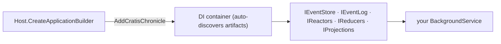

Use Cratis Chronicle in a .NET Worker Service when background work needs to record or react to events without serving HTTP requests. The generic host manages the application's lifetime, while Chronicle connects it to the kernel and discovers its event-processing definitions.

This guide uses a library example. The worker records a book being added, then stays running so reactors can handle later events. You'll check the recorded event in the workbench and the book's current state in a read model. For HTTP endpoints, use the [ASP.NET Core guide](./aspnetcore); to manage the client without a host, use the [console guide](./console).

## Before you start

You need .NET 10 or higher and a local Chronicle kernel. Follow [Run Chronicle locally](./choose-hosting-model#run-chronicle-locally) to start the development image with Docker and check its health. This guide uses `chronicle://localhost:35000` and the image's bundled MongoDB at `mongodb://localhost:27017`.

## Set up the project

Create a folder for your project, then a .NET worker service inside it:

```shell
dotnet new worker
```

Add a reference to the [Chronicle client package](https://www.nuget.org/packages/Cratis.Chronicle):

```shell
dotnet add package Cratis.Chronicle
```

> [!NOTE]
> A worker only needs the base `Cratis.Chronicle` package — `Cratis.Chronicle.AspNetCore` is for web applications.

## Register Chronicle on the host

Register Chronicle with the generic host's dependency-injection (DI) container, select the `Quickstart` event store, and add the background service that will do the work:

<ChronicleClientTabs snippet="get-started/worker/register" />

`AddCratisChronicle` makes services such as `IEventStore` and `IEventLog` available through DI. The client discovers artifacts: the event types, reactors, reducers, and projections that define how your application processes events. The [ASP.NET Core](./aspnetcore) integration uses the same discovery.

Call `await GetStartedWorkerRegistration.ConfigureAndRun(args)` from `Program.cs` after adding the worker class below. That helper builds and runs the host. Chronicle reads connection settings from the `Cratis:Chronicle` section of `appsettings.json`:



```json title="appsettings.json"
{
  "Cratis": {
    "Chronicle": {
      "ConnectionString": "chronicle://localhost:35000",
      "EventStore": "Quickstart"
    }
  }
}
```

[!INCLUDE [common](./_includes/common.mdx)]

## Append from the worker

A `BackgroundService` runs its work in `ExecuteAsync`. This example connects to the kernel, appends one `GetStartedBookAdded`, and waits until the host shuts down:

Chronicle registers `IEventStore` and `IEventLog` as scoped services, while a hosted `BackgroundService` is a singleton. The snippet below shows the append flow, but its constructor injection needs a lifetime adjustment for a scope-validating host: inject `IServiceScopeFactory`, create a scope inside `ExecuteAsync`, and resolve `IEventStore` from that scope. Keep the scope alive for the work that uses the store.

<ChronicleClientTabs snippet="get-started/worker/worker-service" />

Start the worker and open the workbench at `https://localhost:35000`. Select `Quickstart`, then **Sequences**, and look for `GetStartedBookAdded`. Each worker start generates a new book id and appends another book; restarting does not replace the previous one.

After projection processing catches up, query the `GetStartedBook` read model for the new book. The waiting service keeps this process alive for reactor delivery. To see `GetStartedBookReturnedNotifier` write its notification message, append a `GetStartedBookReturned` event for a book while the worker is running. The worker's startup append alone does not trigger that reactor.

## Configure the MongoDB client

The `GetStartedBooks` query reads documents Chronicle wrote, so the MongoDB driver needs to match how Chronicle stores them — register these conventions once at startup:

[!INCLUDE [mongodb](./_includes/mongodb.mdx)]

Then register the database and the collection so a type can take an `IMongoCollection<GetStartedBook>` dependency:

<ChronicleClientTabs snippet="get-started/worker/mongo-registration" />

## Register your artifacts

Chronicle uses the container to create discovered reactors, reducers, and projections. It uses an explicit service registration when one exists; otherwise it constructs the artifact and resolves its constructor parameters through DI. Register the artifact when you need to control its lifetime, and register any dependencies it needs, such as a notification service.

As the solution grows, Cratis Fundamentals can register matching services by convention:

<ChronicleClientTabs snippet="get-started/worker/register-by-convention" />

`AddBindingsByConvention` binds an interface to its matching implementation when they share a namespace and names such as `IFoo` and `Foo`. `AddSelfBindings` registers eligible concrete types as themselves. Both keep existing registrations.

## Going further

For tenant-specific processing, provide an `IEventStoreNamespaceResolver` to select the namespace for an operation. [Namespace resolution](../namespaces/dotnet-client) explains the resolver. If you also need custom identity or correlation handling, use the `configure` callback on `AddCratisChronicle`; [Structural dependencies](../configuration/structural-dependencies) covers those extension points.

## Recap

The worker records events without an HTTP request and remains running for reactor delivery. Its host owns application lifetime, DI supplies client services within their scopes, and the kernel stores the events. The event and read-model definitions are the same ones used by the other host guides.

## Where to go next

Continue with [Reactors](/chronicle/reactors/) to turn recorded events into background actions, or follow the [tutorial](/chronicle/tutorial/) to develop the library model step by step. If the same domain also needs an HTTP API, use the [ASP.NET Core](./aspnetcore) guide. The [console](./console) guide shows client lifetime without a host.
