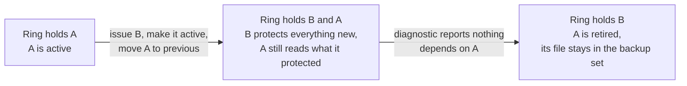

# Data Protection Key Encryption

Configure an encryption certificate in Cratis Chronicle to protect stored Data Protection keys and webhook credentials, and to provide signing and encryption keys for its internal OAuth authority. Keep the certificate and its private key when you rotate it: stored data and backups may still need it after a new certificate becomes active.

## Overview

ASP.NET Core Data Protection encrypts authentication data using a stored key ring. Chronicle persists that key ring through its storage backend, so all nodes must be able to decrypt the same keys. The configured X.509 certificate protects those stored keys; it is separate from the TLS setting that protects network connections.

The production image requires an encryption certificate when its internal OAuth authority is enabled. An external authority removes that startup requirement, but webhook encryption still needs a certificate and Data Protection otherwise stores its keys unencrypted. Development builds allow certificate-free startup.

The same PFX file supplies three consumers with different behavior when no certificate is configured:

| Consumer | Without the certificate, in a production build |
| --- | --- |
| OpenIddict, the internal OAuth authority | Refuses to start when the internal authority is enabled |
| Webhook credentials | Throws `EncryptionCertificateNotConfigured` on the first encryption or decryption of a nonempty secret |
| Data Protection keys | Writes keys unencrypted; it does not generate a certificate or reject startup |

## Configuration

### JSON Configuration

Add the encryption certificate configuration to your `chronicle.json`:

```json
{
    "encryptionCertificate": {
        "certificatePath": "/path/to/encryption-cert.pfx",
        "certificatePassword": "your-certificate-password"
    }
}
```

### Environment Variables

Configure using environment variables (recommended for containerized deployments):

```bash
# Path to the PFX certificate file
Cratis__Chronicle__EncryptionCertificate__CertificatePath=/app/certs/encryption-cert.pfx

# Certificate password
Cratis__Chronicle__EncryptionCertificate__CertificatePassword=your-certificate-password
```

### Configuration Properties

| Property | Type | Required | Description |
| --- | --- | --- | --- |
| certificatePath | string | For the internal authority in production | Path to the PFX file for the active certificate |
| certificatePassword | string | For password-protected PFX files | Password used to load the certificate |
| previous | array | No | Previous certificates retained for existing data and tokens; see [Rotating the certificate](#rotating-the-certificate) |

Every certificate you configure must carry its private key. A PFX exported without one is rejected at
startup with `EncryptionCertificateWithoutPrivateKey`: all three consumers need to decrypt, not just encrypt.

### The certificate ring

The certificate ring is the configured set of active and previous certificates. `certificatePath` selects
the active certificate for new Data Protection keys and webhook credentials. Entries under `previous`
keep older data readable. OpenIddict registers the whole ring and chooses its issuing certificate by
expiration date, as described in [What each consumer does during the overlap](#what-each-consumer-does-during-the-overlap).

```json
{
    "encryptionCertificate": {
        "certificatePath": "/certs/encryption-2026.pfx",
        "certificatePassword": "the-new-password",
        "previous": [
            {
                "certificatePath": "/certs/encryption-2025.pfx",
                "certificatePassword": "the-old-password"
            }
        ]
    }
}
```

As environment variables, the list is indexed the way the configuration binder indexes every list:

```bash
Cratis__Chronicle__EncryptionCertificate__CertificatePath=/certs/encryption-2026.pfx
Cratis__Chronicle__EncryptionCertificate__CertificatePassword=the-new-password
Cratis__Chronicle__EncryptionCertificate__Previous__0__CertificatePath=/certs/encryption-2025.pfx
Cratis__Chronicle__EncryptionCertificate__Previous__0__CertificatePassword=the-old-password
```

An existing single-certificate configuration needs no changes. It defines an active certificate with an
empty `previous` list.

The ring is loaded during startup and held for the life of the process, so changes require a restart.
Give every node the same active certificate and `previous` list: any node may need to read keys or
credentials another node wrote to shared storage.

### What a broken ring does

Chronicle validates every configured ring entry during startup. A missing file or invalid entry stops
startup instead of loading a partial ring:

| Configuration | What happens |
| --- | --- |
| `certificatePath` set, but no file there | `EncryptionCertificateFileNotFound`, naming the path |
| A `previous` entry whose file is not there | `EncryptionCertificateFileNotFound`, naming the path |
| A `previous` entry with no `certificatePath` | `EncryptionCertificateWithoutPath` |
| `previous` set with no active certificate | `PreviousEncryptionCertificatesWithoutActive` |
| The same certificate active and previous | `DuplicateEncryptionCertificateInRing` |
| A certificate carrying no private key | `EncryptionCertificateWithoutPrivateKey` |

> [!IMPORTANT]
> A missing file is not equivalent to an unconfigured certificate. If startup reports
> `EncryptionCertificateFileNotFound`, restore the file or correct its mounted path before restarting.

If you leave the certificate unconfigured, the behavior depends on the consumer and build described in
[Overview](#overview).

## Generating a Certificate

Use a PFX containing an RSA private key: webhook encryption uses RSA. A separate encryption certificate lets you renew TLS without changing the keys needed for stored data. If you share one file, follow [Using Same Certificate for TLS and Encryption](#using-same-certificate-for-tls-and-encryption) for the renewal requirements.

### Using .NET CLI

For development, export a .NET HTTPS development certificate. Do not use a development certificate for production.

```bash
# Generate a certificate for key encryption
dotnet dev-certs https -ep ./encryption-cert.pfx -p YourSecurePassword123
```

### Using OpenSSL

```bash
# Generate a private key
openssl genrsa -out encryption.key 2048

# Create a self-signed certificate
openssl req -x509 -new -nodes -key encryption.key -sha256 -days 3650 \
    -out encryption.crt \
    -subj "/CN=Chronicle Data Protection/O=Your Organization"

# Convert to PFX format
openssl pkcs12 -export -out encryption-cert.pfx \
    -inkey encryption.key -in encryption.crt \
    -password pass:YourSecurePassword123
```

## Docker Configuration

Mount the certificate read-only and configure its path inside the container. This excerpt shows only encryption configuration; the production image also needs TLS configured and a reachable database. When using MongoDB, that database must be a replica set. Use the complete Compose example in [Production hosting](production.md), and supply passwords from your secret store instead of copying the example password.

```yaml
version: '3.8'

services:
  chronicle:
    image: cratis/chronicle:latest
    ports:
      - "35000:35000"
    volumes:
      - ./certs/encryption-cert.pfx:/app/certs/encryption-cert.pfx:ro
    environment:
      - Cratis__Chronicle__Storage__ConnectionDetails=mongodb://mongodb:27017
      - Cratis__Chronicle__EncryptionCertificate__CertificatePath=/app/certs/encryption-cert.pfx
      - Cratis__Chronicle__EncryptionCertificate__CertificatePassword=YourSecurePassword123
```

### Using Same Certificate for TLS and Encryption

You can use the same PFX certificate for both TLS and Data Protection key encryption:

> [!WARNING]
> Replacing a shared PFX during TLS renewal also changes the encryption key on restart. Preserve the old
> file and add it to `previous` before restarting, or data it protected becomes unreadable. Treat each
> renewal as a [rotation](#rotating-the-certificate). Use a separate encryption certificate if your TLS
> renewal process cannot retain and configure the old file.

```yaml
services:
  chronicle:
    image: cratis/chronicle:latest
    volumes:
      - ./certs/chronicle.pfx:/app/certs/chronicle.pfx:ro
    environment:
      # TLS configuration
      - Cratis__Chronicle__Tls__CertificatePath=/app/certs/chronicle.pfx
      - Cratis__Chronicle__Tls__CertificatePassword=YourPassword
      # Data Protection key encryption (same certificate)
      - Cratis__Chronicle__EncryptionCertificate__CertificatePath=/app/certs/chronicle.pfx
      - Cratis__Chronicle__EncryptionCertificate__CertificatePassword=YourPassword
```

## Multi-Instance Deployments

Configure every node with the same active certificate and `previous` list so each can decrypt the shared Data Protection keys and webhook credentials. This excerpt shows only the certificate settings; configure shared storage, TLS, and clustering as described in [Production hosting](production.md#scaling).

```yaml
services:
  chronicle-1:
    image: cratis/chronicle:latest
    environment:
      - Cratis__Chronicle__EncryptionCertificate__CertificatePath=/app/certs/encryption-cert.pfx
      - Cratis__Chronicle__EncryptionCertificate__CertificatePassword=SharedPassword
    volumes:
      - ./certs/encryption-cert.pfx:/app/certs/encryption-cert.pfx:ro

  chronicle-2:
    image: cratis/chronicle:latest
    environment:
      - Cratis__Chronicle__EncryptionCertificate__CertificatePath=/app/certs/encryption-cert.pfx
      - Cratis__Chronicle__EncryptionCertificate__CertificatePassword=SharedPassword
    volumes:
      - ./certs/encryption-cert.pfx:/app/certs/encryption-cert.pfx:ro
```

## Rotating the certificate

Rotate by making a new certificate active and retaining the old one under `previous`. Restart every
node with the same ring after each configuration change. Rotation does not re-encrypt existing data in
bulk, so keep previous certificates until all consumers have stopped needing them.



1. Issue the new certificate without overwriting the current file. Back up both files and their passwords.
2. Set the new certificate as active and add the old one under `previous`. Restart every node. New Data
   Protection keys and webhook credentials now use the new certificate; existing data remains readable.
3. Check all consumers before retiring the old certificate. Use the diagnostic below for Data Protection
   keys, check webhook credentials separately, and account for tokens issued by OpenIddict. Data Protection
   creates new keys on its own schedule; rotation does not migrate existing keys or credentials.
4. Once no consumer needs the old certificate, remove its `previous` entry and restart every node.
5. Retain the retired certificate in the backup set for as long as a restorable backup needs it. Follow
   [Backup and restore ordering](#backup-and-restore-ordering) before removing any certificate file.

> [!WARNING]
> Overwriting the file at `certificatePath` with a different key pair is **not** a rotation. The ring only
> helps when the previous file is kept and listed under `previous`; replacing a file in place leaves no
> overlap and makes everything the old key pair protected unreadable.

### What each consumer does during the overlap

| Consumer | During the overlap |
| --- | --- |
| **Data Protection keys** | New keys are protected with the active certificate; any certificate in the ring can unprotect, so keys written before the rotation stay readable |
| **OpenIddict** — the internal OAuth authority | Every certificate in the ring is registered, so tokens issued under the previous one keep validating. OpenIddict chooses which certificate *issues* by its own rule — it prefers the X.509 key with the furthest expiration date, not the one Chronicle marks active. In a normal rotation the new certificate outlives the old one and the two agree; promote a certificate that expires *earlier* than one still in the ring and OpenIddict keeps issuing under the longer-lived one |
| **Webhook credentials** — Chronicle's value encryption | Values are written with the active certificate and carry the key id of the certificate that protected them, so a value needing a retired certificate is reported as such instead of failing as if it were corrupt. Existing values are rewritten only when the credential itself is changed |

> [!IMPORTANT]
> Finish a rolling upgrade before rotating, and before creating or changing webhook credentials during
> one. A credential written by an upgraded node carries a key id, which a node still running an older
> version cannot read.

An expired previous certificate can still decrypt stored data: RSA decryption does not consult the
certificate's validity window. Expiration alone is not a reason to remove it from the ring.

## Watching a rotation

Call `GET /diagnostics/encryption-certificates` to see this node's ring and the certificates its stored
Data Protection keys depend on. The endpoint requires authentication and reports key ids, subjects,
and paths without returning private keys or protected values.

```bash
curl --silent \
  --header "Authorization: Bearer $CHRONICLE_ACCESS_TOKEN" \
  https://chronicle:35000/diagnostics/encryption-certificates
```

```json
{
  "ring": {
    "isConfigured": true,
    "activeKeyId": "90E5D2C993BFB12A7E6B45D64664C18A7E4A93F0",
    "certificates": [
      {
        "keyId": "90E5D2C993BFB12A7E6B45D64664C18A7E4A93F0",
        "role": "Active",
        "subject": "CN=Chronicle Encryption 2026",
        "notBefore": "2026-01-01T00:00:00+00:00",
        "notAfter": "2027-01-01T00:00:00+00:00",
        "certificatePath": "/certs/encryption-2026.pfx",
        "hasExpired": false
      },
      {
        "keyId": "8CBEF43CE4B7B56664D66D6285A4A2064551ACE5",
        "role": "Previous",
        "subject": "CN=Chronicle Encryption 2025",
        "notBefore": "2025-01-01T00:00:00+00:00",
        "notAfter": "2026-01-01T00:00:00+00:00",
        "certificatePath": "/certs/encryption-2025.pfx",
        "hasExpired": true
      }
    ],
    "isRotating": true
  },
  "dataProtectionKeys": [
    {
      "keyId": "90E5D2C993BFB12A7E6B45D64664C18A7E4A93F0",
      "role": "Active",
      "keyCount": 1
    },
    {
      "keyId": "8CBEF43CE4B7B56664D66D6285A4A2064551ACE5",
      "role": "Previous",
      "keyCount": 1
    }
  ],
  "keysNotProtectedByCertificate": 0,
  "previousCertificatesInUse": true,
  "retiredCertificatesInUse": false,
  "canRetirePreviousCertificates": false
}
```

| Field | What it tells you |
| --- | --- |
| `ring` | The certificates this node actually loaded, active first. This is what has to match across the cluster |
| `dataProtectionKeys` | How many stored Data Protection keys are encrypted to each certificate. Read out of storage — each stored key records the certificate it needs |
| `previousCertificatesInUse` | Stored keys still depend on a certificate in the `previous` position. Removing it now makes them unreadable |
| `retiredCertificatesInUse` | Stored keys depend on a certificate that is in **neither** position. Those keys are already unreadable — this is what a rotation done in the wrong order, or a restore into a ring that has moved on, looks like |
| `keysNotProtectedByCertificate` | Stored keys the report cannot attribute to a certificate, including keys written without certificate protection |
| `canRetirePreviousCertificates` | The ring is rotating and no stored Data Protection keys depend on previous certificates; this does not check webhook credentials or tokens |

Do not use this report alone to decide when to retire a certificate:

The report does not enumerate webhook credentials. A certificate with no Data Protection dependencies
may still protect a webhook secret. Chronicle warns the first time it reads a value with a previous
certificate, naming the key id. Rewrite that credential to encrypt it with the active certificate, and
check your other stored credentials before retiring the old key. Also allow for tokens issued under the
old certificate.

Read the report on every node during a rolling restart: each reports the ring it loaded, which may not
match the new configuration yet. Startup logs also record one entry per loaded certificate.

## Backup and restore ordering

Restore the certificates before starting Chronicle against a restored database. A database backup
contains encrypted keys and credentials, not the private keys needed to decrypt them. If a required
certificate is missing, copying the database back does not make that data readable.

### What has to be in the backup set

| Item | Where it lives | Why |
| --- | --- | --- |
| Every certificate in the ring, plus the passwords | Wherever you keep certificates — a secret store, not the database | Nothing else can decrypt what they protected |
| The storage backend (MongoDB or SQL) | Your database backups | Holds the Data Protection key ring, the webhook definitions and their encrypted credentials, and the OAuth applications and tokens |
| The compliance key store, when one is configured | Vault, Azure Key Vault, or the general storage | PII keys — a separate subsystem the encryption certificate never protects. See [Compliance Storage](configuration/compliance-storage.md) |

The Data Protection key ring is **inside** the storage backend, not a separate artifact — a database backup
already carries it. What a database backup cannot carry is the certificate that unlocks it.

### Retention: a certificate outlives its ring

Keep each certificate and its password for as long as any retained backup needs its private key. This
can be longer than the certificate remains in the running ring. Removing it from `previous` does not
change what an older database backup needs to decrypt.

Do not remove a certificate from the backup set until every dependent backup has passed its retention
period.

### Restore order

1. Restore the certificate ring used when the backup was taken, including its `previous` entries. The
   current ring may no longer contain those certificates.
2. Restore the storage backend (MongoDB or SQL).
3. Restore the compliance key store, if configured, to the same point in time. An older key-store backup
   lacks keys for subjects created since it was taken, so their `[PII]` values read as empty strings. It
   may also restore keys for subjects erased since that backup, making their values readable again. A
   newer key-store backup retains intervening erasures. See
   [Compliance Storage](configuration/compliance-storage.md#backup-and-restore-ordering).
4. Start one node without serving traffic and read the diagnostic. Keys reported as `Retired` need a
   certificate missing from the loaded ring. Restore that certificate under `previous` and restart
   before starting the other nodes.

> [!CAUTION]
> A backup taken *before* a rotation contains data protected by the certificate that was active then. If
> that certificate has since been retired from the ring, restoring the backup produces data nothing can
> read. Put the certificate back under `previous` before you restore, not after.

### What survives losing the cluster

If the running nodes are lost, the storage backup and retained certificates let replacement nodes read
the protected data. Webhook credentials use the encryption certificates directly; Data Protection uses
them to decrypt its stored keys. Neither can recover protected data without the required private key.

## Development Mode

When Chronicle is compiled with the `DEVELOPMENT` symbol, the encryption certificate is optional. This is a compile-time choice, not an environment setting. Both development container images include that symbol.

### Auto-Generated Certificates (Development Only)

Without a configured certificate, a development build generates one when it first needs to encrypt or
decrypt a nonempty webhook credential. It saves the PFX at `certificates/encryption-cert.pfx`, relative
to the working directory, with the password `chronicle-auto-generated` and a ten-year validity period.
Later runs reuse that file; keep it if you need to read the same stored credentials.

This file is not the configured encryption certificate ring. Data Protection does not use it and stores
its keys unencrypted when no certificate is configured. The internal OAuth authority uses separate
ephemeral keys in that configuration.

Production builds do not generate this file. The [Overview](#overview) explains which consumers reject
startup or fail on use when the certificate is missing.

### Running Without Configuration

To run without a certificate in development:

```bash
# No certificate configuration needed in development
docker run -d \
  --name chronicle-dev \
  -p 35000:35000 \
  -e Cratis__Chronicle__Storage__ConnectionDetails=mongodb://localhost:27017 \
  cratis/chronicle:latest-development
```

> **Warning**: Do not use the auto-generated development certificate in production. It uses a fixed, well-known password. Configure and back up your own encryption certificate instead.

## Security Best Practices

Store certificate files with restricted access and keep their passwords in your secret manager. Use strong, unique passwords rather than the values in these examples.

Keep TLS renewal separate from encryption-key rotation when possible. Follow [Rotating the certificate](#rotating-the-certificate) for ring changes and [Backup and restore ordering](#backup-and-restore-ordering) for retention. A certificate can stop serving new writes long before backups stop needing its private key.

## Troubleshooting

### Certificate Not Found

Use the path reported by `EncryptionCertificateFileNotFound` to check the file from inside the server's
runtime environment. In Docker, the setting must name the mounted container path, not the host path.
Check that the server process can read the file.

### Invalid Certificate Password

If loading the PFX fails, verify the password against the export and check how your deployment supplies
it. Shell quoting or Compose interpolation can change special characters. Confirm the supplied value
without printing the password to logs.

### A value needs a certificate that is not in the ring

`EncryptionCertificateNotInRing` names the key id the value was protected with and the key ids the ring
holds. It means that certificate was retired while something still depended on it. Put the file back under
`previous`, restart, and read the value — there is no way to recover it without the certificate.

`ValueNotDecryptableWithAnyCertificate` means no loaded certificate can decrypt a value written without
a key id. Check that the ring includes the original certificate and that the stored ciphertext is intact.

Both messages name key ids and nothing else. Neither prints the protected value.

## Next Steps

Return to [Production Hosting](production.md) to finish the deployment and configure probes. Use
[Local Certificates](local-certificates) for development TLS, or [Configuration](configuration/index.md)
for the remaining server settings. If you store personal data, follow the separate key-store backup
requirements in [Compliance Storage](configuration/compliance-storage.md).

