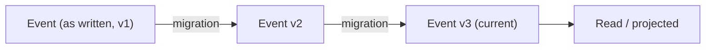

# Migrations

Cratis Chronicle migrations let you change an event's schema while keeping representations for readers that use older generations. You declare how to transform between adjacent generations, and the kernel applies those declarations when events are appended. A separate background job adds missing generations to existing events.



## Why migrations?

Suppose an event records an author's `Name`, but your application now needs `FirstName` and `LastName`. Changing the record alone leaves older events in a shape the new code does not expect. Replacing the old schema also leaves older readers without the contract they use.

A **generation** is a version of one event type's schema. Keep the original shape as generation 1, introduce the new shape as generation 2, and declare the transformations in both directions:

- Upcasting transforms an older generation into a newer one, such as splitting `Name` into `FirstName` and `LastName`.
- Downcasting transforms a newer generation into an older one, such as combining those fields back into `Name`.

Choose these transformations for your data. Splitting on a space, for example, describes a specific name format; it does not establish how every name should be interpreted. The [event type migration reference](../concepts/event-type-migrations.mdx) explains the available operations.

## Architecture: Kernel-side migrations

The client registers schemas and transformation declarations; the Chronicle kernel executes them. A migration class describes the transformation rather than running application code for each event.

Once registered, the definitions apply during append without the registering client staying connected. The kernel derives and stores the registered generations from the appended generation. Readers can request the generation they understand, but the result still depends on the transformations you declared.

## Multi-version storage

For an event type with a complete migration chain, the kernel stores all registered generations on append, whether the event is appended individually or in an `AppendMany` batch:

| Appended generation | Registered transitions | Stored generations |
| --- | --- | --- |
| 1 | 1→2 | 1 and 2 |
| 2 | 1→2 | 2 and downcasted 1 |
| 3 | 1→2 and 2→3 | 1, 2 and 3 |

This lets two services read different shapes of the same event. Service A can request generation 2 while Service B continues to request generation 1. Their read contracts differ, but both representations come from the same appended event.

```text
Append gen 1 event
        │
        ▼
  Kernel receives
        │
        ├── Store gen 1  ─── Service B reads gen 1
        │
        └── Upcast to gen 2
                │
                └── Store gen 2  ─── Service A reads gen 2
```

## Migrations happen in place

Generation backfills are **add-only**: they add missing representations alongside stored generations without replacing their content. This is different from revising an event's content. Backfill can preserve only the content still stored; it cannot recover originals overwritten by earlier backfill implementations or revisions.

Before registering a new generation, upgrade every kernel silo. A silo is a node in the kernel's Orleans cluster. Upgraded workers use add-only backfill, including when they resume legacy jobs, but workers still running an older release can overwrite content during a rolling upgrade.

### Background upcasting for new generations

Registering a new generation starts a background job for that event type in the **default namespace's event log only**. The job does not backfill other namespaces or event sequences, and registration does not mean historical events already have the new representation.

When an event has revision content and a revised generation, the job derives missing generations from that revision. Otherwise it uses the appended generation's stored content. If the appended generation is unknown or its content is missing, the job falls back to the highest stored generation and records a derived source. An unknown appended generation stays unknown; missing content for a known appended generation produces a warning.

Each addition records its source generation and the content-addressed version of the migration definitions used to produce it. The job writes content, hash and provenance together only if the stored event still matches the state it read. A concurrent revision, redaction or generation addition causes it to re-read and retry once. A second conflict is logged and skipped without failing the step.

Already-stored generations remain unchanged, even when migration definitions change. Changing a migration alone does not start another backfill, so it is not a way to repair an already-derived representation.

## Topics

Use [C# client usage](dotnet-client) to declare generations and migrators with attributes. If your application registers event identities at its composition root, follow [Explicit registration](explicit-registration) instead. Both routes produce definitions for the same kernel-side migration engine.

For the meaning of each transformation and how generations are chained, continue with [Event Type Migrations](../concepts/event-type-migrations.mdx).
