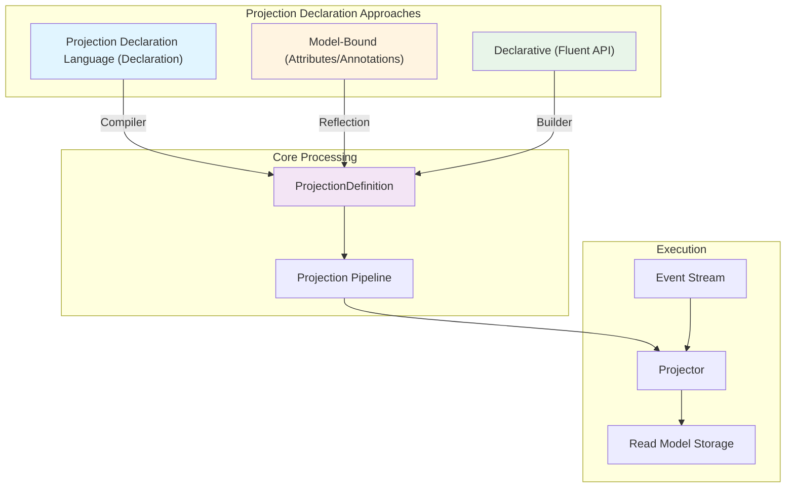
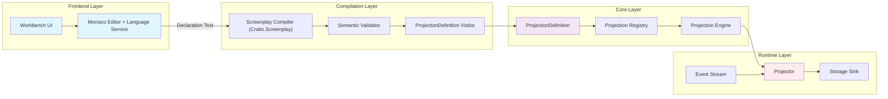
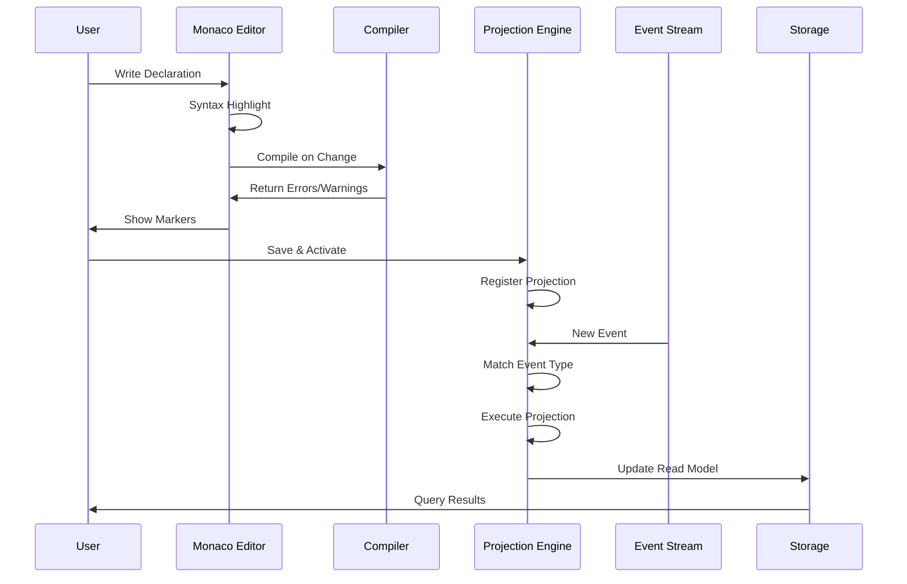

You add a fluent mapping, append an event, and wonder which process actually updates the view. Does
Chronicle call your builder again? Does an attribute run a handler? Those questions matter when you
are deciding where dependencies belong or diagnosing a view that has not changed.

Cratis Chronicle projections separate **authoring**, **registration**, and **execution**. Attributes,
fluent code, and PDL produce a `ProjectionDefinition`; the kernel uses that definition to process
events and update read models. A fluent callback builds the description of the work, rather than
running as application code for each event.

This page follows that ownership boundary. For the initial choice between mappings and reducer code,
use [Choose how to build a read model](choosing-a-read-model-style.mdx). Reducers are a different
execution family, not a fourth input to the projection engine.

## Three Projection Approaches



### 1. Projection Declaration Language

Use PDL when the mapping is an artifact authored in tooling rather than a class in the application.
The [Projection Declaration Language](projection-declaration-language/index.md) is part of Screenplay;
Chronicle translates its supported syntax into a projection definition.

This schematic declaration names an event and destination model. A real declaration must reference
registered event and read-model schemas; these placeholder names are not a runnable application:

```pdl
projection MyProjection => MyApp.ReadModels.MyModel
  from MyEvent
    name = eventProperty
    count eventCount
```

The editor can report syntax and schema diagnostics before you save. Parsing a Screenplay expression
is not sufficient to establish Chronicle support: the translation must accept it as a projection
operation. Previewing a candidate and registering a saved definition are also different steps; a
preview is not evidence that a deployed observer is processing events.

### 2. Model-Bound Projections

Model-bound projections attach mapping metadata to the read model. The owning client reads that
metadata to construct a definition; the attributes themselves are not per-event application handlers.
This keeps a small mapping close to the shape the application queries:

<ChronicleClientTabs snippet="projections/architecture/model-bound" />

The example groups item events by category and counts them. The category key decides which instance
receives an event; the Count operation decides what changes in that instance. Keep those two roles
separate when reading any projection definition.

### 3. Declarative Projections

A fluent projection puts the declaration in a separate class. In the C# form, `Define` uses builders
to emit the definition during registration. The kernel does not call that method or its lambdas for
each event:

<ChronicleClientTabs snippet="projections/architecture/declarative" />

This version also routes by category and counts events. In the fluent C# example, the only property
operation is Count, so the event's other fields are not AutoMapped. `UsingKey` routes the event but
does not itself populate the visible `Category` field. Add an explicit property mapping if the view
needs that field as well as its key; see [aggregate-only AutoMap](declarative/auto-map.mdx#aggregate-only-events).

Use fluent code when keys, context mappings, joins, or hierarchy need a separate definition. Constructor
dependencies can help construct it, but they are not injected into a per-event fold. Use a reducer for
arbitrary branching over previous state.

## Architecture Components



### Frontend Layer

Workbench owns the editing experience. Its Monaco editor and language service provide completion,
hover information, and diagnostics while the author works on a declaration. Those editor results
concern the candidate text, not the progress of an already-running projection.

### Compilation Layer

The `Cratis.Screenplay` package parses the [Screenplay projection syntax](/screenplay/projections/).
Chronicle's semantic validation checks the declaration against available schemas, and its
`IProjectionSyntaxVisitor<T>` implementation translates supported syntax into `ProjectionDefinition`.
Syntax diagnostics and translation diagnostics therefore answer different questions: can the text be
parsed, and can Chronicle build this projection from it?

Model-bound and fluent inputs enter through their own definition builders; they do not need to pass
through the text editor or Screenplay parser.

### Core Layer

`ProjectionDefinition` is the shared representation: event subscriptions, routing keys, mappings,
and supported structural operations. Registration makes a definition available to the kernel and
applies the configured evolution policy. Changing source code is not, by itself, proof that the
replacement definition registered or that replay completed. Use the
[registration lifecycle](registration-lifecycle.md) to understand those transitions.

### Runtime Layer

The kernel matches events from the configured sequence, resolves their target keys, and applies the
mappings to the affected instances. A join or child operation adds the corresponding lookup and
routing work. The configured storage sink persists materialized state.

The result is a stored view that can lag behind the event log. A passive read instead computes an
admitted shape on demand; sharing the mapping engine does not make passive and materialized reads
the same storage path. See [read-model consistency](../read-models/consistency.md).

## Data Flow

The sequence below follows a tooling-authored declaration from editing to a queryable materialized
view. It is a conceptual flow, not a promise that every save activates immediately or that a caller's
append waits for the storage update:



## Choosing an approach

For application code, start with model-bound metadata when it reads clearly, then move to fluent
mappings when a separate definition helps. Use PDL when tooling owns the declaration. Use the
[read-model decision guide](choosing-a-read-model-style.mdx#which-one-should-i-pick) when the harder
question is whether the view needs mappings or state-transition code.

## Common Patterns Across All Approaches

Read a definition in this order: which event types contribute, which keys they address, then which
properties or child structures change. A key selects an instance; a mapping supplies a value. Set
replaces a property, while Count, Increment, Decrement, Add, and Subtract update its current value.
Joins correlate across event sources; children add item identity and parent routing.

All three inputs share the definition format, not an identical authoring or configuration surface.
In particular, do not assume PDL exposes every code-builder setting or every Screenplay expression.
Projection subscriptions select event types; they are not append-metadata subscription filters.

## Find the boundary that failed

| What you observe | Inspect next |
| --- | --- |
| A declaration cannot be translated | The syntax or schema diagnostic and Chronicle's [PDL reference](projection-declaration-language/index.md) |
| The application starts but the definition is absent | Artifact discovery and [registration outcomes](../clients/dotnet/registration-outcome.md) |
| A field is missing or a total is split | [AutoMap rules](declarative/auto-map.mdx), explicit mappings, and the instance key |
| The definition changed but stored data did not | [Evolution, replay, and retirement](registration-lifecycle.md) |
| A successful append is not yet visible | Observer progress and [eventual consistency](eventual-consistency.mdx), rather than another append |

A [read-model scenario](../testing/read-models/scenario.mdx) checks the answer derived from a known
history. It does not establish registration, asynchronous delivery, or persistence in a deployed sink.
Check those boundaries in the running system separately.
