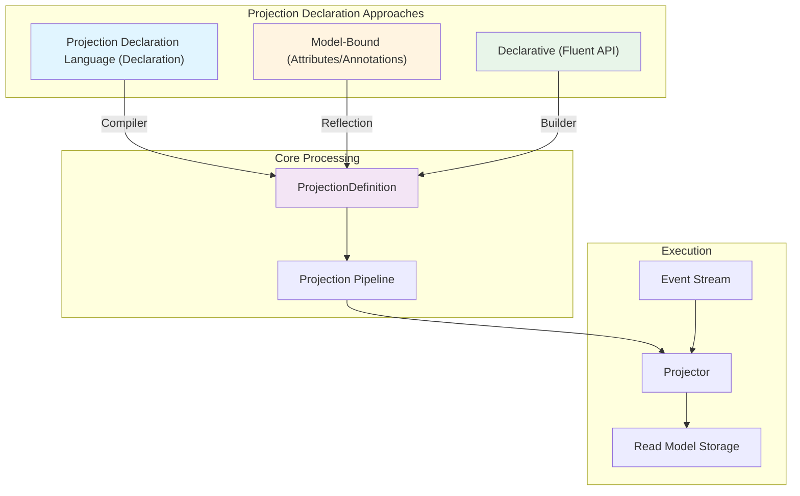
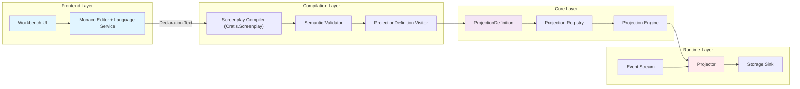
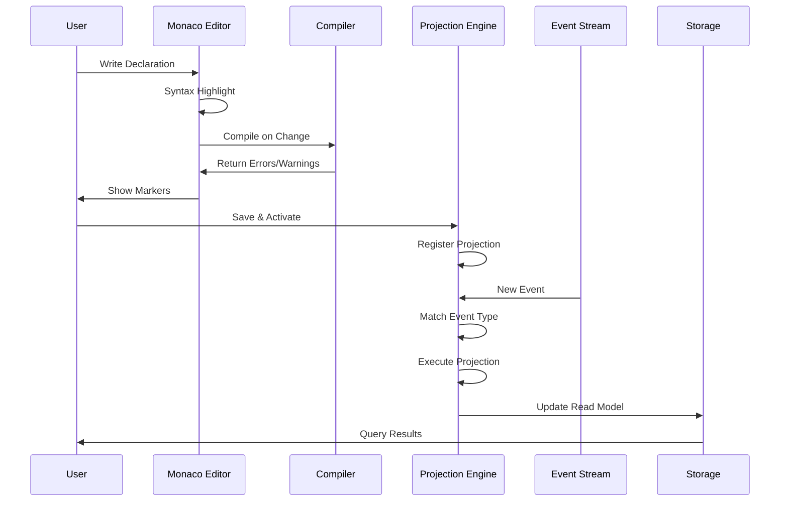

Attributes, fluent definitions, and PDL all become projection definitions that the kernel executes.
For application code, start with model-bound attributes, then fluent mappings when you need structure,
then reducer code when state transitions read better; start new reducers as self-reducing models.
[Choose how to build a read model](choosing-a-read-model-style.mdx) explains that decision. This page
follows the three projection inputs through their common engine.

## Three Projection Approaches



### 1. Projection Declaration Language

The Projection Declaration Language provides a concise, indentation-based syntax optimized for readability and quick authoring.
Typically available from the tooling like Workbench.

**Example:**


```pdl
projection MyProjection => MyApp.ReadModels.MyModel
  from MyEvent
    name = eventProperty
    count eventCount
```

**Benefits:**
- Minimal syntax and ceremony
- Easy to read and understand
- Fast iteration with live preview
- Context-sensitive auto-completion in editors

**Use when:**
- Authoring a definition outside application code
- Prototyping and ad-hoc querying
- Working with Workbench or Screenplay

### 2. Model-Bound Projections


Model-bound projections use attributes or annotations on your read model classes, keeping the projection logic close to the data structure.

**Example:**

<ChronicleClientTabs snippet="projections/architecture/model-bound" />

**Benefits:**
- Type-safe at compile time
- Co-located with read model definition
- Leverages your language's tooling and IntelliSense
- Natural for developers already using attributes/annotations elsewhere

**Use when:**
- Strong type safety is required
- Using an attribute/annotation-first development workflow
- Read model and projection logic should be together
- Refactoring tools are important


### 3. Declarative Projections

Fluent projections use code to construct a mapping definition. The kernel executes that definition;
it does not call `Define` or its builder lambdas for each event.

**Example:**

<ChronicleClientTabs snippet="projections/architecture/declarative" />

**Benefits:**
- Explicit keys, context mappings, joins, children, and nested objects
- Separation of model and mapping
- Programmatic construction of supported mapping expressions

**Use when:**
- Attributes make the mapping hard to scan
- The model must remain free of mapping attributes
- You need specialized builder operations

Constructor dependencies can help construct the definition, but they are not injected into a
per-event fold. Use a reducer for arbitrary branching over previous state.

## Architecture Components



### Frontend Layer

**Workbench UI**: Web-based interface for creating, editing, and testing projections.

**Monaco Editor with Language Service**: Provides rich editing experience with:
- Syntax highlighting for all declaration keywords
- Context-sensitive auto-completion
- Real-time validation with schema awareness
- Hover documentation
- Error markers

### Compilation Layer

**Screenplay Compiler**: The projection language is part of the [Cratis Screenplay language](/screenplay/projections/), and parsing is owned by the `Cratis.Screenplay` package:
- Indentation-based structure with 1-based line and column tracking
- Keywords, identifiers, string literals and expressions
- Nested blocks (children, nested objects, joins, composite keys)
- Syntax errors reported as diagnostics with precise locations

**Semantic Validator**: Performs semantic validation over the parsed syntax:
- Checks event types exist
- Validates property names against schemas
- Ensures composite key types are objects
- Verifies expression syntax

**ProjectionDefinition Visitor**: Chronicle's implementation of Screenplay's `IProjectionSyntaxVisitor<T>` that turns the syntax tree into the final `ProjectionDefinition` object all three approaches produce.

### Core Layer

**ProjectionDefinition**: Unified representation of projection logic, regardless of source (Projection Declaration, Model-Bound, or Declarative).

**Projection Registry**: Manages all registered projections in the system.

**Projection Engine**: Coordinates projection execution, handles event replay, and manages state.

### Runtime Layer

**Event Stream**: Source of events to be projected.

**Projector**: Executes projection logic for each event:
- Applies transformations
- Manages read model instances
- Handles keys and lookups
- Performs joins and child operations

**Storage Sink**: Persists read models (typically MongoDB or another database).

## Data Flow



## Choosing an approach

Use the [read-model decision guide](choosing-a-read-model-style.mdx#which-one-should-i-pick) for scenarios
and a capability comparison. PDL suits definitions authored in tooling; it does not replace the
model-bound-first path for application code.

## Common Patterns Across All Approaches

Regardless of which approach you choose, all projections share these concepts:

- **Event Types**: Define which events trigger the projection
- **Keys**: Identify read model instances
- **Property Mappings**: Transform event data to read model properties
- **Joins**: Correlate events across event sources
- **Children**: Model parent-child relationships
- **Subscriptions**: Select event types; projections do not have append-metadata subscription filters
- **Operations**: Set, increment, decrement, count, add, subtract

All three inputs produce the same `ProjectionDefinition` format. Their authoring and configuration
surfaces differ: sharing an engine does not mean that PDL has every option exposed by the code builders.
