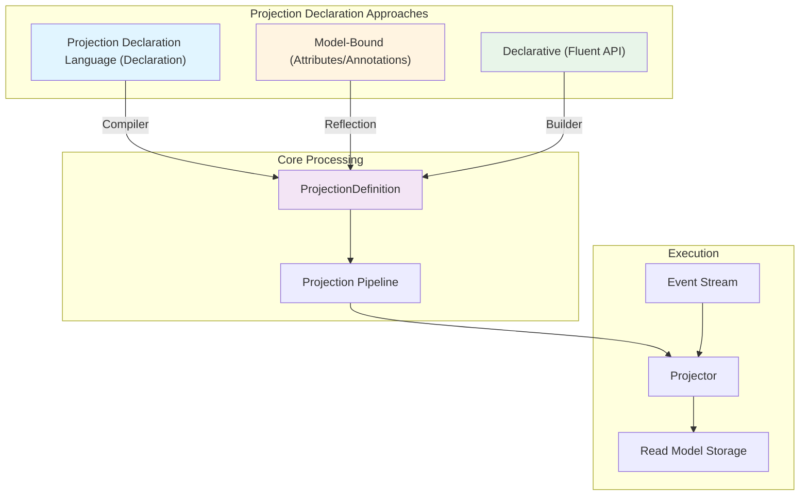
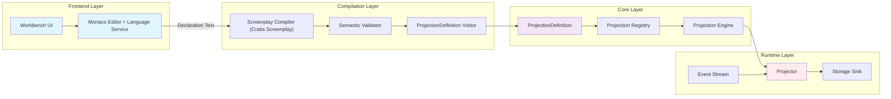
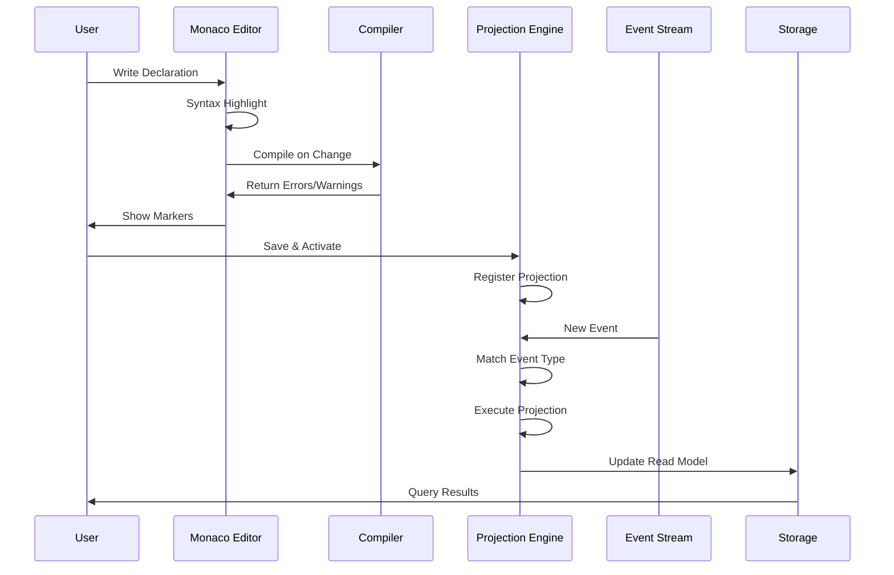

Chronicle projections turn events into read models through a mapping definition executed by the
kernel. Attributes, fluent definitions, and Projection Declaration Language (PDL) produce that shared
definition; they change where you author the mapping, not where it runs.

If you are choosing a style for a screen or query, start with
[choosing a read-model style](choosing-a-read-model-style.mdx). This page follows a projection from
its authored form to the engine and the storage sink that holds the resulting read model.

## Three Projection Approaches



### 1. Projection Declaration Language

PDL is an indentation-based text format for definitions authored outside application code, such as
in the Workbench or Screenplay. The compiler resolves the declaration into the same definition that
code-based mappings produce.


```pdl
projection MyProjection => MyApp.ReadModels.MyModel
  from MyEvent
    name = eventProperty
    count eventCount
```

The declaration names the destination read model and the event that supplies its fields. Choose
[PDL](projection-declaration-language/index.md) when text is the artifact your workflow owns, including
[ad-hoc queries](projection-declaration-language/adhoc-querying.mdx). Its supported expressions and
save settings determine what that definition can do.

### 2. Model-Bound Projections

Model-bound projections put mapping attributes or annotations on the read model. Start here when a
reader can understand how a field is populated by looking at the model itself.

<ChronicleClientTabs snippet="projections/architecture/model-bound" />

The client discovers the metadata and builds a definition for registration. The attributes describe
mappings; they are not event handlers on a model instance. See
[model-bound projections](model-bound/index.mdx) for the available mappings.


### 3. Declarative Projections

Fluent projections use code to construct a mapping definition. The kernel executes that definition;
it does not call `Define` or its builder lambdas for each event.

<ChronicleClientTabs snippet="projections/architecture/declarative" />

Use the [fluent builder](declarative/index.mdx) when attributes make a mapping hard to scan or the
model should remain free of mapping metadata. Keys, joins across event sources, and child collections
can be easier to follow in a separate definition.

Constructor dependencies can help construct that definition, but they are not injected into a
per-event calculation. If the next state needs arbitrary branching over previous state, choose a
[reducer](../reducers/index.mdx) instead.

## Architecture Components



### Frontend Layer

The Workbench hosts the projection editor. Its Monaco language service provides syntax highlighting,
completion, hover information, and error markers while you edit. These checks help you correct a
declaration before saving; they do not mean its read model has caught up with the event log.

### Compilation Layer

The projection language is part of [Cratis Screenplay](/screenplay/projections/). The
`Cratis.Screenplay` package parses the declaration into a syntax tree and reports syntax errors with
line and column locations. Chronicle validates the supported projection syntax against event types
and schemas, then its implementation of `IProjectionSyntaxVisitor<T>` produces a
`ProjectionDefinition`.

A declaration that parses as Screenplay can still use an expression Chronicle does not support. Fix
the reported projection diagnostics before treating the definition as ready to register.

### Core Layer

The registry holds the `ProjectionDefinition` independently of its authoring form. The engine uses
that definition to construct the processing pipeline. When a client registers a changed mapping,
Chronicle compares it with the stored definition and determines whether existing history must be
replayed. [Registration lifecycle](registration-lifecycle.md) explains that decision and the policy
that controls automatic rebuilds.

### Runtime Layer

The projector consumes events selected by the definition, resolves the read-model key, and applies
mappings, joins, and child operations. For a materialized projection, a storage sink persists the
result so queries can read it without replaying history.

That processing is asynchronous: a successful append does not wait for the sink update. A
[passive projection](declarative/passive.mdx) instead computes an instance when it is read, without a
materialized sink. It replays the selected event source, so it cannot generally reproduce a view
built from cross-source joins or custom aggregation keys.

## Data Flow



## Choosing an approach

Use the [read-model decision guide](choosing-a-read-model-style.mdx#which-one-should-i-pick) for scenarios
and a capability comparison. PDL suits definitions authored in tooling; it does not replace the
model-bound-first path for application code.

## Common Patterns Across All Approaches

Regardless of which approach you choose, all projections share these concepts:

- **Event Types**: Define which events trigger the projection
- **Keys**: Identify read model instances
- **Property Mappings**: Transform event data to read model properties
- **Joins**: Correlate events across event sources
- **Children**: Model parent-child relationships
- **Subscriptions**: Select event types; projections do not have append-metadata subscription filters
- **Operations**: Set, increment, decrement, count, add, subtract

All three inputs produce the same `ProjectionDefinition` format. Their authoring and configuration
surfaces differ: sharing an engine does not mean that PDL has every option exposed by the code builders.

Next, choose the [consistency behavior](../read-models/consistency.md) your query needs. Authoring a
projection differently does not make its materialized read model update inside an append.
