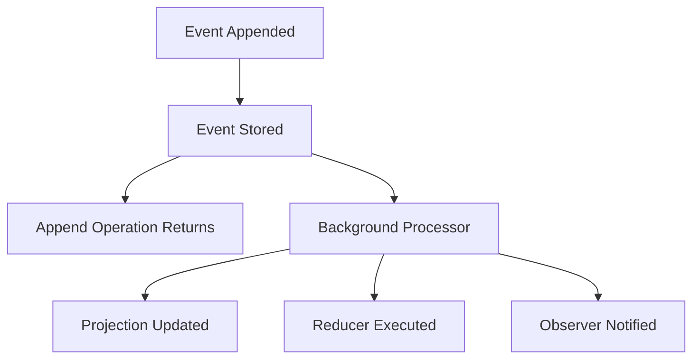

# Eventual Consistency in Projections

Chronicle's materialized projections are eventually consistent: a successful event append stores the
event, but the read model may still show the previous state. Design the query and the screen for that
gap, or explicitly wait when a caller needs to read its own change. There is no fixed catch-up time.

## Understanding Eventual Consistency

An append and a read-model update are separate work. Chronicle stores the event before reporting a
successful append. The projection processes it asynchronously and writes the resulting state to its
sink. Processing may finish before or after the caller receives the append result; the append does
not wait for it.

For example, creating a book can succeed while a query for that book still returns no instance. Show
that the command was accepted without claiming the query result is already available.

## Asynchronous Processing

Materialized projections consume stored events independently of the append call. The same separation
applies to reducers and reactors that run as observers.

### Processing Pipeline

### Benefits of Asynchronous Processing

A slow or failed projection does not undo an event already stored in the log. It does delay the view
that depends on that projection. This lets appends proceed without waiting for each view, while making
observer progress and failures part of operating the application.

## Consistency Guarantees

### What Chronicle Guarantees

Observers process events in order within a partition and retry failed processing. A retry can deliver
an event again, so do not treat processing as exactly once. If retries are exhausted, a failed
partition needs attention before its read model can catch up. See
[observer retry configuration](../hosting/configuration/observers.md).

### What Chronicle Does NOT Guarantee

A successful append does not guarantee an updated materialized view, a maximum delay, or a common
position across different projections. Do not rely on processing order across independent partitions.
Replaying a projection also takes time; registration or a replay request is not proof that its
container is ready for queries.

## Handling Eventual Consistency

### 1. Design for Asynchronous Updates

Return the append outcome or the new book's identifier, then let the query show progress toward the
updated view. In this example, the immediate query in `CreateBookAndReturn` can run before the
projection has created the book:

<ChronicleClientTabs snippet="projections/eventual-consistency/design-for-async" />

### 2. Watch Projection Changes

In the .NET client, `.Watch<TReadModel>()` emits read-model changes so the screen can update when the
projection processes the event. Subscribe before appending and keep the subscription alive for as
long as the screen needs updates:

<ChronicleClientTabs snippet="projections/eventual-consistency/watch" />

The example scopes the subscription to a method. In an application, let the screen or service own
its lifetime; returning from that method disposes the subscription and does not wait for an update.

### 3. Monitor Database Changes

Use Chronicle's watch API for projection changes. If another application writes directly to the sink,
check that database's notification mechanism separately; the projection watch API is not a general
feed of external database writes. Polling a query can refresh a screen, but it does not protect a
business decision from concurrent changes.

### 4. Use Command-Query Segregation

Keep the command's append outcome distinct from the query's projected state. Separating those
contracts makes the lag visible instead of hiding it behind a command that promises a current view:

<ChronicleClientTabs snippet="projections/eventual-consistency/cqs" />

## Best Practices

### 1. Design for Eventual Consistency

If a caller must read its own append from a materialized view, use the .NET append result's
`WaitForCompletion()` and check its success, timeout, and failures before querying. Waiting does not
make the append and query atomic. [Observing appends](../events/observing-appends.mdx#waiting-for-observer-completion-after-append)
explains which observers the wait covers.

For an event-source-keyed instance, a [passive projection](declarative/passive.mdx) can compute the
answer from history at read time instead. Neither a fresh read nor waiting after an append protects a
rule checked before it: use [constraints](../constraints/index.md) or
[decision reads](../read-models/decision-reads.mdx) for that concurrency boundary.

### 2. Test Eventual Consistency Scenarios

Exercise the screen while a read model is missing or stale, and test what happens when an observer
fails or a wait times out. Include a replay in operational checks: a newly registered definition can
be valid while its historical rebuild is still running.

## Summary

Choose [read-model consistency](../read-models/consistency.md) based on what the caller needs to know.
For a screen, an accepted command followed by a watched update may be enough. For a response that
needs the new stored view, wait and handle failure. Before deploying changed mappings, review the
[registration lifecycle](registration-lifecycle.md) so you also account for rebuilding existing data.
