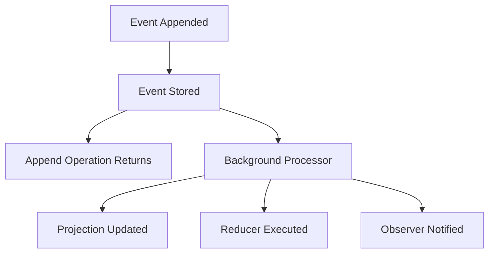

# Eventual Consistency in Projections

You add a book and the command succeeds, but the list still looks unchanged. The event is stored;
the projection may still be updating the list. Keep the successful command result and let the view
catch up rather than appending the book again.

Materialized read models in Cratis Chronicle are **eventually consistent**: the event log accepts the
write independently of the background processing that updates the stored view. To follow the flow,
you need a registered projection and an application appending and reading in the intended store and
namespace. There is no fixed catch-up time.

## Understanding Eventual Consistency

There are two relevant milestones:

1. The append succeeds: the event has been accepted into the event log.
2. The relevant observer processes that event and the sink stores the resulting read-model change.

An ordinary append does not wait for the second milestone. Processing may finish before the caller
receives the append response or may still be behind afterward; do not depend on either timing. A
materialized query between those milestones can return the previous value or no instance.

This is distinct from a [passive read](../read-models/consistency.md), which folds a supported model on
demand instead of reading its materialized state.

## Asynchronous Processing

Event persistence and observer work have separate paths. A projection, reducer, and other observer
can make progress independently; one view being current does not prove that every other view is:

### Processing Pipeline

The diagram shows the separation of work, not a guaranteed ordering between the append response and
an observer's completion. Failure to update a view does not undo the event already appended.

## Consistency Guarantees

### What append success establishes

A successful append establishes the write's outcome, not the freshness of a query. Observer progress
and failed-partition state are the evidence to inspect when you need to know whether processing has
caught up. Retrying a read can observe later progress; retrying the write is a different operation.

### What it does not establish

There is no universal delay after which every view must be current. An observer can be catching up,
replaying, paused, or failing. Do not infer cross-source processing order or simultaneous visibility
across different projections. Eventual consistency depends on processing being able to resume and
complete; a broken mapping is not repaired by waiting longer.

## Handling Eventual Consistency

### 1. Design for Asynchronous Updates

For a book list, use a materialized projection and `IReadModels.Observe<T>()` in the .NET client.
Subscribe to receive the current collection, then replace the displayed list with each later snapshot.
Chronicle produces these collections as the stored view changes; your screen does not need to repeat
the command or poll for each book. Follow [observing read models](../read-models/observing-read-models.mdx)
to connect the producer to an Arc query and a subscribing consumer.

Return the append outcome and the new book's key while the list catches up. The following examples
separate a successful append from an immediate read that may still find no instance:

<ChronicleClientTabs snippet="projections/eventual-consistency/design-for-async" />

The examples await the append; they do not abandon it as an unobserved background task. The second
method illustrates the race: an immediate materialized read is not a reliable command result.

If this request must return a view containing its own append, check append success first. In the
.NET client, call `appendResult.WaitForCompletion(explicitTimeout)` and inspect `IsSuccess`, `TimedOut`,
`FailedPartitions`, and `OutstandingObservers` before reading. Follow
[waiting for observer completion after append](../events/observing-appends.mdx#waiting-for-observer-completion-after-append)
for the procedure and server requirements. A timeout leaves a successful append in the log; it is not
a reason to issue the write again.

### 2. Watch Projection Changes

Keep `Observe` for a screen that replaces its whole list. Choose `Watch<TReadModel>()` in the .NET
client when you need individual projection changesets, such as the key and removal flag of a changed
book. The other tabs show their client's subscription form:

<ChronicleClientTabs snippet="projections/eventual-consistency/watch" />

Own the subscription for as long as the screen or service needs it. Start it before the write when
the flow depends on seeing that update, and use a subscription-readiness signal where the client
provides one; calling a lazy watch API alone does not prove the server is subscribed.

The C# `CreateBookAndWatch` illustration scopes its subscription to the method. It does not await a
matching changeset before returning, so it can dispose the subscription before projection catches
up. For a real request, keep watching for the required lifetime or use the bounded observer-wait
workflow instead. The TypeScript tab shows explicit readiness before the append; use the lifecycle
of the selected client rather than transferring another client's timing assumptions.

A watch is not an initial snapshot or a substitute for a current-state query after interruption.
Follow [watching read models](../read-models/watching-read-models.mdx) for changesets, filtering, and
subscription ownership, and plan how the caller refreshes after a disconnect.

### 3. Monitor Database Changes

Chronicle's watch surface reports Chronicle read-model changes; it is not a generic change-data-capture
API for arbitrary writes made directly to the sink database. If another system writes to a database,
use that database's supported change feed or a deliberate polling design for those changes. Keep
that integration separate from deciding whether a Chronicle observer has processed your event.

### 4. Use Command-Query Segregation

Return the command's append result separately from the query's view. The caller can then tell a
successful write from a view that has not caught up:

<ChronicleClientTabs snippet="projections/eventual-consistency/cqs" />

The live book list helps readers browse; it cannot decide who gets the last copy. In an Arc command,
explicitly opt into read protection **On**, take the keyed read model in `Handle()` or a
`CommandValidator<T>`, and check availability there. Arc protects that read when it completes the
command's events. Unspecified read protection is **Off** today. Start with
[Arc's protected borrowing command](/arc/backend/csharp/chronicle/consistency/getting-started/).

Without Arc, take a detached [decision read](../read-models/decision-reads.mdx) and carry it into the
event log's `AppendMany(..., guardedBy: ...)` call. A read without that guarded write does not protect
the rule. [Read-model consistency](../read-models/consistency.md#choosing-the-right-model) connects both
command paths and the separate choice to wait for your own write.

## When the view still has not changed

If the list still looks wrong, start with what you can see:

| Observation | Check or action |
| --- | --- |
| The expected projection is not listed | Check artifact discovery and [registration outcomes](../clients/dotnet/registration-outcome.md). |
| The instance is missing but processing is progressing | Confirm the store, namespace, and model key; keep the caller pending within its timeout. |
| Processing is paused or has a failed partition | Inspect the observer's state and failure, then address the cause; elapsed time alone will not repair it. |
| A field is wrong after processing completed | Check the [mapping](declarative/set-properties.mdx) and [AutoMap rules](declarative/auto-map.mdx), rather than retrying the append. |
| The result changed after a deployment | Inspect [definition evolution and replay](registration-lifecycle.md). |

Use [Chronicle troubleshooting](../troubleshooting/index.mdx) for the running system's diagnostic
surface. When testing the caller, include a delayed view, a missing instance, a failed observer, a
wait timeout, and a disconnected watch. Assert that none of those visibility failures silently
reissues an already-successful append.

For the book screen, start with [Observe and an Arc observable query](../read-models/observing-read-models.mdx).
Protect borrowing in the command, not in the screen's copy of the list. Add an observer wait only
where the caller needs to read back its own append.
