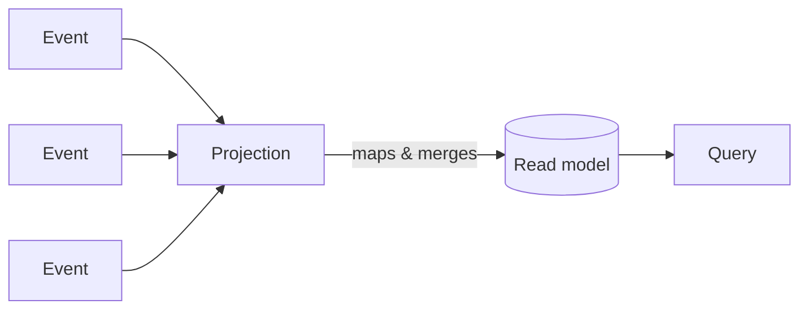

A Cratis Chronicle projection declares how events build a **read model**, the view your application
queries. An account screen, for example, needs a balance rather than a list of deposit events.
By default, Chronicle stores that view and updates it as events arrive, so each query does not have
to rebuild it.

Use separate projections when readers need different shapes: an account balance and a transaction
list can derive from the same events without sharing a model. That means more definitions to
maintain, but a change to one view does not have to accommodate every other consumer.

## How you'll define one

Start with model-bound attributes for straightforward mappings. In the
[.NET account example](model-bound/index.mdx#basic-example),
`[FromEvent<MbIndexAccountOpened>]` builds `MbIndexAccountInfo` from an account-opening event.
`Name` maps by convention because it has the same name on both types; `[SetFrom<MbIndexAccountOpened>(nameof(MbIndexAccountOpened.InitialBalance))]`
maps the event's initial balance into the view's `Balance` property.

Move to fluent `IProjectionFor<T>` when the mapping needs structure. Choose a reducer when ordinary
state-transition code expresses the logic more clearly; a self-reducing model is the default for new
reducer code. [Choose how to build a read model](choosing-a-read-model-style.mdx) compares these forms
on the same event history. It also covers when separation or dependency injection warrants an
`IReducerFor<T>`, when to nominate a plain class, and when tooling-authored Projection Definition
Language (PDL) fits.

Projections join events, never other read models. Fluent mappings use AutoMap by default;
model-bound projections opt into event mappings with attributes such as `[FromEvent<T>]`.

## Choose your consistency

Decide whether readers can use the stored view while it catches up or need state computed from the
event log for this read:

| | [Materialized (eventual)](eventual-consistency) | [Passive (on demand)](declarative/passive.mdx) |
| --- | --- | --- |
| **When it updates** | Shortly after the event is appended (the default) | Computed on demand, without persistent storage |
| **Cost** | Reads use the stored result; projection work happens in the background | Every read folds the matching event history from the beginning, starting with fresh state |
| **Use it for** | Frequently read lists, dashboards, and history | Current state for an event-source-keyed instance, where the replay cost is acceptable |

Start materialized when readers can tolerate that gap. A passive instance read replays one event
source's history, so keep views that join other sources or use event-content keys materialized.
When one caller occasionally needs its own write back, it can
[wait for the append's observers](../read-models/consistency.md#read-after-write--waiting-for-a-materialized-read-model)
before reading, rather than changing the model for every reader.

No projection updates synchronously inside the append. A fresh read also cannot enforce a rule
against concurrent writers: use a [constraint](../constraints/index.md) for uniqueness, or a
[decision read](../read-models/decision-reads.mdx) to guard a state-based decision.

## Topics

| Topic | Description |
| ------ | ----------- |
| [Architecture](architecture) | How the projection engine turns events into read models |
| [Choose how to build a read model](choosing-a-read-model-style.mdx) | One decision path, worked examples, capabilities, and switching costs |
| [Model-Bound Projections](model-bound/) | Build read models with attributes — the default style |
| [Declarative Projections](declarative/) | Build read models with the fluent `IProjectionFor<T>` API |
| [Immediate Projections](immediate-projections.md) | Why there is no synchronous projection mode, and what to use instead |
| [Eventual Consistency](eventual-consistency) | The default — how and when eventual projections catch up |
| [Registration lifecycle](registration-lifecycle.md) | What happens when projections register, change, fail, or are no longer declared |
| [Tagging Projections](tagging-projections) | Organize and tag projections |
| [Appended event metadata filters](../events/filtering/index.md) | How tags and metadata correlate reducers and reactors that run alongside projections |

Once the projection is defined, [retrieve its read model](../read-models/index.md) for your application.
[Build a full-stack feature](/build-a-full-app/) follows that handoff through to a frontend.
