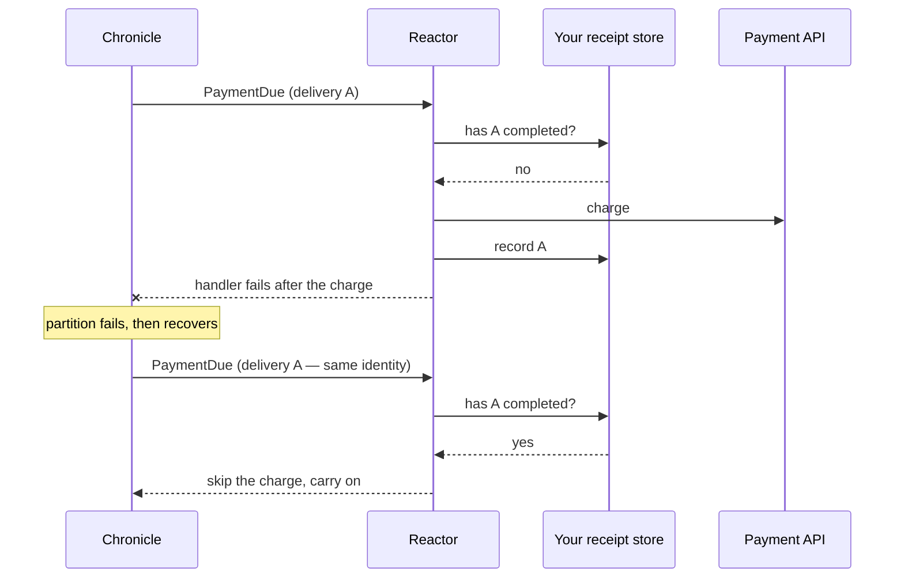

# Delivery identity

`ReactorDelivery` identifies one event delivered to one reactor partition in Cratis Chronicle, where events are grouped by event source id. Its identity stays the same when recovery or replay delivers that event again. Use it to key a side-effect receipt or a request to a receiver that deduplicates repeated requests; the identity alone does not prevent duplicate work.

<ChronicleClientTabs snippet="reactors/delivery-identity/basic" />

Use `delivery.Id` as the receipt key. Check for a completed receipt before doing the work, and record completion afterwards. This check has a failure window unless recording the receipt is atomic with the effect; see [What it does and does not guarantee](#what-it-does-and-does-not-guarantee).

## Why the existing markers are not enough

[OnceOnly](once-only) and [Replay](replay) control replay, such as history re-delivered after an observer rewind, redaction or revision. Recovery of a failed event-source partition is ordinary observation, so neither marker prevents the regular handler from running again.

That distinction matters when a handler charges a card and then fails before Chronicle records its progress. A retry can repeat the charge. The delivery identity stays the same across failure and recovery, so your receipt check or the payment API's idempotency key can recognize the repeated request. See [Troubleshooting](../troubleshooting/index.mdx) for repeated-effect symptoms and [Observers](../hosting/configuration/observers.md) for retry and quarantine configuration.

## How the three relate

| Mechanism | Covers replay | Covers recovery after a failure | Needs storage |
|---|---|---|---|
| `[OnceOnly]` | Yes — the handler is skipped | No | No |
| `[Replay]` | Yes — a different handler takes over | No | No |
| `ReactorDelivery` | The identity matches; your code must check it | The identity matches; your code must check it | Application-owned receipt, or receiver-side deduplication |

Use `[OnceOnly]` when replay should skip the handler, or `[Replay]` when replay needs different handling. Add delivery-keyed duplicate protection for effects that could repeat during recovery. You can keep `[OnceOnly]` alongside that protection: replay skips the call, while ordinary retries still reach your receipt check.

<ChronicleClientTabs snippet="reactors/delivery-identity/with-once-only" />

## What counts as the same delivery

The identity is built from six values Chronicle already knows:

| Component | What it is |
|---|---|
| `Reactor` | The reactor the event is delivered to |
| `EventStore` | The event store the event belongs to |
| `Namespace` | The namespace within that event store |
| `EventSequence` | The event sequence the reactor observes — the event log, or an inbox |
| `Partition` | The event source id the event is observed under |
| `SequenceNumber` | The event's position in the event sequence |

Two deliveries agreeing on all six are the same delivery; differing on any one of them makes them different. There
is deliberately nothing in there about *why* the event arrived, so a replay and the live delivery it repeats share
one identity. If a handler needs to know why, take an `EventContext` alongside and read its `ObservationState`.

`ReactorDelivery` is a record, so you can compare two of them directly. `delivery.Id` renders the same components
as a single string for use as a storage key.

:::caution[The identity is a persisted key]
Once you store receipts under `delivery.Id`, that string is part of your data. Renaming a reactor type without
giving it a stable id via `[Reactor("...")]`, moving a reactor to a different event sequence, or renaming a
namespace all change the identity — and every receipt written under the old one stops matching, so the side
effects they covered can run again. Give any reactor whose deliveries you record an explicit id.
:::

## Keys for returned events

When a C# handler [returns events](side-effects#duplicate-protection-for-returned-events), the built-in handlers derive idempotency keys from the delivery identity, the reactor's effect epoch and each event's position in the returned value. With a kernel that supports idempotent appends, repeating the same keys and output does not append another copy. See the linked page for conflicts and the fallback on kernels without that capability.

To key an effect you append yourself, call `delivery.IdempotencyKeyFor("effect-name")` and use `AppendOnce`; see [Appending events](../events/appending). These keys protect event-log appends, not handler invocations or external calls. A payment, email or webhook needs its own duplicate protection.

## When to bump the effect epoch

`EffectEpoch` is a number on the reactor attribute, `0` by default. Set it with `[Reactor("id", effectEpoch: 1)]`, or `[Reactor("id", "sequence", effectEpoch: 1)]` when you also name the event sequence. It is part of the derived keys but **not** of `delivery.Id`, so your receipts keep matching when you change it.

Raise the epoch only when the same input should deliberately append new output. Review which historical inputs will run again: the new keys permit new appends. Keep the reactor's id and event sequence stable so you retain its observer identity.

For ordinary retries and replays, keep the epoch and build output from stable inputs. Changed content under an existing key causes a conflict and fails the partition. A fresh `Guid`, the current time or a changed lookup result can cause that conflict even when you did not intend to change the handler's meaning. Fix unintended variation rather than raising the epoch to bypass it.

## What it does and does not guarantee

`ReactorDelivery` is not exactly-once delivery. Chronicle does not know whether an external effect completed and stores no application receipt for it. You own the receipt's storage, uniqueness and retention policy, including how long old deliveries must remain recognizable.

The diagram above shows a receipt recorded before the handler fails. If the process instead dies after the charge but before writing that receipt, the retry can charge again. Concurrent attempts can also both pass a simple check. Recording the receipt before a remote call moves the failure window: a crash can leave a receipt for work that never happened.

For an effect in your own database, write the receipt and effect in the same transaction. For a remote call, pass the delivery identity as an idempotency key only if the receiver supports that contract, and account for its key retention and retry rules. The identity gives you a stable key; the transaction or receiver provides the duplicate protection.

:::note[Client coverage]
The examples use the C# `ReactorDelivery` argument. TypeScript handlers receive `ReactorDelivery` as their fourth argument, after the event, context and services; its `id` is a receipt key. Elixir exposes `delivery_id` on the event context. The C# effect-key APIs above are separate from these receipt keys.
:::
